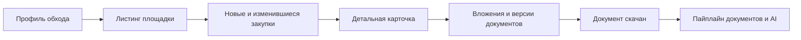
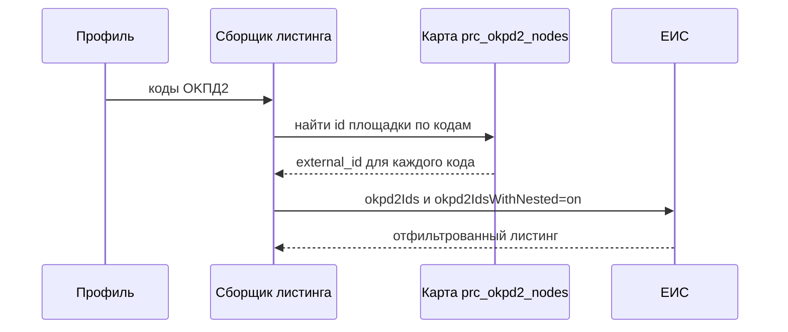
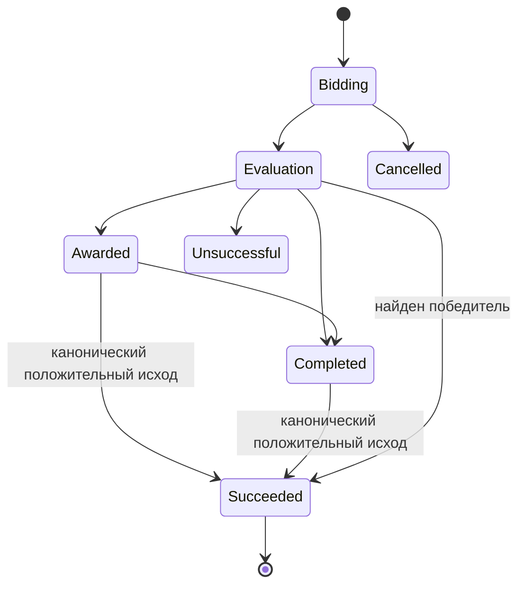

# Краулинг и обнаружение

Это первая стадия конвейера — до неё EST-AI (AI-анализ документов) не подключается. Задача
краулинга — найти закупки на площадках-источниках и скачать приложенные к ним документы.

## Контур обхода

Профиль обхода задаёт, какую часть площадки и как часто проверять. Система читает листинг,
сохраняет новые и изменившиеся закупки, затем отдельно снимает их карточки и вложения. Скачанная
версия документа передаётся в следующий контур, где её готовят и анализируют; сам краулинг на этом
заканчивается. Технические очереди, лимиты и точки передачи описаны в
[`03_Dev/crawling-pipeline.md`](../03_Dev/crawling-pipeline.md).

## Площадка, краулер, прогон

- **Площадка (Platform)** — сайт-источник данных о закупках (например, реестр ЕИС).
- **Краулер (Crawler)** — настроенный профиль обхода одной площадки: что искать, с какой
  периодичностью, какие фильтры.
- **Прогон (CrawlerRun)** — один запуск краулера. У прогона есть статус (идёт/завершён/провален),
  время начала/окончания и «пульс» — отметка, что процесс жив, а не завис.

## Что происходит на этой стадии

1. Краулер обходит площадку и находит закупки — новые или изменившиеся с прошлого прогона.
2. Для каждой найденной закупки система сохраняет её карточку (номер, статус, участники, лоты) и
   список приложенных документов.
3. Документы скачиваются на диск (объектное хранилище). Если один и тот же файл заменили на
   площадке — сохраняется новая версия документа, а не перезапись старой (история не теряется).
4. Как только версия документа успешно скачана — она готова к следующей стадии, AI-анализу
   (`document-and-estimate-pipeline.md`).

## Прокси

Запросы к площадкам могут идти через прокси-узел — система сама выбирает подходящий узел под
конкретный запрос (по стране, доступности, недавним отказам) и учитывает исход, чтобы реже выдавать
проблемные узлы. Профиль обхода может требовать прокси конкретной страны или явно работать напрямую
— это настраивается в карточке краулера в админке.

## Настройки обхода: три уровня

Настройка живёт там, где её смысл: профиль определяет намерение конкретного обхода, площадка —
её ограничения, а конфигурация — общие безопасные правила исполнения. Поэтому изменение
расписания профиля не меняет лимит для всей площадки, а изменение общего лимита не расширяет
предметную выборку профиля.

| Параметр | Где живёт | На что влияет | Кто читает |
|:--|:--|:--|:--|
| Режим, расписание, активность, фильтр и диапазон дат | Профиль обхода | Что и когда искать; fresh — короткий актуальный поток, archive — ограниченный исторический диапазон | Диспетчер запуска и листинг |
| Страна прокси и разрешение прямого листинга | Профиль обхода | Маршрут только запросов листинга | Резолвер прокси и листинг |
| Лимит запросов и паузы стадий | Площадка, с общим fallback в конфигурации | Общий темп запросов к хосту и интервалы между ними | Общий бюджет запросов |
| Пороги и эталон healthcheck | Площадка и конфигурация | Когда наблюдение считает площадку исправной, деградировавшей или сломанной | Ежедневный healthcheck |
| TLS-доверие, таймаут checkpoint и размер пачки деталей | Конфигурация | Безопасность соединения и границу работы одной очередной задачи | HTTP-клиенты и jobs |

## Фильтр профиля — типизированный, свой у каждой площадки

Что именно искать на площадке (этапы закупки, диапазон цены, дата публикации) задаётся в форме
краулера полями, которые площадка реально понимает — не свободным набором ключ-значение. У каждой
площадки/реестра — свой набор полей (площадка ЕИС по 44-ФЗ: этапы «подача заявок»/«работа
комиссии»/«завершена»/«отменена», цена от/до, даты публикации, строка поиска); опечатка в имени
поля отклоняется формой сразу, а не тихо игнорируется площадкой. Верификация фактов ЕИС —
2026-08-04/05 (`plans/archive/2026.07.31-SYS-INTEGRITY/findings/P4-eis-recon.md`).

Для ОКПД2 профиль хранит понятные человеку коды, а не внутренние идентификаторы ЕИС. Перед
запросом система сверяет их с картой площадки; отсутствующий код останавливает запрос и требует
сначала обновить карту, чтобы фильтр не стал незаметно шире.

## Отслеживание изменений: перекрытие окон и суточный дозор

Обход «свежего потока» (fresh) идёт короткими интервалами (по умолчанию каждые 30 минут) и ловит
почти все обновления влёт. На случай простоя (площадка недоступна, воркер стоял) есть два
подстраховывающих механизма:

- **Рескан бэклога** — если свежий обход упёрся в потолок глубины выдачи площадки (не успел дойти
  до последнего известного обновления), система запускает точечный архивный обход окна простоя.
  Окно рескана берётся с запасом на пару суток назад (перекрытие) — источник (ЕИС) отдаёт дату
  обновления только с точностью до суток, и часовые пояса заказчиков по стране расходятся с
  расписанием сервера; без запаса обновление на границе окна рискует остаться незамеченным.
- **Суточный дозор (delta-scan)** — плановый ежесуточный проход по тому же окну «вчера/сегодня с
  запасом», независимо от того, случился ли простой. Выключен по умолчанию до первого боевого
  прогона площадки — включение обхода на всю страну посреди ещё не законченной настройки означало
  бы непрерывный боевой трафик к источнику.

Повторный проход по уже виденному обновлению ничего не портит: система сравнивает хэш значимых
полей закупки и, если ничего не изменилось, просто отмечает «видели снова» — новой записи в
истории не создаётся.

## Статус закупки и положительный исход

Статус, пришедший с площадки, приводится к каноническому статусу закупки и каждое изменение
остаётся в истории. Положительный исход фиксируется один раз: когда статус стал `awarded` или
`completed`, либо когда в результате определения поставщика появился победитель. После этого
создаётся событие «закупка состоялась» для витрин и подписчиков.

## Сиды площадки: ЕИС заводится данными, не миграцией

Площадка ЕИС, её реестр 44-ФЗ и два профиля обхода (архивный — для обучающего корпуса за 2025 год,
и «свежий поток» — для боевого слежения, изначально выключен до решения владельца) заводятся
сидером, не миграцией — это обычные данные, не структура схемы. Повторный прогон сидера безопасен
(не плодит дублей), но перезаписывает ручные правки профиля, сделанные оператором в админке —
об этом стоит помнить при повторном `db:seed`.

## Живые ограничения площадки ЕИС (снято 2026-08-04/05)

- Глубина выдачи одного запроса листинга ограничена **ровно 5 000** записей (не «около 10 000», как
  считалось раньше) — за пределом площадка молча повторяет последний блок вместо ошибки; система
  детектирует это сравнением с предыдущим блоком.
- Блок выгрузки — 500 строк за запрос.
- Площадка использует сертификат российского удостоверяющего центра — доверие к нему прошито в
  образе приложения (не системным доверенным набором), подробности — `docs/03_Dev/crawling-pipeline.md`.
- Как запустить контрольный архивный обход и что при этом смотреть — `docs/03_Dev/runbooks/archive-run.md`.

## Устойчивость к сбоям

Обход площадки может прерваться (сеть, блокировка, перезапуск). Прогон умеет возобновляться с
места остановки, а не начинать с нуля — это важно для больших площадок, где полный обход занимает
часы. Если прогон завис (нет «пульса» долгое время) или регулярно падает — это видно оператору
в разделе «Прогоны» админки (`04_Operators/reference/statuses.md`).

## Где почитать про internals

Технические детали (job'ы, очереди, курсор возобновления, общий бюджет запросов, healthcheck и
дробление по цене для больших выборок) —
[`03_Dev/crawling-pipeline.md`](../03_Dev/crawling-pipeline.md). Этот раздел — для понимания
процесса, не для настройки кода.

Что происходит с документом ПОСЛЕ скачивания (подготовка → анализ → извлечение сметы) —
`document-and-estimate-pipeline.md`.
