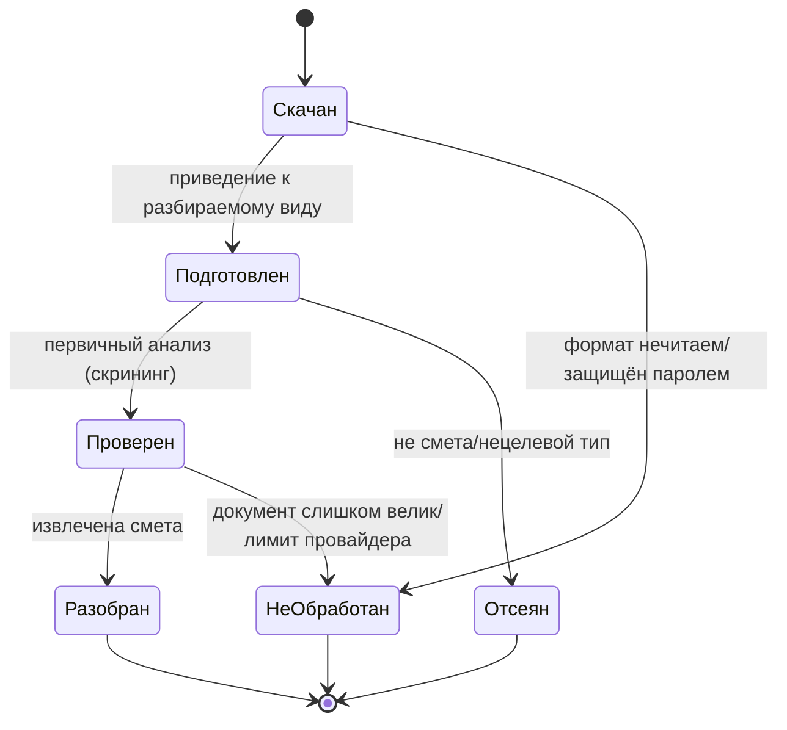

# Путь документа и сметы

Как скачанный документ (см. `crawling-and-discovery.md`) превращается — если в нём есть смета —
в структурированные строки, которые можно анализировать.

## Три шага после скачивания

### 1. Подготовка

Документ приводится к виду, пригодному для анализа. Архив разворачивается на отдельные файлы;
таблица Excel конвертируется в формат, который умеет читать модель. Если файл огромный (тысячи
строк в Excel, документ весом в сотни мегабайт) или похож на «zip-бомбу» — он сразу помечается
как необрабатываемый, не тратя время на дальнейшие шаги (см. §Терминальные исходы).

### 2. Первичный анализ (скрининг)

Дешёвая и быстрая модель смотрит на первые несколько страниц документа и определяет: это смета,
что-то другое, или непонятно.

- **Явно смета** — документ идёт дальше, на полное извлечение.
- **Явно не смета** (например, само извещение о закупке, протокол, техзадание без сметы) —
  документ помечается своим типом и на этом останавливается — извлекать нечего.
- **Непонятно** — документ отсеивается как нецелевой.
- **Пограничный случай** (модель не уверена — не «явно да», но и не «явно нет») — вместо тихого
  отбрасывания система либо перепроверяет более сильной моделью, либо помечает документ
  «нужно ревью» — оператор увидит его отдельно и решит сам (`04_Operators/how-to/review-estimate.md`).

### 3. Извлечение сметы

Если документ прошёл скрининг как смета — начинается собственно извлечение:

1. **Паспорт** — шапка сметы: номер, наименование, единица измерения итога и т.п.
2. **Строки** — построчное содержимое: разделы, позиции, количества, цены, суммы. Для обычных
   документов это делается по всему документу целиком; для очень больших документов (сотни
   страниц, несколько смет вперемешку в одном файле) система сначала находит границы каждой
   сметы внутри документа окнами, а затем разбирает каждую смету отдельно — постепенно, не
   упираясь в ограничения одного запроса к AI-провайдеру.
3. **Итоги** — сверка сумм по разделам и по смете целиком.

После извлечения бэкенд (не модель) детерминированно проверяет полноту (все ли строки собраны)
и арифметику (сходятся ли суммы). Если что-то не сходится — смета не отбрасывается, но помечается
«подозрительная» и видна оператору для ревью, а не выдаётся как безусловно верная.

## Терминальные исходы

Каждый документ рано или поздно приходит к одному из финальных состояний:

- **Разобран** — смета успешно извлечена (возможно, с пометкой «подозрительная», если суммы не
  сошлись).
- **Отсеян** — документ не смета (или скрининг не смог определить тип).
- **Не смогли обработать** (`unprocessable`) — документ принципиально не поддаётся разбору:
  нечитаемый формат, защищён паролем, слишком большой или превышает лимиты AI-провайдера даже
  для разбора окнами. Это НЕ технический сбой (который автоматически повторяется) — это
  констатация факта, видимая оператору (`04_Operators/reference/statuses.md`,
  `04_Operators/how-to/restart-failed-run.md`).
- **Ошибка (failed)** — временный технический сбой (например, недоступен провайдер) — такие
  документы автоматически подхватываются повторной попыткой.

## Д1-lite — путь документа (без job'ов и error-блока)

Полная версия с job'ами, очередями и error-блоком (для разработчика) — `docs/03_Dev/document-pipeline.md` (Д1).

Как готовятся промты, которыми пользуется модель на каждом шаге — `prompts-and-quality.md`.
