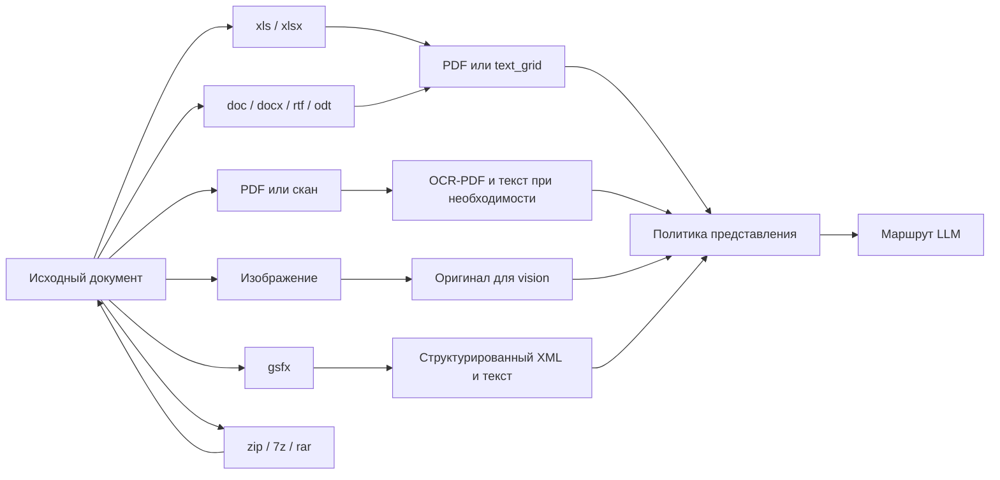
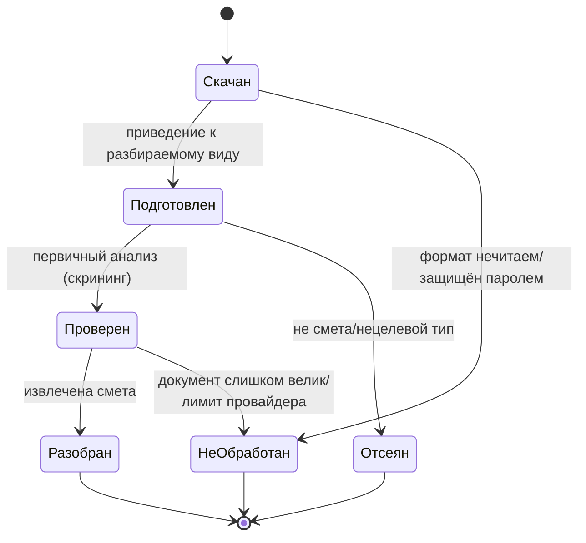

# Путь документа и сметы

Как скачанный документ (см. `crawling-and-discovery.md`) превращается — если в нём есть смета —
в структурированные строки, которые можно анализировать.

Файл считается скачанным только после успешной записи immutable object в хранилище; затем одной
короткой транзакцией фиксируются версия, статус и событие. Повтор того же хэша также проверяет
объект и долечивает неполный database-state, не создавая вторую версию или событие.
То же правило действует для каждого подготовленного представления: пока object write не
подтверждён, representation не появляется в БД и документ не может стать `prepared`.

## Три шага после скачивания

### 1. Подготовка

Документ приводится к виду, пригодному для анализа. Архив разворачивается на отдельные файлы;
таблица Excel конвертируется в формат, который умеет читать модель. Если файл огромный (тысячи
строк в Excel, документ весом в сотни мегабайт) или похож на «zip-бомбу» — он сразу помечается
как необрабатываемый, не тратя время на дальнейшие шаги (см. §Терминальные исходы).

Система принимает конкретные семейства форматов, а не абстрактные «офисные документы»:

- `xls`/`xlsx` превращаются в PDF и, когда это возможно, в текстовую сетку таблицы;
- `doc`/`docx`/`rtf`/`odt` превращаются в PDF;
- PDF с бедным или отсутствующим текстовым слоем проходит OCR и получает OCR-PDF вместе с текстом;
- `png`/`jpg`/`jpeg`/`tif`/`tiff`/`bmp`/`webp` идут в vision-ветку без преобразования;
- `gsfx` читается как структурированный XML и текст;
- `zip`/`7z`/`rar` безопасно разворачиваются в дочерние документы, а каждый вложенный файл проходит тот же путь.

Новый формат не становится «поддержанным» только из-за расширения: разработчик добавляет его в
закрытый реестр с проверкой MIME и сигнатуры, ровно одним обработчиком и тестовыми примерами
успеха/несовпадения. Неизвестный формат и файл с неподходящими байтами останавливаются до анализа.

Каждый переход `prepared → screening` и `screened → extraction` восстанавливается из базы,
а не по наблюдению очереди. Если worker погиб после DB commit и до отправки job, периодический
reconciler берёт ограниченный атомарный claim на активной версии и незавершённом run, после чего
повторно ставит только следующий допустимый шаг. Временная ошибка AI остаётся `running` с due
backoff и проходит через тот же путь; permanent failure становится явным terminal outcome.
Решения `retain`, `review` и `ignore` не являются кандидатами на extraction.

### Бюджеты worker-операций

Матрица `config('ai.pipeline.operation_budgets')` версии `pipeline-operation-budget/v1`
является контрактом длительных операций. `prepare` работает на отдельном
`redis_prepare/doc_prepare` lane: source setup 120 s + text-layer probe 180 s + OCR 1800 s +
Tesseract version 180 s + PDF page-count 180 s + 120 s reserve выполняются в job 2580 s,
supervisor 2640 s и Redis `retry_after` 2700 s. Перед каждым внешним OCR-инструментом job проверяет, что
весь обязательный хвост ещё помещается до deadline; нехватка времени остаётся retriable
ошибкой, а не `unprocessable` документа. Для screening это соответственно
210 + 30 ≤ 240 < 300 < 420 s. Extraction checkpoint'ится на 120 s: ещё один максимум
150-секундный вызов и 30-секундный reserve ровно помещаются в 300 s job, затем идут
supervisor 360 s и `retry_after` 420 s. Lease берётся из той же строки матрицы: 2700 s для
prepare и 420 s для screening/extraction. Поэтому duplicate delivery не получает активный
document/analysis, но после SIGKILL короткая стадия не остаётся запертой дольше своего
visibility window.

Horizon получает SIGTERM, Docker даёт ему не менее 4200 s (`HORIZON_STOP_GRACE_PERIOD`),
поэтому worker завершает или сохраняет checkpoint до SIGKILL. После нештатного SIGKILL
P3.4 reconciler поднимает только due continuation и atomic lease/recovery claim не допускают
двух активных владельцев.

После этого система выбирает первое доступное представление из политики конкретного расширения;
если политика не дала результата, используется оригинал только когда это разрешено настройкой.
Так модель получает не «самый красивый» файл по предположению, а представление, реально
получившееся у подготовителя. Точные правила выбора, лимиты и fallback описаны в
[`03_Dev/ai/estimate-extraction.md`](../03_Dev/ai/estimate-extraction.md#346-выбор-представления-на-вход).

## Д13 — форматы, представления и модель

### 2. Первичный анализ (скрининг)

Дешёвая и быстрая модель смотрит на первые несколько страниц документа и определяет: это смета,
что-то другое, или непонятно.

- **Явно смета** — документ идёт дальше, на полное извлечение.
- **Явно не смета** (например, само извещение о закупке, протокол, техзадание без сметы) —
  документ помечается своим типом и на этом останавливается — извлекать нечего.
- **Непонятно** — документ отсеивается как нецелевой.
- **Пограничный случай** (модель не уверена — не «явно да», но и не «явно нет») — вместо тихого
  отбрасывания система либо перепроверяет более сильной моделью, либо помечает документ
  «нужно ревью» — оператор увидит его отдельно и решит сам (`04_Operators/how-to/review-estimate.md`).

Скрининг сохраняет краткое содержание, точные теги и число видимых смет (`none`, `single`,
`multiple` или `unknown`). Это не число страниц или файлов внутри архива: архив сначала становится
набором отдельных документов. Модель описывает факты, а система сама записывает решение: извлечь,
оставить как известный не-сметный тип, отправить на ревью или отсечь. Поэтому текст модели не может
самостоятельно обойти правило отсечения или запустить извлечение.

### 3. Извлечение сметы

Если документ прошёл скрининг как смета — начинается собственно извлечение:

1. **Паспорт** — шапка сметы: номер, наименование, единица измерения итога и т.п.
2. **Строки** — построчное содержимое: разделы, позиции, количества, цены, суммы. Для обычных
   документов это делается по всему документу целиком; для очень больших документов (сотни
   страниц, несколько смет вперемешку в одном файле) система сначала находит границы каждой
   сметы внутри документа окнами, а затем разбирает каждую смету отдельно — постепенно, не
   упираясь в ограничения одного запроса к AI-провайдеру.
3. **Итоги** — сверка сумм по разделам и по смете целиком.

После извлечения бэкенд (не модель) детерминированно проверяет полноту (все ли строки собраны)
и арифметику (сходятся ли суммы). Если что-то не сходится — смета не отбрасывается, но помечается
«подозрительная» и видна оператору для ревью, а не выдаётся как безусловно верная.

**Отдельно от сметы целиком, помечается и КАЖДАЯ ПОЗИЦИЯ** (например, строка, которую AI не смог
разобрать из-за плохого скана исходника): AI прямо говорит «эту строку и вот эти её поля я не смог
прочитать», вместо того чтобы молча вернуть пустоту, неотличимую от «поле в документе и правда
пустое». Бэкенд добавляет к этому свои находки (найденную арифметическую нестыковку раздела,
пропуск в нумерации) — обе причины видны оператору напротив конкретной позиции в витрине смет,
а не только общим статусом сметы.

## Терминальные исходы

Каждый документ рано или поздно приходит к одному из финальных состояний:

- **Разобран** — смета успешно извлечена (возможно, с пометкой «подозрительная», если суммы не
  сошлись).
- **Отсеян** — документ не смета (или скрининг не смог определить тип).
- **Развёрнут** (`expanded`) — архив успешно превратился в дочерние документы; сам архив дальше не
  анализируется, а каждый дочерний файл проходит обычную подготовку.
- **Не смогли обработать** (`unprocessable`) — документ принципиально не поддаётся разбору:
  нечитаемый формат, защищён паролем, слишком большой или превышает лимиты AI-провайдера даже
  для разбора окнами. Это НЕ технический сбой (который автоматически повторяется) — это
  констатация факта, видимая оператору (`04_Operators/reference/statuses.md`,
  `04_Operators/how-to/restart-failed-run.md`).
- **Ошибка (failed)** — временный технический сбой (например, недоступен провайдер) — такие
  документы автоматически подхватываются повторной попыткой. Вложение, не скачанное из-за
  временной ошибки, остаётся `discovered` до наступления backoff и затем попадает в отдельную
  ограниченную download-job; для этого не нужна новая редакция закупки.

## Д1-lite — путь документа (без job'ов и error-блока)

Полная версия с job'ами, очередями и error-блоком (для разработчика) — `docs/03_Dev/document-pipeline.md` (Д1).

Как готовятся промты, которыми пользуется модель на каждом шаге — `prompts-and-quality.md`; полный
канон контрактов ответов и алгоритма извлечения —
[`03_Dev/ai/estimate-extraction.md`](../03_Dev/ai/estimate-extraction.md).
