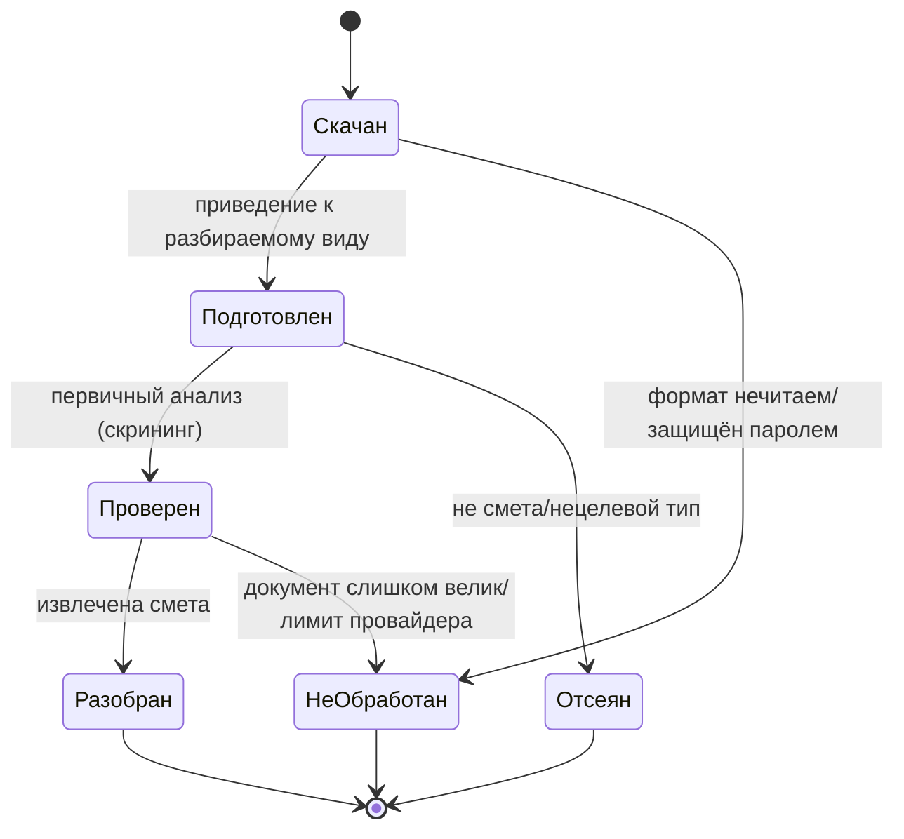

# Путь документа и сметы

Здесь будет бизнес-языком: как документ проходит подготовку → первичный анализ (по каким условиям
отсеивается/проходит/помечается borderline) → извлечение (включая гигантские документы окнами) →
терминальные исходы, в т.ч. «не смогли обработать» (`unprocessable`).

## Д1-lite — путь документа (без job'ов и error-блока)

Полная версия с job'ами, очередями и error-блоком (для разработчика) — `docs/03_Dev/document-pipeline.md` (Д1).

Наполняется в P10.4 (развёрнутый бизнес-текст).
