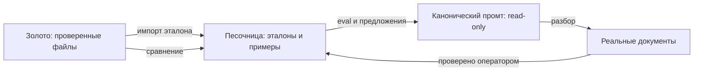

# Промты и качество

«Промт» — это инструкция, которую система отправляет AI-модели вместе с документом: что искать,
как оформить результат, на какие ошибки обратить внимание. От качества промта напрямую зависит
качество извлечённой сметы — это не разовая настройка, а то, что уточняется по мере накопления
опыта.

## Жизненный цикл промта

1. **Файл** — канонический текст промта живёт в git (файл в репозитории), под ревью, как код.
   Это единственный источник истины «как должно быть».
2. **Сид** — при развёртывании канонический текст переносится в базу данных (рабочая копия,
   которую использует система в реальном времени).
3. **Админка** — в интерфейсе оператор ВИДИТ канонические промты, но НЕ может их редактировать
   или удалять напрямую — это защищённые записи (см. `04_Operators/how-to/manage-prompts.md`).
   Так канон не расходится с репозиторием незаметно.
4. **Корректирующий промт** — если оператор видит систематическую ошибку модели (например,
   регулярно путает единицы измерения), он не правит канон, а создаёт отдельную корректирующую
   запись — точечное уточнение, которое подмешивается к канону при следующих разборах.

## Требования к промтам

- Промт должен явно описывать формат ожидаемого результата — система дополнительно проверяет,
  что ответ модели соответствует строгой структуре (а не просто «похож на JSON»).
- Промт не должен требовать от модели того, что дешевле и надёжнее проверить на бэкенде
  (например, точную арифметику сумм — её сверяет код после получения ответа, не сама модель).
- Правки канонического промта — как правки кода: с обоснованием «почему» (что именно чинит) и
  под ревью.

## Петля качества

Оператор — не пассивный наблюдатель результата, а часть контура улучшения:

1. **Проверка** — оператор смотрит на результат разбора (`04_Operators/how-to/check-ai-analysis.md`).
2. **Коррекция** — если что-то не так, оператор фиксирует структурированную коррекцию: что именно
   неверно и почему (`04_Operators/how-to/review-estimate.md`).
3. **Перезапуск** — документ разбирается заново, уже с учётом коррекции (если она отмечена как
   применимая ко всем документам этого типа) или как отдельный точечный пересчёт.
4. **Голден-пример** — когда оператор отмечает результат «проверено», он становится эталонным
   примером — материалом для будущего обучения и оценки качества модели, а не разовой галочкой.

## Три слоя смет

Система не смешивает эталон, тренировочную рабочую область и результаты реальных закупок.

- **Золото** — проверенные файлы `*.gold.json`. Это read-only канон, с которым сравнивают
  результат разбора.
- **Песочница** — эталоны и примеры ответов в рабочей базе. Здесь безопасно готовить и проверять
  изменения промта без подмены канонических файлов.
- **Реальные документы** — результаты обработки закупок. Проверенный оператором результат может
  стать примером для дальнейшей оценки, но не переписывает золото сам по себе.

Промт собирается из канонических файлов: правила шагов соединяются со словарями названий из
контрактов, а структура ожидаемого ответа передаётся модели отдельной схемой. Поэтому канон
остаётся read-only и проходит ревью; операторская коррекция — отдельное дополнение, а не тихая
правка исходного промта. Техническая композиция и её кэшируемая граница показаны в
[`03_Dev/ai/prompts.md`](../03_Dev/ai/prompts.md).

## Д14 — три слоя смет

## Условия прохождения стадий

- **Скрининг** отсеивает документ, если модель уверенно определяет «это не смета» или не может
  определить тип; пограничные случаи не отбрасываются молча — уходят на ревью
  (`document-and-estimate-pipeline.md` §2).
- **Извлечение** считается завершённым успешно, когда собраны все ожидаемые строки и суммы
  сходятся; расхождение переводит смету в статус «подозрительная», а не проваливает разбор
  целиком.

Технические детали композиции промта (что именно попадает в запрос к модели, версии, кэширование)
— `03_Dev/ai/prompts.md`; контракты и алгоритм извлечения —
[`03_Dev/ai/estimate-extraction.md`](../03_Dev/ai/estimate-extraction.md).
