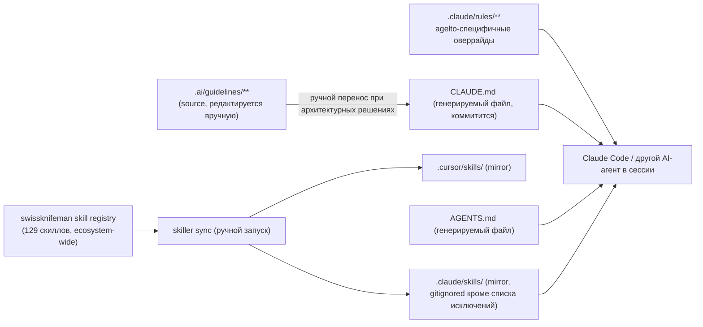

# AI-контур проекта

Про устройство агентского контекста проекта (skills/rules/CLAUDE.md для Claude Code и других
AI-агентов). НЕ про LLM-пайплайн документов/смет — см. [`ai/prompts.md`](../ai/prompts.md) для этого.

## Источники и потребители

## Что коммитить

- `.ai/guidelines/**` — ЕДИНСТВЕННЫЙ источник для agelto-специфичных правил (архитектура, глоссарий,
  навигация, PR-чеклист, шаблоны задач). Коммитится всегда.
- `CLAUDE.md`/`AGENTS.md`/`GEMINI.md` — **генерируемые артефакты**, ведутся ВРУЧНУЮ (Boost подключён
  только как MCP-сервер, не композитор контекста — см. корневой `CLAUDE.md` §Fast Entry Rules).
  Правки идей — сначала в `.ai/guidelines/**`/`docs/`, затем вручную переносятся в эти файлы.
- `.claude/skills/`, `.cursor/rules/` — генерируемые зеркала skill-реестра (`skiller sync`), **не
  редактируются напрямую** (см. `.ai/guidelines/navigation.md` §Agent File Edit Safety). `.gitignore`
  игнорирует `.claude/*` целиком, с явными исключениями (`skills/`, `agents/`, `workflows/`,
  `rules/`, `hooks/`, `agent-pack.lock.json`, `review-gate.env.ini`) — только они трекаются.
- `.claude/rules/**` (например `agelto-reviewer-overrides.md`) — проектные оверрайды поверх общих
  swissknifeman-скиллов; коммитятся, читаются агентом наравне с CLAUDE.md.

## Цикл редактирования

`item/phase → handoff → /clear` (skill `plan-protocol`) применим и к контексту: правка правила →
`.ai/guidelines/**` → при необходимости ручной перенос в `CLAUDE.md` → коммит. Подробный цикл и
источник истины — skill `ai-context-workflow`.

## Смежное

- [`scenarios.md`](scenarios.md) — какие скилы подключать в каком порядке под конкретную задачу.
- [`subagents-and-workflows.md`](subagents-and-workflows.md) — роли агентов и dev-loop проекта.
- `.ai/guidelines/navigation.md` — Reference Table (маршрутизация по доменным терминам/задачам).
- `docs/meta/editing.md` — как править саму документацию `docs/` (не путать с `.ai/`-контуром).
