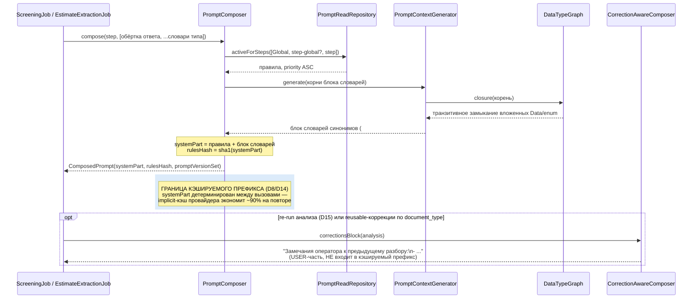

# Промт-система

Здесь будет: файлы обоих корней канона (`resources/ai/prompts/**` + `resources/<домен>/ai/prompts/**`,
D32) → сид `PromptSeeder` → `is_protected` (D17),
composite versioning (промт + модель + схема, `rules_hash`), как писать промты (выжимка правил v1,
research/B §4).

## Д3 — композиция промта

Композиция: `App\Services\Llm\PromptComposer::compose()` (`app/Services/Llm/PromptComposer.php:30`) —
порядок Global → step-global (`ScreeningGlobal`/`ExtractionGlobal`) → сам шаг, `priority` ASC внутри
каждого уровня (канон v1, `PromptComposer::stepsForComposition()`), затем блок словарей синонимов —
`App\Services\Llm\Schema\PromptContextGenerator::generate()`.

**Разделение «схема / правила» (P2.3–P2.5, D88/D101).** Структуру контракта ответа (типы,
обязательность, вложенность, `description` каждого поля) несёт ИСХОДЯЩАЯ СХЕМА провайдера
(`App\Services\Llm\Schema\JsonSchemaGenerator` + атрибут `App\Attributes\Ai\Description`, читаемый
`ContractAttributeReader` — см. ниже) — отдельный канал вызова (`response_schema` через
`Prism\Schema\RawSchema`, НЕ системная часть промта). `PromptContextGenerator::generate()` печатает
в системную часть ТОЛЬКО словарь синонимов (`#[Alias]`) — печать очищенного PHP-исходника
Data-контрактов (приём v1, `Old/app/Services/PromptService.php::getCleanSchema`) снята: два
носителя одной структуры (докблок промта и JSON-схема) дороже одного и расходятся молча (D88).
Инвариант держит тест когерентности (`tests/Feature/Ai/PromptCompositionTest.php`).

**Состав блока словарей (P6.1, D51).** Печатается ТРАНЗИТИВНОЕ ЗАМЫКАНИЕ переданных корней (обёртки
ответа шага), а не переданный список — обход доходит до вложенных Data-классов и enum'ов
(конструктор, элементы массивов по докблоку `@param X[]`, самоссылки без зацикливания). Владелец
правила обхода ОДИН — `App\Services\Llm\Schema\DataTypeGraph`, тот же, что у `JsonSchemaGenerator`.
Печатаются только классы, реально несущие `#[Alias]` — синоним того, как поле/значение может
называться в исходном документе; JSON-схема эту семантику не несёт (`description` там — про смысл
поля для модели, не про синонимы написания).

Словари `#[Alias]`, до которых обход не доходит (`EstimateHeaderMap` — «НЕ часть JSON-ответа LLM ни
одного шага»), объявляет сам ТИП документа одним объявлением
(`App\Services\Procurement\Analyzers\Estimate\EstimateStepDictionaries`), которое читают ВСЕ
потребители шага; ядро о них не знает. Достижимое замыканием (`ResourceType`) в объявлении не
дублируется. Смена состава блока меняет `rules_hash` — живые explicit-кэши анализов инвалидируются
штатным `LlmCacheManager::validHandle()` один раз, ручная правка `rules_hash` запрещена.

## Атрибут `#[Description]` и ридер контрактов (P2.3/P2.4)

`App\Attributes\Ai\Description` (property/parameter/class constant) — типизированный носитель
семантики поля контракта ответа, заменивший докблок-bullet (`@param X описание`) на всех свойствах
Data-контрактов пяти шагов. `App\Services\Llm\Schema\ContractAttributeReader` читает атрибуты
(`descriptions()`/`aliases()`/`caseAliases()`, без кэша) — единственный источник и для блока
словарей (выше), и для `description` в исходящей схеме (`JsonSchemaGenerator::classSchema()`).
Покрытие контрактов проверяет `tests/Feature/Ai/ContractDescriptionCoverageTest.php`.

`JsonSchemaGenerator` печатает `description` каждого свойства в схему и НЕ сортирует свойства/
`required` — оба массива идут в порядке объявления параметров конструктора Data-класса (единый
порядок между схемой и, где применимо, словарями, D89). `propertyOrdering` (отдельный ключ
`response_schema`, требуемый некоторыми моделями линейки 2.0) НЕ эмитируется — по вердикту
`findings/P2-vendor-structured-output.md` §3/§7 модели активных маршрутов проекта (линейка 3.x) его
не требуют.

Коррекции — `App\Services\Llm\CorrectionAwareComposer::correctionsBlock()`
(`app/Services/Llm/CorrectionAwareComposer.php:26`) — намеренно USER-часть, не системная (иначе
ломался бы стабильный префикс кэша).

## Файлы → сид → админка

Источник истины — оба корня канона (`resources/ai/prompts/**` + `resources/<домен>/ai/prompts/**`,
D32) (git); `App\Enums\Llm\PromptStep` — интерфейс, шаги
разбиты на ядерный `CorePromptStep` (кросс-документные) и типовые enum'ы анализаторов
(`App\Enums\Procurement\Analyzers\Estimate\EstimatePromptStep` — 9 значений вместе, включая
`extraction:discovery` для windowed-пути, D37; P2.5). Каждый файл — front-matter
(`key`/`step`/`version`/`priority`/`is_active`) + markdown-текст. `php artisan ai:prompts:sync`
(`PromptsSyncCommand`, есть `--check` для сухой сверки дрейфа) читает дерево и upsert'ит в
`llm_prompts` по `(key, version)`; `php artisan db:seed` (`PromptSeeder`) достаточно для полного
развёртывания. **Как именно писать промт-текст** (структура файла, `key`/`step`/`priority`, когда
заводить дополнительный промт того же шага) — единственный источник инструкции —
`resources/ai/prompts/README.md`, не дублируется здесь.

`is_protected` (D17) — сидовые промты из репозитория read-only в админке (запись — только git-PR);
операторы создают ТОЛЬКО дополняющие/корректирующие записи поверх канона (RBAC-обход через
`PromptPolicy`, см. [`../admin-panel.md`](../admin-panel.md)). Field `key` — кодовое поле
идентификации при апдейте, не `id`.

В панели `Ai/Prompts` видны идентифицирующие метаданные и полный текст каждой версии. Страница
«Композиция системного промта» вызывает `PromptComposer` без schema-классов и показывает только
текущую склеенную RULES-часть, цепочку и `promptVersionSet`. Это диагностическое состояние сейчас,
а не исторический запрос: schema-блок добавляет вызывающий код. Для payload, реально отправленного
в провайдер, используется «Финальный промт прогона» конкретного run; композиция его не пересобирает.

## Composite versioning

Поведение LLM-вызова определяется ТРОЙКОЙ (не только текстом промта): промт-версия + модель + схема
ответа. `rulesHash = sha1(systemPart)` (см. Д3) фиксирует итоговый системный текст ПОСЛЕ композиции
и подмешивания схем — сохраняется на каждый `LlmCall` (`llm_calls`) вместе с идентификатором
модели маршрута. Это даёт воспроизводимость: любой сохранённый вывод можно однозначно связать с
ТОЧНОЙ комбинацией, которая его породила — критично для gold-датасета (`ai/training-loop.md`) и
`EvalRun.prompt_version_set` (`estimate:eval:run`).

## Очередь предложений и критик промта (P5.6, D8/D59–D61/D64)

Носитель — `prc_ai_prompt_suggestions` (`App\Models\Procurement\Ai\PromptSuggestion`), ОТДЕЛЬНО от
`prc_ai_corrections`: коррекция правит КОНКРЕТНЫЙ разбор (USER-часть повторного вызова), предложение
— это ТЕКСТ системной инструкции, который проходит аудит, прежде чем стать файлом (D59). Два вида
(`PromptSuggestionKind`): `prompt_patch` — полный новый текст тела файла промта; `correction_hint` —
переиспользуемая подсказка для существующего `prc_ai_corrections(is_reusable=true)`.

**Критик** — `CorePromptStep::PromptCritic` (`resources/ai/prompts/prompt-critic/0-prompt-critic.md`),
обычный шаг системы промтов (версионируемый, `is_protected`, сидится наравне с остальными). Вызов
идёт БЕЗ tools/function-calling, ТОЛЬКО USER-частью (diff-отчёт + текущая композиция промта шага);
системная часть вызова состоит исключительно из промта критика (D64) — текст, предложенный критиком,
никогда не попадает в систему автоматически.

`estimate:prompts:suggest {--code=} {--analysis=} {--step=*} {--dry-run}` строит
`EstimateDiffReport` (`training-loop.md` §4) по эталону и для каждого запрошенного шага зовёт
`App\Services\Procurement\Tuning\PromptCritic`; предложение, дублирующее уже существующее
`pending`/`rejected` по паре (`prompt_key`, нормализованный текст), не создаётся повторно.

**Решение — только человек** (`PromptSuggestionStatus`: `pending` → `approved`/`rejected` →
`applied`/`reverted`). Экран `PromptSuggestionResource` (Filament) — только список+карточка, записи
создаёт команда, не форма: очередь по умолчанию открыта на `pending`, фильтры по форме/типу
документа/шагу; карточка несёт решение (кто/когда/причина), предмет (обе оси — тип документа и шаг),
обоснование критика (`rationale`/`evidence`) и предложенный текст РЯДОМ с текущим. Одобренная запись
показывает состояние **«одобрено, но не применено»** — готовую команду
`docker compose exec app php artisan ai:prompts:apply <id>`, которую человек запускает ВТОРЫМ,
отдельным шагом. `ai:prompts:apply` работает только со `status=approved`: для `prompt_patch` поднимает
`version` во front-matter и заменяет тело файла, для `correction_hint` заводит
`prc_ai_corrections(is_reusable=true)`. Коммит правленного файла и `ai:prompts:sync` (развёртывание в
БД) — тоже руками: автоматического пути «критик предложил → промт живёт в проде» нет ни на одном шаге.

## Смежное

- Композиция и блок словарей синонимов — `App\Services\Llm\Schema\PromptContextGenerator` генерирует
  их из `#[Alias]` Data-контрактов; структура ответа (типы/`description`/порядок) — отдельно,
  исходящей схемой (`App\Services\Llm\Schema\JsonSchemaGenerator`, см. выше).
- Как менеджеры и операторы читают промт-систему бизнес-языком — `docs/02_Workflow/prompts-and-quality.md` (P10.4).
- Feature-карточки конкретных AI-шагов — [`feature-card-screening.md`](feature-card-screening.md),
  [`feature-card-estimate-extraction.md`](feature-card-estimate-extraction.md).
- Наследие v1, антипаттерны и глубокая формулировка правок промта — `docs-private/prompt-engineering-notes.md` (не зеркалится в Brain).
