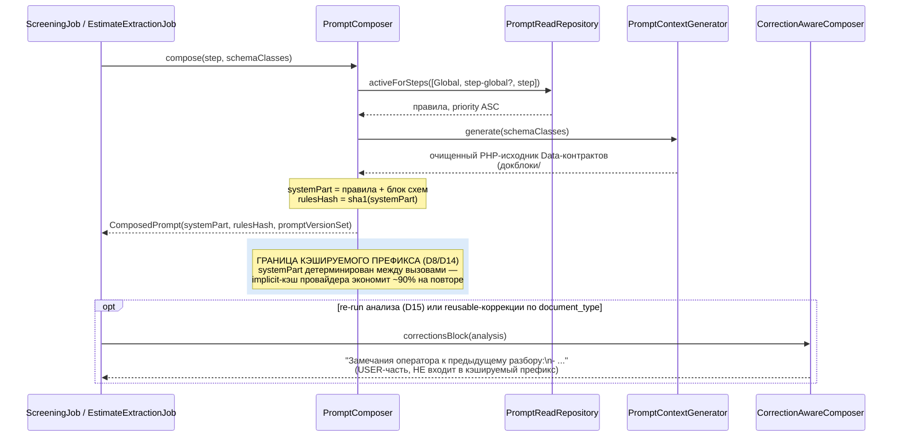

# Промт-система

Здесь будет: файлы обоих корней канона (`resources/ai/prompts/**` + `resources/<домен>/ai/prompts/**`,
D32) → сид `PromptSeeder` → `is_protected` (D17),
composite versioning (промт + модель + схема, `rules_hash`), как писать промты (выжимка правил v1,
research/B §4).

## Д3 — композиция промта

Композиция: `App\Services\Llm\PromptComposer::compose()` (`app/Services/Llm/PromptComposer.php:30`) —
порядок Global → step-global (`ScreeningGlobal`/`ExtractionGlobal`) → сам шаг, `priority` ASC внутри
каждого уровня (канон v1, `PromptComposer::stepsForComposition()`). Блок схем —
`App\Services\Llm\Schema\PromptContextGenerator::generate()`
(`app/Services/Llm/Schema/PromptContextGenerator.php:23`) — обёртки шага (суффикс `Response`) всегда
последними. Коррекции — `App\Services\Llm\CorrectionAwareComposer::correctionsBlock()`
(`app/Services/Llm/CorrectionAwareComposer.php:26`) — намеренно USER-часть, не системная (иначе
ломался бы стабильный префикс кэша).

## Файлы → сид → админка

Источник истины — оба корня канона (`resources/ai/prompts/**` + `resources/<домен>/ai/prompts/**`,
D32) (git); `App\Enums\Llm\PromptStep` — интерфейс, шаги
разбиты на ядерный `CorePromptStep` (кросс-документные) и типовые enum'ы анализаторов
(`App\Enums\Procurement\Analyzers\Estimate\EstimatePromptStep` — 9 значений вместе, включая
`extraction:discovery` для windowed-пути, D37; P2.5). Каждый файл — front-matter
(`key`/`step`/`version`/`priority`/`is_active`) + markdown-текст. `php artisan ai:prompts:sync`
(`PromptsSyncCommand`, есть `--check` для сухой сверки дрейфа) читает дерево и upsert'ит в
`llm_prompts` по `(key, version)`; `php artisan db:seed` (`PromptSeeder`) достаточно для полного
развёртывания. **Как именно писать промт-текст** (структура файла, `key`/`step`/`priority`, когда
заводить дополнительный промт того же шага) — единственный источник инструкции —
`resources/ai/prompts/README.md`, не дублируется здесь.

`is_protected` (D17) — сидовые промты из репозитория read-only в админке (запись — только git-PR);
операторы создают ТОЛЬКО дополняющие/корректирующие записи поверх канона (RBAC-обход через
`PromptPolicy`, см. [`../admin-panel.md`](../admin-panel.md)). Field `key` — кодовое поле
идентификации при апдейте, не `id`.

## Composite versioning

Поведение LLM-вызова определяется ТРОЙКОЙ (не только текстом промта): промт-версия + модель + схема
ответа. `rulesHash = sha1(systemPart)` (см. Д3) фиксирует итоговый системный текст ПОСЛЕ композиции
и подмешивания схем — сохраняется на каждый `LlmCall` (`llm_calls`) вместе с идентификатором
модели маршрута. Это даёт воспроизводимость: любой сохранённый вывод можно однозначно связать с
ТОЧНОЙ комбинацией, которая его породила — критично для gold-датасета (`ai/training-loop.md`) и
`EvalRun.prompt_version_set` (`estimate:eval:run`).

## Смежное

- Композиция и блок схем — `App\Services\Llm\Schema\PromptContextGenerator` генерирует их из PHP
  Data-контрактов (докблоки/`#[Alias]`-словари как инструкции модели, приём v1 — research/B §Синхронизация PHP↔JSON).
- Как менеджеры и операторы читают промт-систему бизнес-языком — `docs/02_Workflow/prompts-and-quality.md` (P10.4).
- Feature-карточки конкретных AI-шагов — [`feature-card-screening.md`](feature-card-screening.md),
  [`feature-card-estimate-extraction.md`](feature-card-estimate-extraction.md).
- Наследие v1, антипаттерны и глубокая формулировка правок промта — `docs-private/prompt-engineering-notes.md` (не зеркалится в Brain).
