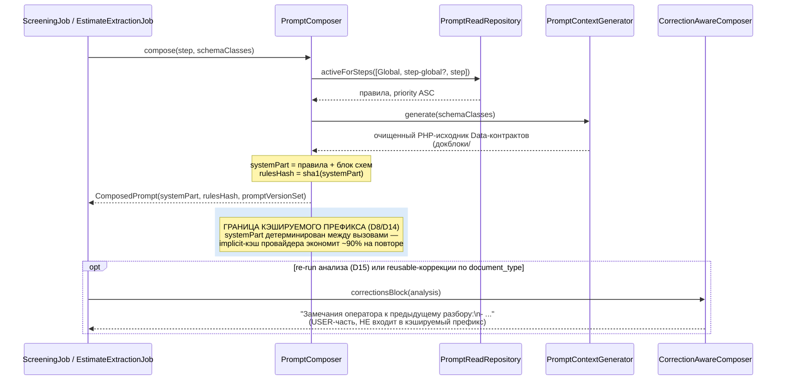

# Промт-система

Здесь будет: файлы `resources/ai/prompts/**` → сид `PromptSeeder` → `is_protected` (D17),
composite versioning (промт + модель + схема, `rules_hash`), как писать промты (выжимка правил v1,
research/B §4).

## Д3 — композиция промта

Композиция: `App\Services\Llm\PromptComposer::compose()` (`app/Services/Llm/PromptComposer.php:30`) —
порядок Global → step-global (`ScreeningGlobal`/`ExtractionGlobal`) → сам шаг, `priority` ASC внутри
каждого уровня (канон v1, `PromptComposer::stepsForComposition()`). Блок схем —
`App\Services\Llm\Schema\PromptContextGenerator::generate()`
(`app/Services/Llm/Schema/PromptContextGenerator.php:23`) — обёртки шага (суффикс `Response`) всегда
последними. Коррекции — `App\Services\Llm\CorrectionAwareComposer::correctionsBlock()`
(`app/Services/Llm/CorrectionAwareComposer.php:26`) — намеренно USER-часть, не системная (иначе
ломался бы стабильный префикс кэша).

Наполняется в P10.3 (развёрнутый текст: как писать промты, composite versioning).
