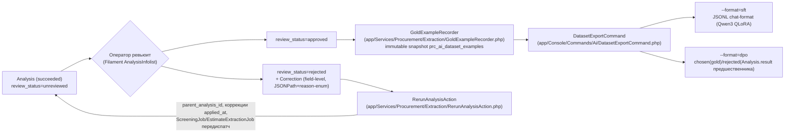

# Обучающий контур

Здесь будет: analysis → review → correction → re-run → gold → export SFT/DPO (D15), публичная
часть локального LLM-стека (детали — `docs-private/local-llm-training.md`).

## Д5 — обучающий контур

`source` gold-примера: `corrected` — если у прямого предшественника анализа есть применённая
коррекция (`applied_at` не null); иначе `llm` (approve сырого вывода без цикла правок).
Скрининг (`AnalysisStep::Screening`) не производит `estimates[]`-контракт — петля покрывает только
извлечение смет (`GoldExampleRecorder`, докблок класса).

Наполняется в P10.3 (развёрнутый текст, связка с `docs-private/local-llm-training.md`).
