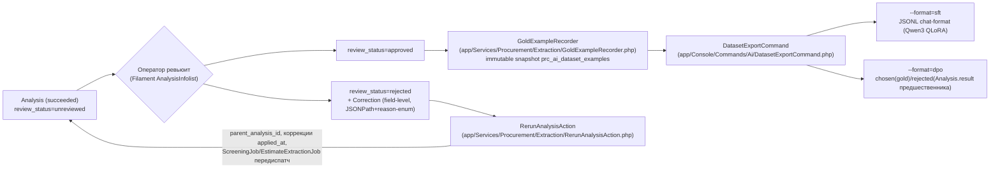

# Обучающий контур

Здесь будет: analysis → review → correction → re-run → gold → export SFT/DPO (D15), публичная
часть локального LLM-стека (детали — `docs-private/local-llm-training.md`).

## Д5 — обучающий контур

`source` gold-примера: `corrected` — если у прямого предшественника анализа есть применённая
коррекция (`applied_at` не null); иначе `llm` (approve сырого вывода без цикла правок).
Скрининг (`AnalysisStep::Screening`) не производит `estimates[]`-контракт — петля покрывает только
извлечение смет (`GoldExampleRecorder`, докблок класса).

## Раздельное хранение raw/gold (D15)

Канон — Google DocAI HITL / Argilla-паттерн (research/G §4): сырой вывод модели ХРАНИТСЯ НЕИЗМЕННО
отдельно от исправленного. `Analysis.result` — сырой вывод на момент завершения; `prc_ai_corrections`
— field-level коррекции (JSONPath + `CorrectionReason` enum + свободный комментарий); `verified`
(`review_status=approved`) порождает IMMUTABLE gold-снапшот в `prc_ai_dataset_examples` со ВСЕМИ
версиями (`prompt_version_set`, схема, модель) — воспроизводимость training-run. Раздельное
хранение бесплатно даёт preference-пары для будущего DPO: `chosen` = gold, `rejected` = raw-вывод
предшественника (см. диаграмму, ветка `--format=dpo`).

## Корректирующие промты (re-run с hints)

`RerunAnalysisAction` не просто повторяет вызов — коррекции превращаются в versioned hints,
привязанные к `document_type`/полю (не свободный текст «что не так», который непереиспользуем ни на
inference, ни в обучении); подмешиваются в промт через `CorrectionAwareComposer` при повторе (см.
Д3, `../llm-providers.md`/`prompts.md`) — намеренно USER-часть, вне кэшируемого системного префикса.

## Экспорт и целевой локальный стек

`DatasetExportCommand` пишет манифест (счётчики/версии/sha) рядом с выходным JSONL — тем же именем
с суффиксом `.manifest.json`, воспроизводимость training-run. Целевой стек локальной LLM (задел,
само обучение — вне этого плана): vision-слой БЕЗ дообучения (Qwen2.5-VL-7B/MiniCPM-V 2.6) +
текстовый Qwen3-4B/8B с QLoRA-SFT на 1–3k размеченных смет + serve vLLM `structured_outputs`
(backend xgrammar) через `OpenAiCompatibleProvider` (`../llm-providers.md`). Подробности экономики,
объёма датасета и анти-паттернов — `docs-private/local-llm-training.md` (не зеркалится в Brain-vault,
чувствительная промт-инженерия/экономика).

## Смежное

- Feature-карточка извлечения (что именно ревьюится) — [`feature-card-estimate-extraction.md`](feature-card-estimate-extraction.md).
- Как оператор проверяет/правит смету — `docs/04_Operators/how-to/review-estimate.md` (P10.4).
- Composite versioning промт+модель+схема — [`prompts.md`](prompts.md).
