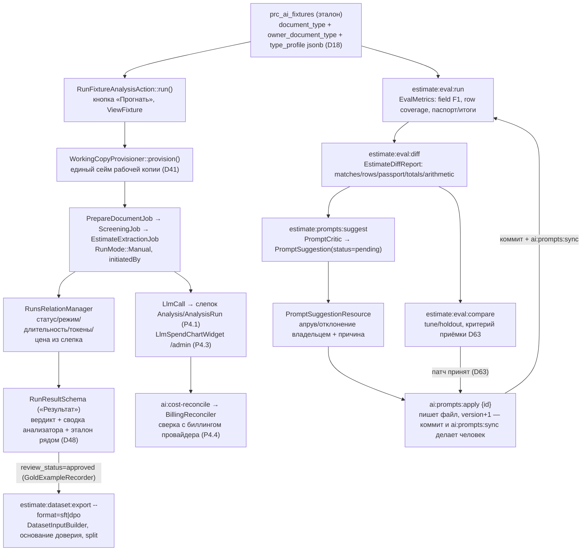

# Обучающий контур

Контур целиком — от заведённого эталона до строки в обучающем датасете локальной LLM. Документ
идёт маршрутом человека, а не по фазам плана: числа и точные поля контракта — ссылкой на
`docs/specs/v2/08-estimate-extraction.md` (нормативный носитель), здесь — зачем каждый шаг существует
и как он связан с соседним.

## 1. Откуда берётся эталон (тип-профиль, D18)

Реестр обучения — `prc_ai_fixtures`, ОДНО ядро на любой тип документа: `code`/`sha256`/
`storage_path`/`source_format` + две оси типа — `document_type` (фактический тип файла, он же
ожидаемый вердикт скрининга для негативов) и `owner_document_type` (тип, чей анализатор владеет
профилем) — плюс `type_profile jsonb`, схему которого задаёт и валидирует анализатор владельца
(сегодня единственный анализатор — смета: `class`/`form`/`expected_estimates`/`expected_rows`/
`gold_source` внутри профиля). Форма профиля в админке — generic jsonb-редактор, не типизированная
форма (D43): второй тип документа не требует правки экрана реестра.

Пара «исходник + эталонный разбор» заводится вне закупки, на служебной площадке «Обучалка»
(`Platform::training()`, D91): `estimate:gold:import` (пары `<name>.<ext>`+`<name>.gold.json`,
§8.1/8.2 спеки) или `estimate:dataset:import` (тот же контракт эталона, независимая от первой
реализация создания рабочей копии — см. «Известные долги»). Обе команды создают `Document`+
`DocumentVersion` с `external_id` по своей конвенции (`fixture:<CODE>`/`gold:<name>`).

**Восстановление корпуса в пустой БД (D94).** Реестр `prc_ai_fixtures` и рабочие копии — рантайм-
проекция манифеста `estimates/manifest.json` (git-SSOT), не первичный носитель: свежая БД
восстанавливает корпус без единого платного вызова, тремя командами по порядку —
`estimate:fixtures:import` (манифест → диск эталонов → `prc_ai_fixtures`, идемпотентно по sha256,
битая запись отклоняется индивидуально) → `estimate:gold:import --prepare` (рабочие копии ВНЕ
закупки + `prc_ai_dataset_examples` из `<CODE>.gold.json`/`<CODE>.screening.json`,
`source=deterministic`) → `estimate:fixtures:verify` (диагностическая сверка манифест ↔ диск ↔
реестр, ничего не правит). Граница: git-SSOT (`estimates/manifest.json`) сам пуст или не читается —
это эскалация владельцу, а не повод строить корпус вручную из чего-то другого.

## 2. Как запускается прогон и что он показывает (P5.2/P5.3/P5.4)

Кнопка **«Прогнать»** на карточке эталона (`ViewFixture`, право `AnalysisPermission::Create`,
видна только если нет активного прогона) вызывает `RunFixtureAnalysisAction::run()`: гейт
`ai.screening.enabled` → рабочая копия ЧЕРЕЗ единый сейм `WorkingCopyProvisioner::provision()`
(тот же класс, что и `estimate:gold:import`, подтверждено построчной сверкой P7.2, D41) → гейт
активного прогона → на повторном прогоне снимает активные анализы обоих шагов и откатывает статус
документа к `downloaded` → диспатчит штатный вход пайплайна (`PrepareDocumentJob`) с
`RunMode::Manual` и инициатором — Action сам прогон не заводит, обработка идёт ТЕМ ЖЕ путём, что
краулинг (очередь → подготовка → скрининг → извлечение).

**История прогонов** (`RunsRelationManager` на карточке эталона) — статус и режим бейджами,
время начала/завершения, длительность, и токены/цена **строкой из готового слепка прогона**
(P4.1) — без агрегации на лету; список опрашивается (`poll`), пока есть незавершённый прогон.
Пустые ячейки токенов/цены у прогона без слепка честно подписаны «нет данных», а не нулём.

**Модалка «Результат»** (`RunResultSchema`) — три секции: вердикт первичного анализа (тип, ветка
решения, уверенность, теги, ошибка); сводка от анализатора — построена ОБЩИМ рендером, который не
знает предметку (`DocumentAnalyzerRegistry::for()->summarize()`, контракт D27 — витрина не читает
`prc_estimate_*` напрямую); и **эталон РЯДОМ с предсказанием** (тело последней версии записи
датасета по этому эталону, показ БЕЗ правки — D48, править эталон отсюда нельзя). Большие сводки
режутся (20 строк сводки / 40 строк JSON эталона), факт обрезания печатается явно.

## 3. Откуда берётся расход и где его смотреть (P4.1/P4.3/P4.4)

Каждый LLM-вызов (`llm_calls`) несёт токены и стоимость; они СВОРАЧИВАЮТСЯ в слепок на самом
`Analysis` и на сущности ПРОГОНА (`AnalysisRun`, P4.1) — история прогонов (выше) и любой другой
потребитель читают ГОТОВЫЙ слепок, не считают заново. На дашборде `/admin` — виджет
`LlmSpendChartWidget` (`app/Filament/Widgets/LlmSpendChartWidget.php`): диаграмма расхода по дням
в разрезе провайдера и модели поверх сейма источника (`UsageSource`), с подписью горизонта данных
и явной пометкой дней «за горизонтом» — доступ через `HasAzGuardWidget` (та же ролевая матрица, что
у остальной админки).

Периодическая сверка трекинга с РЕАЛЬНЫМ биллингом провайдера — `artisan ai:cost-reconcile
{--from} {--to} {--file}` (`BillingReconciler`): дельта по дням в абсолюте и процентах против
`config('ai.reconcile.threshold_percent')`; операторский порядок действий — runbook
`docs/03_Dev/runbooks/billing-reconcile.md`, читается инженером, не оператором (см.
`docs/04_Operators/how-to/read-spend-dashboard.md` для взгляда оператора на дашборд).

## 4. Как прогнать eval и прочитать diff (P6.2)

`estimate:eval:run --task=extraction` прогоняет ТЕКУЩИЙ пайплайн извлечения по всем эталонам с
gold-примером и сравнивает результат с `gold.estimates[]` (`EvalMetrics`, §8.4 спеки):
field-level precision/recall/F1 по построчным полям, row coverage, паспорт и итоги — тем же
приёмом позиционного сопоставления смет. Результат — агрегат `prc_ai_eval_runs` + построчные
`prc_ai_eval_results`.

Для конкретного эталона — `estimate:eval:diff --code=<CODE>` строит `EstimateDiffReport`
(`EstimateDiffReport::build()`, §8.6): парный проход сопоставления смет (по номеру сметы →
по адресу → по позиции), построчные расхождения (`missing`/`extra`/`field_mismatch`),
расхождения паспорта и итогов, отдельная арифметическая проверка предсказания и gold ТОЙ ЖЕ смет
СЛОТА — человекочитаемый вход для решения, что чинить промтом, а что не чинится (документ такой).

## 5. Как рождается и принимается патч промта (P5.6, D8)

`estimate:prompts:suggest --code=<CODE> --step=<step>` собирает diff-отчёт (выше) и ТЕКУЩУЮ
композицию промта шага, зовёт `PromptCritic` (шаг системы промтов, `is_protected`, дешёвая модель,
БЕЗ tools/function-calling, только USER-часть — D64) и заводит запись `prc_ai_prompt_suggestions`
(`status=pending`): либо `prompt_patch` (полный новый текст файла), либо `correction_hint`
(переиспользуемая подсказка).

Решение — ТОЛЬКО человек (D8): экран **очередь предложений** (`PromptSuggestionResource`, только
список+карточка — записи создаёт команда, не форма) показывает статус, форму, обе оси предмета
(тип документа + шаг), обоснование критика (`rationale`/`evidence`) и предложенный текст РЯДОМ с
текущим. Апрув/отклонение — с обязательной причиной, решение аудируется (кто/когда).
**Одобрено — не значит применено:** карточка одобренной записи несёт готовую команду
`docker compose exec app php artisan ai:prompts:apply <id>` — именно человек запускает её ВТОРЫМ
шагом; команда пишет файл (поднимает `version`), но коммит файла и `php artisan ai:prompts:sync`
(развёртывание в БД) — тоже руками. Автоматического пути от «критик предложил» до «промт живёт в
проде» нет ни на одном шаге (Безопасность петли, §6.1/D64 спеки).

## 6. Как измеряется, что стало лучше (`tune`/`holdout`)

Корпус эталонов делится на `tune`/`holdout` детерминированно (`estimates/eval-splits.json`,
`estimate:eval:run --write-splits`, ось `form`). Патч принимается, только если ОДНОВРЕМЕННО
выполнены четыре условия критерия D63 (план `2026.07.26-EST-TRAIN`): рост F1 на `tune` ≥ 0.01,
падение F1 на `holdout` ≤ 0.005, падение row coverage на `holdout` ≤ 0.005, потеря по ОТДЕЛЬНОМУ
эталону ≤ 0.05 F1. `estimate:eval:compare --base=<id> --candidate=<id>` сравнивает два прогона
`EvalRun` числом, а не на глаз.

## 7. Как всё это уезжает в датасет локальной модели (P7.1)

`estimate:dataset:export --format=sft|dpo` — конечная точка контура: выгружает
`prc_ai_dataset_examples` в chat-JSONL, который training-раннер берёт как есть (chat-template
целевой модели в экспорт не входит). Один строитель входа на оба формата
(`DatasetInputBuilder`) кладёт в `user`-часть РЕАЛЬНЫЙ текст представления документа (не ссылку).
**Основание доверия** — запись экспортируема, только если `source='deterministic'` ИЛИ
`verified_at !== null`: непроверенный вывод модели (`review_status` ещё не `approved`) в датасет
не попадает никогда. SFT берёт последнюю версию gold на пару документ+задача; DPO строит
preference-пару `chosen` (gold) / `rejected` (вывод предшественника ПО СОХРАНЁННОМУ `analysis_id`
записи, не по активному анализу версии — D56) — источник `rejected` появляется только у записей
`source='corrected'`, то есть после хотя бы одного цикла ревью-с-коррекцией.

## Известные долги

- **Обучение локальной модели** — вне этого плана; экспорт готовит вход, дальше — задел
  `docs-private/local-llm-training.md` (не зеркалится в Brain-vault).
- **Экспорт screening-задачи** не реализован — `DatasetInputBuilder`/`estimate:dataset:export`
  берут только `task=extraction`.
- **Длинные документы в датасет не попадают** — текст сверх `config('ai.dataset_export.max_input_chars')`
  (дефолт 300000 символов) пропускается целиком, а не режется на несколько обучающих строк.
- **`estimate:dataset:import` остаётся ОТДЕЛЬНОЙ, не сведённой к `WorkingCopyProvisioner`
  реализацией** создания рабочей копии эталона (подтверждено ревизией P7.2, D41/D57) — объединение
  трёх вызывающих (`estimate:gold:import`, действие «Прогнать», `estimate:dataset:import`) не
  сделано этим планом сознательно; следующий шаг — новый D# и отдельный item.
- **CI-гейт по метрикам eval не включён** — `estimate:eval:run` пишет `ci_status` информационно,
  без порогового сравнения между прогонами (появится вместе с реальным голденом, §8.4 спеки).

## Смежное

- Полный контракт (JSON-схемы шагов, алгоритм извлечения, экономика, retention) —
  `docs/specs/v2/08-estimate-extraction.md`.
- Композиция промта, версии, кэширование — [`prompts.md`](prompts.md).
- Выбор представления документа на вход LLM — `docs/03_Dev/adr/0010-input-representation.md`.
- Операторские шаги — `docs/04_Operators/how-to/{run-fixture-analysis,read-spend-dashboard,
  manage-prompts,check-ai-analysis,review-estimate}.md`.
