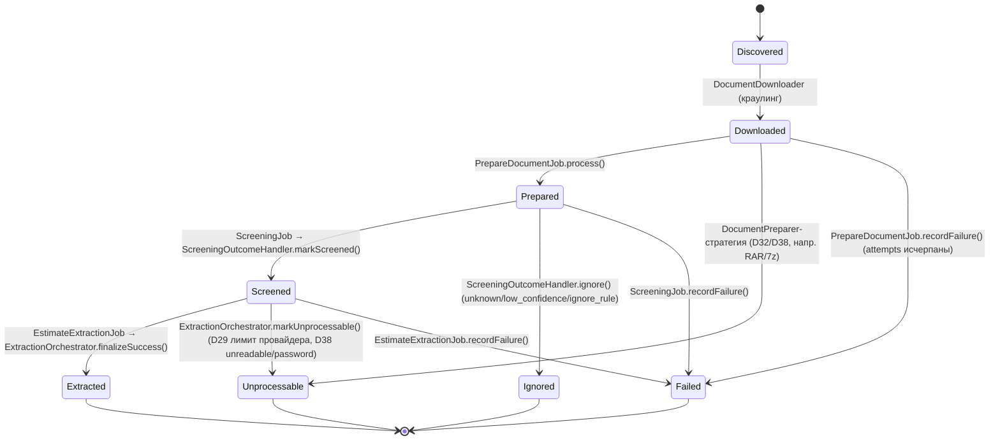
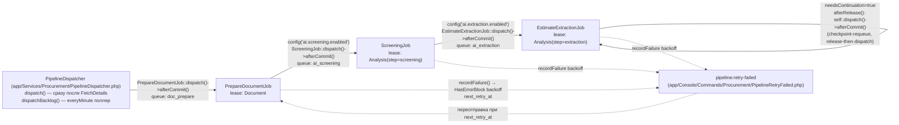
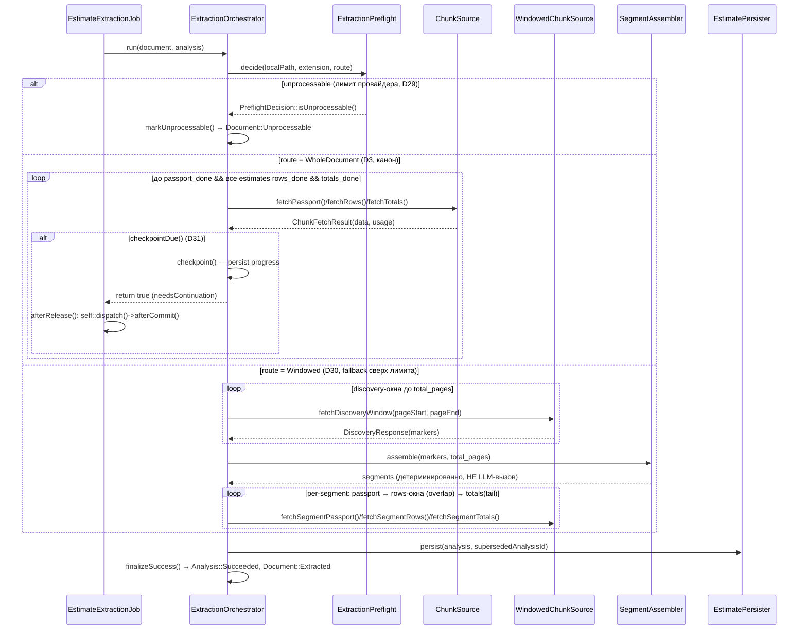

# Document & Estimate Pipeline: internals

Здесь будет: мост → подготовка → скрининг → извлечение; jobs/очереди/lease/retry; инварианты
идемпотентности; статусы (включая `unprocessable`, D32); failure modes со ссылками на runbooks.

## Д1 — FSM документа

Узлы = `App\Enums\Procurement\DocumentStatus` (`app/Enums/Procurement/DocumentStatus.php`);
переходы подписаны job/методом-триггером:

| Класс | Файл |
|:--|:--|
| `DocumentStatus` | `app/Enums/Procurement/DocumentStatus.php` |
| `PrepareDocumentJob` | `app/Jobs/Procurement/PrepareDocumentJob.php` |
| `DocumentPreparer` | `app/Services/Procurement/Prepare/DocumentPreparer.php:26` |
| `ScreeningJob` | `app/Jobs/Procurement/ScreeningJob.php` |
| `ScreeningOutcomeHandler` | `app/Services/Procurement/Screening/ScreeningOutcomeHandler.php:42` |
| `EstimateExtractionJob` | `app/Jobs/Procurement/EstimateExtractionJob.php` |
| `ExtractionOrchestrator` | `app/Services/Procurement/Extraction/ExtractionOrchestrator.php:81` |

Упрощённая версия без job'ов/ошибок (бизнес-язык) — `docs/02_Workflow/document-and-estimate-pipeline.md` (Д1-lite).

## Д2 — стадии, очереди, lease/retry

Все три job'а наследуют `App\Jobs\Procurement\PipelineJob` (`app/Jobs/Procurement/PipelineJob.php`) —
шаблонный метод `handle()`: status-guard → `acquireLease()` → `process()` → (при исключении)
`recordFailure()` + rethrow → `finally releaseLease()` → `afterRelease()`. Уникальность диспатча:
`PrepareDocumentJob`/`ScreeningJob` — `ShouldBeUnique` (короткий single-shot); `EstimateExtractionJob`
— `ShouldBeUniqueUntilProcessing` (checkpoint-requeue, D31/D39) — lock снимается ДО обработки,
чтобы self-dispatch продолжения не дедуплицировался.

## Д4 — extraction-сессия

Точечное переизвлечение диапазона (не всей сметы) — `RerunRangeAction`
(`app/Services/Procurement/Extraction/RerunRangeAction.php`, Scope Included P6.3): переиспользует
`ChunkSource::fetchRows()` и файловый handle из `analysis.progress`, не участвует в
checkpoint-цикле, не пересчитывает `validation_status`/иерархию целиком (Known Deviations P6.3).

Наполняется в P10.3 (развёрнутый текст: инварианты идемпотентности, failure modes → runbooks).
