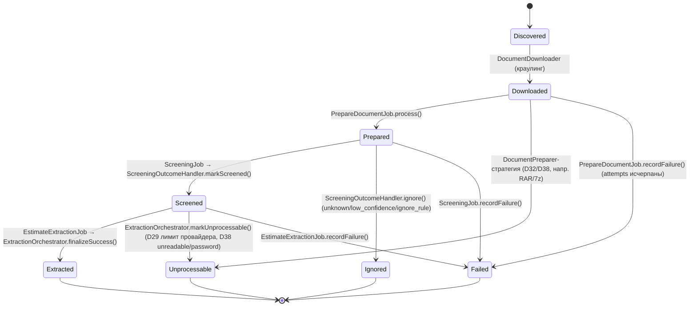
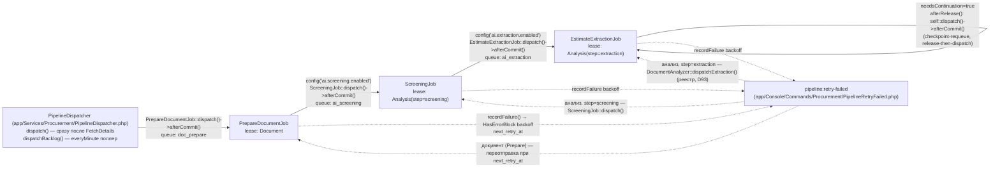
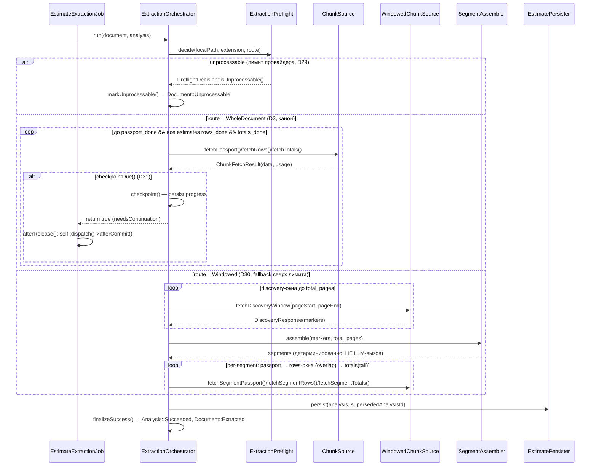

# Document & Estimate Pipeline: internals

Цикл документа: мост из краулинга (`crawling-pipeline.md`) → подготовка (`Prepare/`) → скрининг
(`Screening/`) → извлечение (`Extraction/`). Каждая стадия — отдельный queued job на Horizon
(`Jobs/Procurement/`), статус документа/анализа — единственный источник истины о прогрессе (не
локальное состояние job'а). Диаграммы ниже — по фактическому коду P4–P9, обновляются вместе с ним.

Полный извлекатель подключается реестром анализаторов по типу документа: скрининг фиксирует
известный тип, а отсутствие извлекателя не превращает документ в ошибку. Версия документа
контентно адресуется; оригинал, подготовленные представления и данные вызовов хранятся так, чтобы
анализ можно было воспроизвести без повторного скачивания источника.

## Д1 — FSM документа

Узлы = `App\Enums\Procurement\Document\DocumentStatus` (`app/Enums/Procurement/Document/DocumentStatus.php`);
переходы подписаны job/методом-триггером:

| Класс | Файл |
|:--|:--|
| `DocumentStatus` | `app/Enums/Procurement/Document/DocumentStatus.php` |
| `PrepareDocumentJob` | `app/Jobs/Procurement/PrepareDocumentJob.php` |
| `DocumentPreparer` | `app/Services/Procurement/Prepare/DocumentPreparer.php:26` |
| `ScreeningJob` | `app/Jobs/Procurement/ScreeningJob.php` |
| `ScreeningOutcomeHandler` | `app/Services/Procurement/Screening/ScreeningOutcomeHandler.php:42` |
| `EstimateExtractionJob` | `app/Jobs/Procurement/Analyzers/Estimate/EstimateExtractionJob.php` |
| `ExtractionOrchestrator` | `app/Services/Procurement/Analyzers/Estimate/ExtractionOrchestrator.php:81` |

Упрощённая версия без job'ов/ошибок (бизнес-язык) — `docs/02_Workflow/document-and-estimate-pipeline.md` (Д1-lite).

Место Д1 среди остальных осей состояния домена (`AnalysisStatus`, `RunStatus`, `ProcurementStatus`,
`PipelineStage`/`AnalysisStep`) — `docs/03_Dev/state-machines.md`.

## Событие завершения закупки: подписка

`App\Events\Procurement\ProcurementSucceeded` возникает ровно один раз, когда закупка впервые
достигает положительного исхода: канонический статус `completed` или award с определённым
победителем. Событие отправляется только после коммита транзакции. Будущий потребитель подписывается
обычным Laravel listener на этот event; слушателя и рассылки в текущем контуре нет.

Нагрузка содержит только значения и идентификаторы, включая срез `hasEstimate`/
`estimatesCount`. Эти поля не означают, что все сметы уже распознаны: извлечение может завершиться
позже. Полный неизменяемый контракт: `plans/2026.08.06-CRAWL-HARDEN/root/contracts/procurement-succeeded-v1.md`.

## Д2 — стадии, очереди, lease/retry

Ретрай `Analysis` — ДВЕ независимые ветки по `step` (`PipelineRetryFailed::dispatchAnalysisRetry()`):
`screening` передиспатчит `ScreeningJob` напрямую; `extraction` резолвит анализатор через
`DocumentAnalyzerRegistry` (`App\Services\Procurement\Contracts\DocumentAnalyzerRegistry`) и
зовёт `DocumentAnalyzer::dispatchExtraction()` — ядро команды не называет `EstimateExtractionJob`
поимённо, тот же приём, что у `RerunAnalysisAction` (Д-4, P7.7: до фикса ветка extraction бросала
`LogicException` безусловно — провалившийся extraction никогда не передиспатчился).

Все три job'а наследуют `App\Jobs\Procurement\PipelineJob` (`app/Jobs/Procurement/PipelineJob.php`) —
шаблонный метод `handle()`: status-guard → `acquireLease()` → `process()` → (при исключении)
`recordFailure()` + rethrow → `finally releaseLease()` → `afterRelease()`. Уникальность диспатча:
`PrepareDocumentJob`/`ScreeningJob` — `ShouldBeUnique` (короткий single-shot); `EstimateExtractionJob`
— `ShouldBeUniqueUntilProcessing` (checkpoint-requeue, D31/D39) — lock снимается ДО обработки,
чтобы self-dispatch продолжения не дедуплицировался.

**Ретрай — НЕ через Horizon.** Все пять supervisor'ов (`config/horizon.php`, включая
`supervisor-ai-shadow` — теневой прогон `ShadowAnalysisJob`, P9.4) держат `tries: 1` сознательно
(D135, P7.7): очередной ретрай задиспатчил бы стадию ДВАЖДЫ параллельно с `pipeline:retry-failed`.
Единственный контур ретрая — `HasErrorBlock` (`attempts`/`next_retry_at`/`failed_permanently` на
`Document`/`Ai\Analysis`) + расписанная команда выше; сторож — `tests/Unit/Architecture/JobRetryContractGuardTest.php`.

## Д4 — extraction-сессия

**Деградированный источник (скан/нечитаемый фрагмент, план `2026.07.31-SYS-INTEGRITY` P8).** Ни FSM,
ни Д4-диаграмма веткой не меняются — деградация видна не документу целиком, а отдельным ПОЗИЦИЯМ
внутри уже успешного `Succeeded`-прогона. Модель, не сумев прочесть строку, кладёт в ответ `extract_rows`
контрактную пометку `quality={"reason":"unreadable","fields":[...]}` (§3.2
`docs/03_Dev/ai/estimate-extraction.md`) вместо того, чтобы молча вернуть `null` по каждому полю
неотличимо от «поле законно пусто в источнике». `Persist` (`EstimatePersister`) мёржит эту пометку с
построчными аномалиями, которые уже вычисляет `EstimateValidator` на шаге детерминированной валидации
(§4.1 п.6 спеки) — обе причины уходят в `prc_estimate_items.quality` под ключами `model`/`validator`
одним и тем же writer-путём, `RerunRangeAction` переписывает ключ `model` и стирает `validator` на
переизвлечённой строке той же самой сборкой (второй ветки код не заводит). Персист пишет `quality`
ВСЕГДА, включая явный `NULL` — иначе пометка первого прогона молча переживает строку, которую он
описывал.

Точечное переизвлечение диапазона (не всей сметы) — `RerunRangeAction`
(`app/Services/Procurement/Analyzers/Estimate/RerunRangeAction.php`, Scope Included P6.3): переиспользует
`ChunkSource::fetchRows()` и файловый handle из `analysis.progress`, не участвует в
checkpoint-цикле, не пересчитывает `validation_status`/иерархию целиком (Known Deviations P6.3).

## Инварианты идемпотентности

- **Lease + status-guard, не только `ShouldBeUnique`.** Каждый `PipelineJob::handle()` — status-guard
  (документ/анализ уже не в ожидаемом статусе → no-op) → `acquireLease()` (TTL-лизинг по модели, канон
  v1 `acquireLease`) → `process()` → `finally releaseLease()`. Двойной диспатч job'а безопасен: либо
  дедуплицируется на уровне очереди (`ShouldBeUnique`), либо гасится guard'ом/lease (для
  `EstimateExtractionJob`, где `ShouldBeUniqueUntilProcessing` снимает lock ДО обработки — D31/D39).
- **Checkpoint-requeue — не повторный запуск с нуля.** `EstimateExtractionJob` ограничен по времени
  константой строго меньше job timeout (`config('ai.extraction.checkpoint_seconds')`); при
  `checkpointDue()` — `checkpoint()` персистит `analysis.progress` и `handle()` завершается успешно
  (без исключения), `afterRelease()` сам передиспатчит job. Следующий запуск читает `progress` и
  продолжает с места остановки — НЕ повторяет уже подтверждённые passport/rows/totals.
- **Повтор job не дублирует Document/Analysis.** Гарантируется constraint-уровнем (D24 — partial
  unique `(document_version_id, step)`) плюс transactional persist: `EstimatePersister` пишет новые
  сметы и удаляет superseded-сметы предыдущего анализа той же версии документа в одной транзакции.

## Статусы

`DocumentStatus` (см. Д1) — терминальные исходы: `Extracted` (успех), `Ignored` (скрининг отсеял —
`unknown`/`low_confidence`/`ignore_rule`), `Failed` (исчерпаны `attempts` — временный/технический
сбой, ретраится `pipeline:retry-failed` до исчерпания), **`Unprocessable`** (D32 — отдельный
терминальный исход, НЕ generic `Failed`: константация факта «не можем обработать», не сбой —
`attempts` не жжём, ретраи не назначаются). Причина — `App\Enums\Procurement\Document\UnprocessableReason`
(`unreadable_format`/`password_protected`/`provider_limit_size`/`provider_limit_pages`/`zip_bomb`/
`too_large`/`other`), пишется в `analysis.result`. Владельцы enum-кейсов по порядку исполнения
(D38): `too_large`/`zip_bomb` — P4.2 (`SpreadsheetStrategy`/`ArchiveStrategy`-гейты),
`unreadable_format`/`password_protected` — P5.1 (`PdfPageSlicer`), `provider_limit_size`/
`provider_limit_pages` — P6.1 (`ExtractionPreflight`).

## Пометки неполных позиций

`EstimateValidator` ставит позиции с пустым № позиции, шифром расценки, наименованием, единицей
измерения или количеством в `quality.validator` с причиной `required_field_missing`. Это сигнал
для оператора на уровне строки: фильтр «Причина пометки» в таблице позиций позволяет показать
только такие записи. Пометка не добавляет заметку сметы и не меняет `validation_status`: до
решения владельца по допустимым пустотам для конкретных форм она не означает ошибку разбора всей
сметы.

Для контрольного замера используется чистая read-only команда
`estimate:fields:audit --source=gold --json` (либо `--source=database` для уже сохранённых
смет). Она не вызывает LLM и не пишет в БД; фиксированный снимок золотого корпуса лежит в
`plans/2026.08.06-CRAWL-HARDEN/artifacts/P7.4-fields-audit.json` и задаёт пороги регрессионного
теста.

## Failure modes → runbooks

| Симптом | Runbook |
|:--|:--|
| Документ/анализ не двигается по статусам (lease не освобождается, `next_retry_at` в прошлом без ретрая) | [`runbooks/stuck-analysis.md`](runbooks/stuck-analysis.md) |
| Ошибки/квоты/таймауты со стороны Gemini (429, региональные блокировки, EOL-модель) | [`runbooks/gemini-errors.md`](runbooks/gemini-errors.md) |
| Растёт очередь `doc_prepare`/`ai_screening`/`ai_extraction`, supervisor'ы Horizon не успевают | [`runbooks/horizon-backlog.md`](runbooks/horizon-backlog.md) |

Диагностика на уровне пайплайна в целом — `pipeline:status` (`PipelineStatus`, срез по статусам) и
`pipeline:stuck-check` (`PipelineStuckCheck`, пороги «висит дольше N» не откалиброваны на живом
трафике — открытый вопрос плана EST-AI). `stuckDocuments()` смотрит `discovered`/`downloaded`/
`prepared`/`screened` (Д-5, P7.7: до фикса `discovered` в список не входил — провал СКАЧИВАНИЯ был
невидим для единственного канала, который сам приходит к человеку, `PipelineAlert`).
