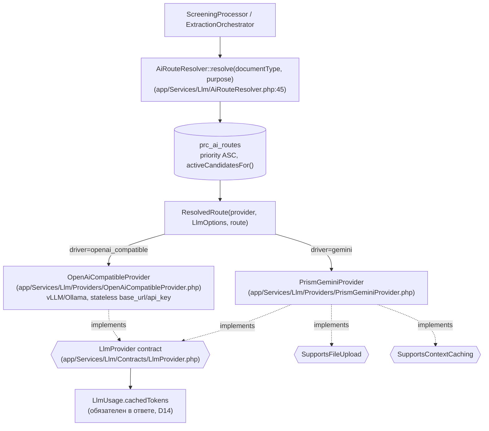

# LLM-провайдеры

Здесь будет: контракт `LlmProvider`, адаптеры (Gemini/OpenAI-совместимый), роутинг `prc_ai_routes`,
capability-based кэширование по провайдерам (D14), модели EOL/successor (D27).

## Д6 — LLM-слой: роутинг и адаптеры

Capability-based кэширование (D14): промт всегда prefix-stable (`PromptComposer`); опциональный
cache-hint интерпретируется адаптером — Gemini → `cachedContents` (`SupportsContextCaching`,
частично подключён — см. Known Deviations `ExtractionOrchestrator`), OpenAI/vLLM → no-op/
автоматический prefix-cache; `usage.cachedTokens` обязателен в ответе независимо от адаптера.
`shadowRoute()` (`app/Services/Llm/AiRouteResolver.php:74`) — теневой маршрут для сравнения
с локальной LLM (P9.4, `ShadowDispatch`).

Наполняется в P10.3 (развёрнутый текст: контракт, учёт стоимости, модели EOL D27).
