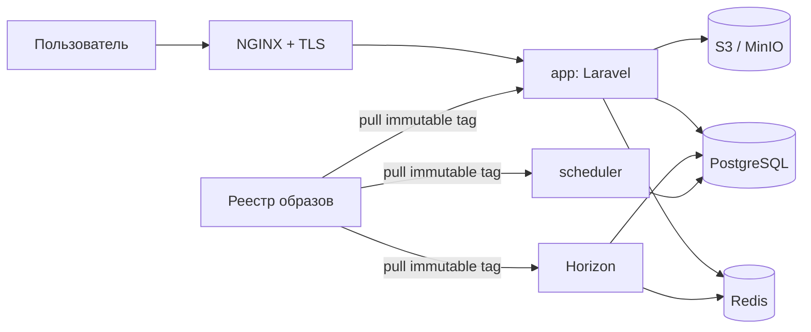
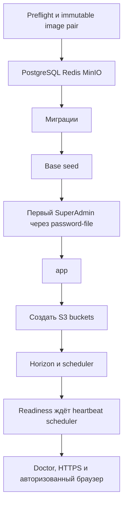

# Production: от чистого сервера до повторяемого релиза

Это основная инструкция по production для Agelto. Она рассчитана на один поддерживаемый сегодня
профиль: Ubuntu 24.04, один Docker-host, NGINX перед приложением, PostgreSQL, Redis и S3-совместимое
хранилище в Compose. Сначала пройдите её сверху вниз для нового сервера; после этого для обычных
изменений используйте только [сценарии повторного релиза](#5-повторный-релиз-уже-настроенного-окружения).

> **Как читать главу.** Это не описание замысла и не набор альтернатив. Блоки в разделе 4 — точный
> порядок первой поставки, проверенный на чистом изолированном Compose-проекте: каждый следующий
> блок запускается только после зелёного результата предыдущего. Команда `first-deploy:check` —
> справочный контракт порядка; она не заменяет команды ниже.

## 1. Что получится и что подготовить заранее

После прохождения у вас будет закрытый production-контур: приложение, Horizon и scheduler запускаются
из одного неизменяемого образа; данные и секреты не попадают в образ; внешний трафик идёт только через
NGINX и TLS; у релиза есть проверка готовности, а у данных — проверенный backup/restore путь.



Перед началом соберите в защищённом месте:

| Нужно | Зачем проверить до изменений |
|---|---|
| Домен, DNS A/AAAA и публичный IP | TLS выпускается только после подтверждения владения DNS. |
| SSH public key инженера и отдельный deploy key репозитория | Первым входит человек, вторым читает репозиторий; ключи не заменяют друг друга. |
| Полный SHA кандидата и immutable `IMAGE_TAG` | Сервер получает конкретный релиз, а не ветку и не `latest`. |
| Реестр, из которого host может выполнить `docker pull` | Host не собирает образ и не должен иметь исходники для сборки. |
| Root-only файлы `APP_KEY`, паролей БД/Redis/MinIO | Секрет не передаётся в CLI, env, логи или Git. |
| Данные подключения к PostgreSQL, Redis, S3 и SMTP | Их нужно проверять из runtime-контейнера, не только с ноутбука. |
| Владелец решения о миграции и начальном администраторе | Это отдельные изменяющие действия, не побочный эффект `up`. |

Поддерживается именно этот single-host профиль. Managed PostgreSQL, внешний Redis/S3, HA или DR —
не «незначительные параметры»: сперва нужна архитектурная схема, SLA и отдельная эксплуатационная
инструкция. Не переносите команды из этой главы в другую топологию по аналогии.

## 2. Подготовка чистого Ubuntu-сервера

Перед этой главой пройдите [Ubuntu → готовый checkout](server-setup.md). В ней указаны все
реальные команды: создание `deploy` и его SSH key, Docker, firewall, NGINX/Certbot, clone в
`/srv/agelto/repository`, заполнение production-profile, `.env.production` и `secrets:init`.
После её последнего зелёного `prod:config` возвращайтесь сюда; не заменяйте её разрозненными
командами `git clone`, `docker compose` или ручной генерацией паролей.

Войдите на новый Ubuntu 24.04 сервер и работайте из проверенного checkout кандидата. Сначала создайте
игнорируемый профиль из `docker/host/production-profile.example`; заполните только его допустимые
ключи, укажите абсолютные пути к отдельным файлам секретов и задайте права `root:root 0600`.

```bash
sudo make -f docker/Makefile host:check PROFILE=docker/host/production-profile
sudo make -f docker/Makefile host:apply PROFILE=docker/host/production-profile CONFIRM=apply
docker version
docker compose version
```

`host:check` не меняет машину. `host:apply` устанавливает Docker Engine/Buildx/Compose, создаёт
пользователя `deploy` и применяет только подтверждённый профиль. Право в группе `docker` фактически
равно root — не добавляйте туда обычных пользователей.

Не закрывайте исходную SSH-сессию. В новой сессии сначала проверьте ключевой вход как `deploy`, и
только затем установите SSH-fragment, проверьте конфигурацию и выполните reload:

```bash
sudo install -m 0644 docker/host/sshd_config.d/90-agelto.conf /etc/ssh/sshd_config.d/90-agelto.conf
sudo sshd -t
sudo systemctl reload ssh
```

Откройте только SSH, HTTP и HTTPS. Docker-порты могут обойти UFW, поэтому приложение и data-сервисы
должны слушать только loopback, а правило `DOCKER-USER` должно быть реально установлено и переживать
перезагрузку. После reboot выполните:

```bash
sudo make -f docker/Makefile host:preflight PROFILE=docker/host/production-profile
ss -lnt
docker info --format '{{.LoggingDriver}}'
```

Продолжать можно, только если `host:preflight` зелёный, SSH работает ключом, а из внешней сети не
видны PostgreSQL, Redis, MinIO и application-port.

## 3. Домен, TLS, репозитории и секреты

Сначала подтвердите, что A/AAAA домена указывают на нужный host. Затем установите HTTP-конфигурацию
`docker/host/nginx/agelto.conf` во временный файл, замените все `__AGELTO_*__`, выполните `nginx -t`,
получите сертификат Certbot, снова выполните `nginx -t` и только после этого reload NGINX. Конечная
проверка: HTTPS, redirect, forwarded headers, WebSocket upgrade и `certbot renew --dry-run`.

Для checkout и private Composer dependency подготовьте отдельные read-only deploy keys. Не
используйте личный token, agent forwarding или write key:

```bash
sudo make -f docker/Makefile repositories:prepare PROFILE=docker/host/production-profile
# Добавьте две напечатанные public keys в соответствующие GitHub repositories как read-only deploy keys.
sudo make -f docker/Makefile repositories:sync PROFILE=docker/host/production-profile
```

Файл `.env.production` содержит только несекретную конфигурацию. Создайте отсутствующие secret files
только через `make secrets:init`; повторный запуск сохраняет их байты. Не передавайте пароль как
argument, не добавляйте его в `.env.production` и не вставляйте в доказательства релиза.

## 4. Первый запуск: точная последовательность

Выполняйте команды от пользователя `deploy` в `/srv/agelto/repository`. Значения в первой группе
не являются секретами; они делают все последующие команды короче и гарантируют, что один запуск не
смешает два проекта или два image tag.

```bash
cd /srv/agelto/repository
export ENV_FILE=.env.production
export COMPOSE_PROJECT_NAME=agelto_prod
export IMAGE_TAG="$(awk -F= '$1 == "IMAGE_TAG" { print $2; exit }' "$ENV_FILE")"
test -n "$IMAGE_TAG" && test "$IMAGE_TAG" != latest
```

`cd` выбирает единственный checkout. `ENV_FILE` содержит non-secret production-настройки,
`COMPOSE_PROJECT_NAME` изолирует Docker-ресурсы Agelto, а `IMAGE_TAG` извлекается из того же файла,
который увидит Compose. Последняя команда должна завершиться без вывода; иначе заполните
`IMAGE_TAG` в `.env.production` и не продолжайте.



### Шаг 1. Проверить host, secrets и Compose без изменений

```bash
make -f docker/Makefile infra:preflight MODE=prod-runtime ENV_FILE="$ENV_FILE"
make -f docker/Makefile prod:config \
  ENV_FILE="$ENV_FILE" IMAGE_TAG="$IMAGE_TAG" COMPOSE_PROJECT_NAME="$COMPOSE_PROJECT_NAME"
```

`infra:preflight` проверяет Docker daemon, свободные порты, private vendor pin, схему env-файла,
права и полноту файловых secrets, затем рендерит Compose без pull/build/start. `prod:config` повторно
рендерит именно production Compose с выбранным tag. Оба результата должны быть зелёными; они ничего
не создают.

### Шаг 2. Войти в Docker Hub и получить пару образов

Текущий production contract использует имена `agelto/app` и `agelto/doctor`, то есть Docker Hub.
Если namespace закрыт, войдите токеном из файла `deploy` с правами `0600`. Введите имя Docker Hub пользователя в
терминале; токен не показывается и не передаётся в аргументах:

```bash
read -r -p 'Docker Hub user: ' REGISTRY_USERNAME
docker login --username "$REGISTRY_USERNAME" --password-stdin \
  < /home/deploy/.config/agelto/registry-password
make -f docker/Makefile prod:image:promote \
  ENV_FILE="$ENV_FILE" IMAGE_TAG="$IMAGE_TAG" COMPOSE_PROJECT_NAME="$COMPOSE_PROJECT_NAME"
```

Первая команда создаёт переменную только в текущей shell. Вторая читает токен из файла `0600` и
записывает Docker credential store пользователя `deploy`, не печатая token. `prod:image:promote` делает `docker pull` **обоих**
неизменяемых образов — app и Doctor — и не перезапускает сервисы. Если реестр публичный, login можно
пропустить; `prod:image:promote` всё равно обязателен.

### Шаг 3. Поднять только сервисы данных

```bash
make -f docker/Makefile prod:infra:up \
  ENV_FILE="$ENV_FILE" IMAGE_TAG="$IMAGE_TAG" COMPOSE_PROJECT_NAME="$COMPOSE_PROJECT_NAME"
```

Команда один раз собирает только локальный образ PostgreSQL с нужным расширением, затем запускает и
ждёт healthcheck `postgres`, `redis` и `minio`. Она не запускает PHP-приложение, не трогает volumes
существующего проекта и не собирает app image. Продолжайте только после exit code 0.

### Шаг 4. Применить схему и базовые данные

Перед миграцией выполните backup по [главе backups](backups.md) и получите явное решение владельца
о совместимости миграции. Затем:

```bash
make -f docker/Makefile prod:migrate OWNER_GATE=approved \
  ENV_FILE="$ENV_FILE" IMAGE_TAG="$IMAGE_TAG" COMPOSE_PROJECT_NAME="$COMPOSE_PROJECT_NAME"
make -f docker/Makefile prod:seed-base \
  ENV_FILE="$ENV_FILE" IMAGE_TAG="$IMAGE_TAG" COMPOSE_PROJECT_NAME="$COMPOSE_PROJECT_NAME"
```

`prod:migrate` запускает `php artisan migrate --force`; без буквального `OWNER_GATE=approved` он
откажется работать. `prod:seed-base` добавляет обязательные базовые справочники и идемпотентен.
Ни одна из команд не выполняет `migrate:fresh` и не удаляет данные.

После migration проверьте partition contract до включения workers: выполните
`docker compose --env-file "$ENV_FILE" --project-name "$COMPOSE_PROJECT_NAME" exec -T app php artisan partitions:maintain`.
Команда должна завершиться успешно; она запускает штатное обслуживание и откажется при разрыве
месячных партиций. Не исправляйте такой разрыв вручную удалением partition или `migrate:fresh`.

### Шаг 5. Создать первого администратора из file-secret

```bash
make -f docker/Makefile prod:admin:create \
  PASSWORD_FILE=local/secrets/admin_initial_password \
  ENV_FILE="$ENV_FILE" IMAGE_TAG="$IMAGE_TAG" COMPOSE_PROJECT_NAME="$COMPOSE_PROJECT_NAME"
```

Команда монтирует password-file read-only только в одноразовый контейнер и создаёт initial admin с
email из `ADMIN_EMAIL` в `.env.production`. Пароль не попадает в shell history, Compose env или
аргументы Artisan. Команда create-only: если пользователь уже существует, остановитесь и сверяйте
состояние, а не генерируйте нового администратора.

### Шаг 6. Запустить приложение, создать buckets и workers

```bash
make -f docker/Makefile prod:app:up \
  ENV_FILE="$ENV_FILE" IMAGE_TAG="$IMAGE_TAG" COMPOSE_PROJECT_NAME="$COMPOSE_PROJECT_NAME"
make -f docker/Makefile prod:storage:init \
  ENV_FILE="$ENV_FILE" IMAGE_TAG="$IMAGE_TAG" COMPOSE_PROJECT_NAME="$COMPOSE_PROJECT_NAME"
make -f docker/Makefile prod:workers:up \
  ENV_FILE="$ENV_FILE" IMAGE_TAG="$IMAGE_TAG" COMPOSE_PROJECT_NAME="$COMPOSE_PROJECT_NAME"
```

Перед включением document pipeline проверьте effective timeout contract внутри именно этого
Compose-проекта: `prepare` обязан быть на `redis_prepare` с 2580 < 2640 < 2700 s; screening —
240 < 300 < 420 s; extraction — checkpoint 120 s и 300 < 360 < 420 s. Horizon получает
`SIGTERM`, а `HORIZON_STOP_GRACE_PERIOD` не должен быть меньше 4200 s (он покрывает также
длинную archive lane). Не увеличивайте отдельный timeout без одновременного изменения всей
цепочки job → supervisor → retry_after → lease → graceful shutdown и зелёного
`pipeline-worker-recovery-contract.sh` на изолированном test-проекте.

`prod:app:up` запускает и ждёт healthcheck web-приложения. `prod:storage:init` создаёт основной и
estimates buckets в MinIO через credentials из file-secret; повторный запуск безопасен. Только затем
`prod:workers:up` поднимает Horizon и `schedule:work` и ждёт их healthcheck.

### Шаг 7. Дождаться scheduler heartbeat и проверить runtime

Scheduler записывает heartbeat по минутному расписанию, поэтому сразу после его старта readiness
может быть красным. Следующий цикл ждёт до 75 секунд, выводит результат каждой проверки и не
запускает вручную `schedule:run` (он мог бы выполнить другие production-задачи вне расписания):

```bash
for attempt in $(seq 1 15); do
  if make -f docker/Makefile prod:readiness \
    ENV_FILE="$ENV_FILE" IMAGE_TAG="$IMAGE_TAG" COMPOSE_PROJECT_NAME="$COMPOSE_PROJECT_NAME"; then
    break
  fi
  test "$attempt" -lt 15 || exit 1
  sleep 5
done

make -f docker/Makefile prod:doctor \
  ENV_FILE="$ENV_FILE" IMAGE_TAG="$IMAGE_TAG" COMPOSE_PROJECT_NAME="$COMPOSE_PROJECT_NAME"
curl --fail --show-error --silent "https://$(awk -F= '$1 == "APP_URL" { sub(/^https:\/\//, "", $2); print $2; exit }' "$ENV_FILE")/up" >/dev/null
```

`prod:readiness` проверяет DB, cache, S3, release state, assets, Horizon и scheduler. `prod:doctor`
запускает отдельный Doctor image и завершится с ошибкой при fail/warn; он не применяет auto-fix.
Последний `curl` доказывает доступность через TLS/NGINX, а не только внутри Docker. Все три проверки
обязаны завершиться с exit code 0.

### Шаг 8. Авторизованная browser-проверка и открытие трафика

Откройте `https://<ваш FQDN>/admin` в новом профиле браузера. Для входа используйте `ADMIN_EMAIL` из
`.env.production` и содержимое `local/secrets/admin_initial_password`; чтобы увидеть пароль локально
без попадания в history, выполните `less local/secrets/admin_initial_password` и выйдите клавишей
`q`. После входа проверьте страницу админки, затем откройте **напрямую**, а не через переходы:

```text
https://<ваш FQDN>/documentation/
https://<ваш FQDN>/documentation/04_Operators/production/server-setup
```

Обновите обе страницы. На второй должны быть стили, скрипты и SVG Mermaid-диаграммы, без 404 и
ошибок в browser console. Это доказывает авторизацию, прямой URL закрытой документации и правильную
работу asset base path. Лишь после этой проверки направляйте обычный production-трафик на сервер.

### Controlled-production gate парсинга

Успешный deployment/readiness не является разрешением на первое 72-часовое окно crawler'а. До
первого controlled request зафиксируйте отдельный owner carrier с точными environment,
crawler profile/filter, request ceiling и reversible stop action, а также immutable app/doctor
digest. На том же target выполните:

```bash
docker compose --env-file "$ENV_FILE" --project-name "$COMPOSE_PROJECT_NAME" -f docker-compose.prod.yml config --quiet
docker compose --env-file "$ENV_FILE" --project-name "$COMPOSE_PROJECT_NAME" -f docker-compose.prod.yml ps
docker compose --env-file "$ENV_FILE" --project-name "$COMPOSE_PROJECT_NAME" -f docker-compose.prod.yml exec -T app php artisan horizon:status
docker compose --env-file "$ENV_FILE" --project-name "$COMPOSE_PROJECT_NAME" -f docker-compose.prod.yml exec -T app php artisan config:show queue
docker compose --env-file "$ENV_FILE" --project-name "$COMPOSE_PROJECT_NAME" -f docker-compose.prod.yml exec -T app php artisan config:show horizon
docker compose --env-file "$ENV_FILE" --project-name "$COMPOSE_PROJECT_NAME" -f docker-compose.prod.yml exec -T app php artisan config:show partitioning
```

Все команды обязаны завершиться с exit code 0. Ненастроенный target, отсутствующий env/profile,
неизвестный digest или любой красный runtime check дают `NO-GO` до трафика; время такого preflight
не входит в 72 часа. Не создавайте локальный production-like stack вместо целевого окружения и не
переносите P4.1 probe scope в production неявно.

Зафиксированная попытка P4.3 от 2026-09-11 получила `NO-GO` до трафика из-за отсутствующих
`COMPOSE_PROJECT_NAME`, `.env.production`, host profile и доступного production target. Её artifact
остаётся nonterminal и продолжает тот же evidence chain после материализации prerequisites.

## 5. Повторный релиз уже настроенного окружения

В этом разделе не нужно заново настраивать ОС, DNS, TLS, deploy keys или секреты. Всегда начинайте
с вопроса «что изменилось?» и используйте таблицу ниже.

| Изменение | Что подготовить вне production host | Команда на host | Что не делать |
|---|---|---|---|
| PHP-код | Новый immutable `IMAGE_TAG`, собранный и опубликованный CI/build-machine | `make prod:deploy:code IMAGE_TAG=<tag> COMPOSE_PROJECT_NAME=agelto_prod ENV_FILE=.env.production` | Не запускать Composer или Docker build на host. |
| Composer dependency | Новый immutable tag с уже закрытым vendor | `make prod:deploy:php-deps IMAGE_TAG=<tag> COMPOSE_PROJECT_NAME=agelto_prod ENV_FILE=.env.production` | Не выполнять `composer install/update` на host. |
| Frontend/Filament assets | Новый immutable tag с уже собранными assets | `make prod:deploy:frontend IMAGE_TAG=<tag> COMPOSE_PROJECT_NAME=agelto_prod ENV_FILE=.env.production` | Не собирать Vite на host. |
| Runtime config, уже включённый в готовый tag | Готовый tag и проверенный non-secret `ENV_FILE` | `make prod:deploy:runtime IMAGE_TAG=<tag> COMPOSE_PROJECT_NAME=agelto_prod ENV_FILE=.env.production` | Не менять секреты через env или argv. |
| Новый готовый образ, который ещё не получен сервером | Опубликованный immutable tag | `make prod:image:promote IMAGE_TAG=<tag> COMPOSE_PROJECT_NAME=agelto_prod ENV_FILE=.env.production` | Не считать pull запуском нового кода. |
| Получить и сразу переключиться на готовый образ | Опубликованный immutable tag, approval на переключение | `make prod:deploy:image IMAGE_TAG=<tag> COMPOSE_PROJECT_NAME=agelto_prod ENV_FILE=.env.production` | Не использовать `latest`, `--build`, `down` или удаление volumes. |

### Что на самом деле означают классы релиза

Классы `code`, `php-deps`, `frontend` и `runtime` выражают **причину инвалидировать runtime** и
оставляют след в операции. Они не превращают immutable image в набор файлов, которые можно заменить
на host. Поэтому для любого изменения, попадающего в образ (PHP, Composer, frontend или `docs/`),
нужен новый tag, собранный вне production. Специальные команды экономят не сборку образа как таковую,
а опасную сборку **на сервере**: они делают pull/recreate готового tag с `--no-build` и не трогают
volumes.

Порядок повторного релиза: проверить кандидата и backup → при необходимости явно согласовать
совместимость миграции → promote/selected deploy target → readiness → Doctor → авторизованный
smoke/canary. Неизвестная совместимость схемы останавливает релиз до drain и promotion.

Если менялись `docs/` или граница закрытого портала, до promotion обязательно выполните на build
machine/CI:

```bash
make documentation:acceptance
```

## 6. Проверка результата и действия при проблеме

После каждого переключения зафиксируйте tag/digest, время, результат readiness и Doctor. Проверьте:

1. `app`, `horizon` и `scheduler` запущены; Horizon не потерял долгую job во время recreate.
2. `app:readiness` зелёный: он проверяет DB, cache, storage, release state, Filament assets,
   Horizon и heartbeat scheduler.
3. В браузере проходит авторизованное полезное действие; `/up` не заменяет этот smoke-test.
4. Логи не показывают burst новых ошибок; backup остаётся виден и проверен restore-ом.

При неудаче не удаляйте volumes, не запускайте `migrate:fresh`, не переключайте тег «на глаз» и не
редактируйте state вручную. Сохраните tag/profile/state, остановитесь на первом красном gate и
выберите нужный путь:

| Ситуация | Безопасный следующий шаг |
|---|---|
| До promotion не прошла проверка | Исправить prerequisite и повторить тот же check. |
| Новый runtime не прошёл readiness/canary | Вернуть известный previous immutable digest только при явно подтверждённой schema compatibility. |
| Нужны данные, а не только код | Восстанавливать только из проверенного manifest в отдельно allowlisted `*_rehearsal` target. |
| Неясен симптом | [Production troubleshooting](troubleshooting.md), не произвольная последовательность команд. |

## Связанные справочники

Эта глава содержит основной путь. Для редких операций и детальных ограничений используйте
[backups](backups.md), [ротацию секретов](secret-rotation.md), [откат и restore](rollback-restore.md)
и [справочник команд](commands.md). Они дополняют последовательность, но не меняют её.
