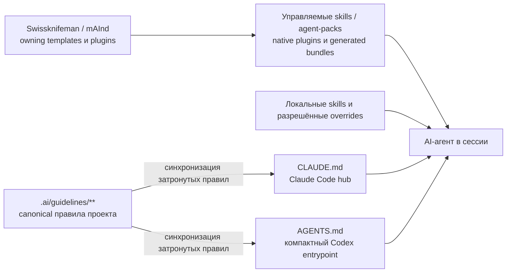

# AI-контур проекта

Устройство агентского контекста проекта: общие инструкции, локальные skills и управляемые
интеграции Claude Code/Codex. LLM-пайплайн документов и смет описан в [`ai/prompts.md`](../ai/prompts.md).

## Источники и потребители

## Что коммитить

### Выбор providers и plugins

Настройку providers, plugins и connections ведёт skill `ecosystem-setup` через owning
инструменты Swissknifeman/mAInd. `.agents/plugins/**` и
`.agents/.swissknifeman-codex-links.json` — управляемые bundles/links; вручную их не редактируют.
Локальные настройки и caches не заменяют canonical инструкции проекта.

- `.ai/guidelines/**` — ЕДИНСТВЕННЫЙ источник для agelto-специфичных правил (архитектура, глоссарий,
  навигация, PR-чеклист, шаблоны задач). Коммитится всегда.
- `CLAUDE.md` и `AGENTS.md` — трекаемые entrypoints. Сначала меняют `.ai/guidelines/**`, затем
  синхронизируют затронутые правила в обоих файлах. Laravel Boost служит MCP-инструментом.
- Локальные `.claude/skills/**` без managed/generated-маркера можно редактировать и коммитить.
  Перед правкой проверяют заголовок: явно указанный mAInd owning template также означает
  управляемую копию, независимо от `source: local` в lock-файле.
- Managed skills и generated agent-packs обновляют у владельца через штатный канал доставки;
  правила `swissknifeman:managed`, `swissknifeman:generated` и extension-points указаны в файлах.
  Каталог `.claude/rules/**` содержит и generated правила, и разрешённые проектные overrides
  (например `agelto-reviewer-overrides.md`); владение определяют по заголовку каждого файла.
- Перед изменением/коммитом проверяют `git status` и `git check-ignore` целевого пути. Полные
  каталоги skills между providers вручную не копируют.

## Цикл редактирования

Native Planner владеет активным plan state; его execution-input задаёт текущий scope и authority.
Исполнитель возвращает stage-report, координатор принимает evidence и ведёт lifecycle/коммиты.
Task Layout v2 и `plans/archive/**` сохраняются как история; их lifecycle-команды не запускают.

Для AI-контекста цикл: canonical правило → синхронизация затронутых entrypoints/local skills →
проверка ссылок и фактов → коммит. Подробности — skill `ai-context-workflow`. Проверки выполняют
через изолированный `core-*` rig по `testing-rules`.

## Смежное

- [`scenarios.md`](scenarios.md) — какие скилы подключать в каком порядке под конкретную задачу.
- [`subagents-and-workflows.md`](subagents-and-workflows.md) — роли агентов и dev-loop проекта.
- `.ai/guidelines/navigation.md` — Reference Table (маршрутизация по доменным терминам/задачам).
- `docs/meta/editing.md` — как править саму документацию `docs/` (не путать с `.ai/`-контуром).
