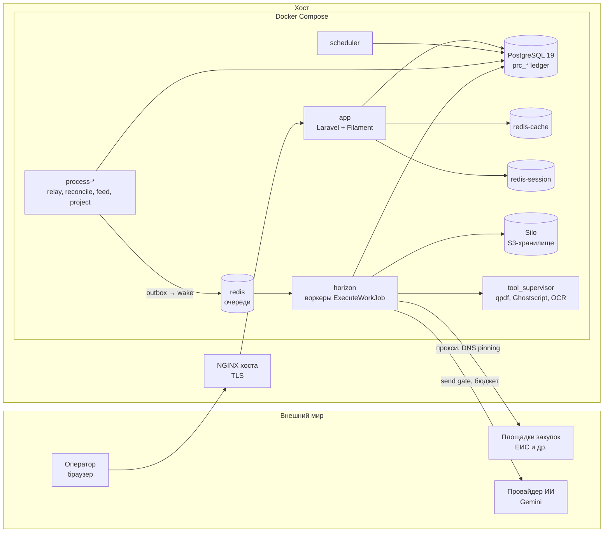
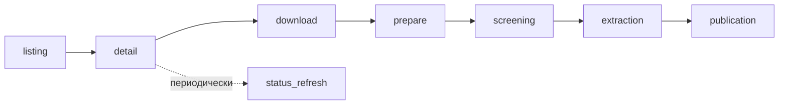
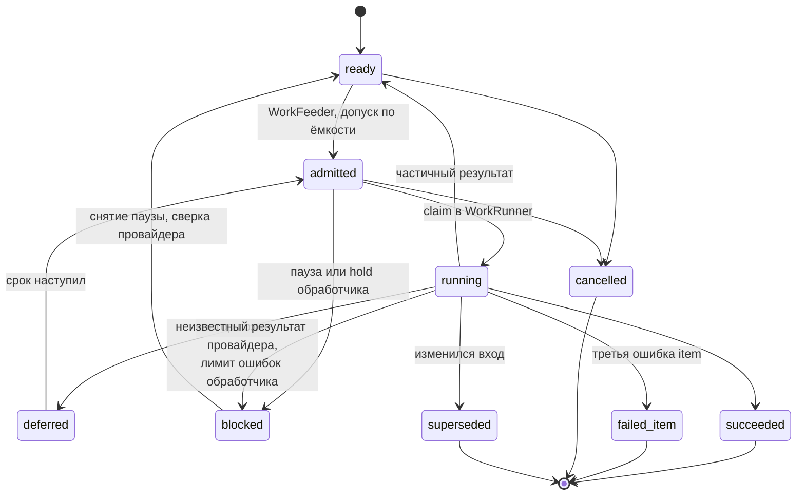
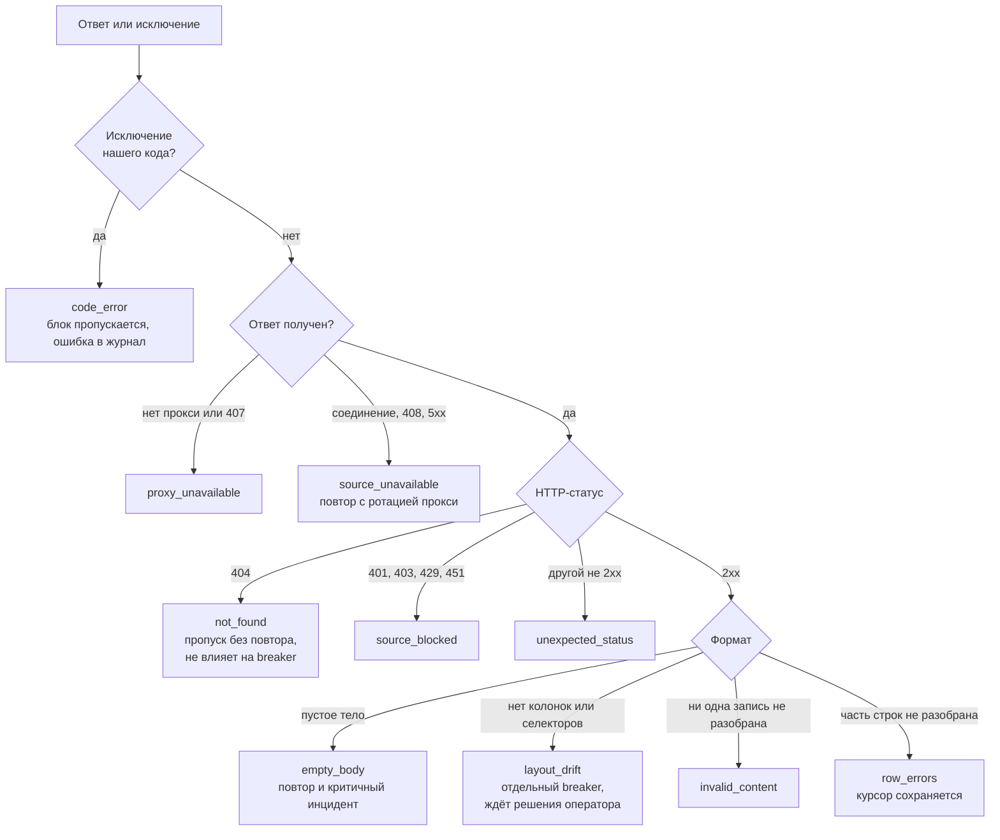
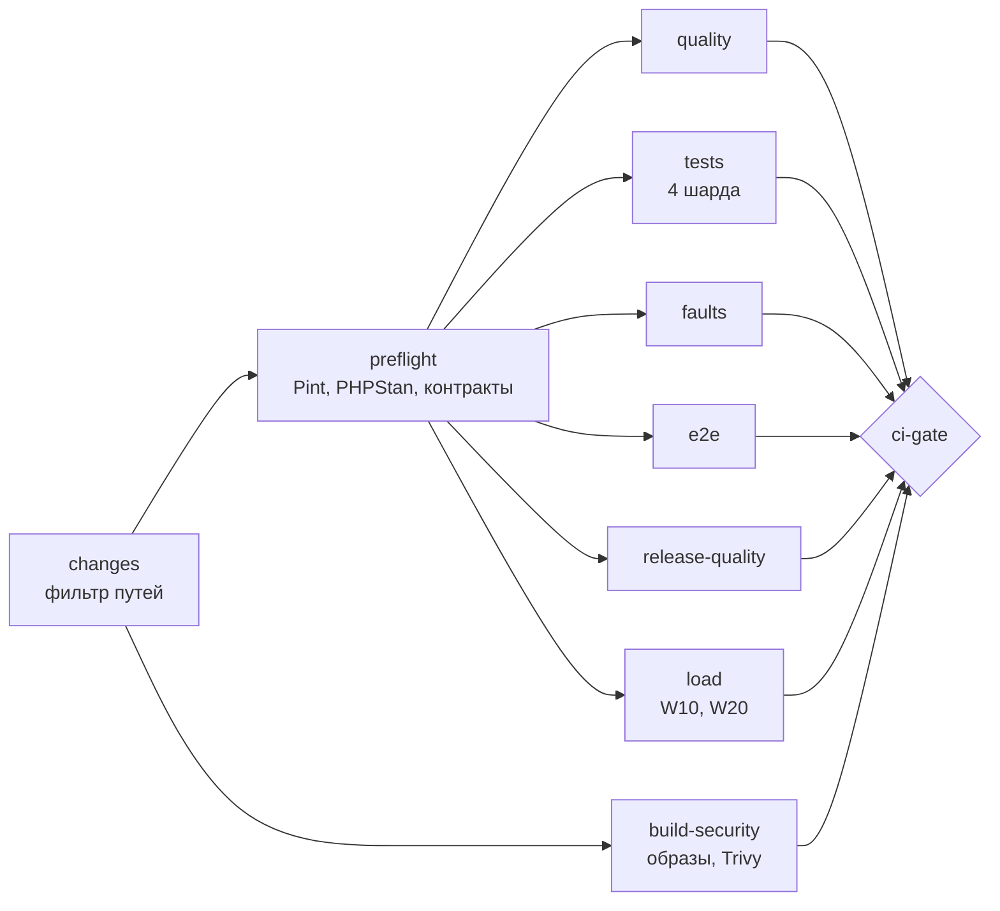

# Обзор архитектуры в схемах

Страница даёт общую картину на одном экране: из чего состоит система, как работа проходит
через Process Core, как классифицируются отказы источников и как устроен CI. Подробности и
точные контракты — на страницах, на которые ведут ссылки в каждом разделе. Версии окружения
перечислены в [обновлении окружения](runbooks/environment-upgrade.md).

## Компоненты и потоки данных

Источник истины для исполнения — PostgreSQL: work, попытки, переходы и outbox живут в таблицах
`prc_*`. Redis только доставляет сообщения; при его потере reconcile и relay восстанавливают
доставку из PostgreSQL. Сетевые вызовы и объектный I/O не выполняются внутри открытых транзакций
БД. Подробнее: [архитектура](architecture.md), [Process core](process-core.md),
[восстановление](runbooks/process-recovery.md).

## Стадии конвейера

Основной источник листинга — выгрузка CSV площадки, HTML-обход — запасной путь. Каждая стадия
выполняется одним `ExecuteWorkJob` по work из ledger; стадии ИИ (`screening`, `extraction`)
проходят через финансовый gate отправки и бюджет. Подробнее:
[краулинг](crawling-pipeline.md), [документы](document-pipeline.md),
[поставщики LLM](llm-providers.md).

## Жизненный цикл work

Терминальные состояния (`succeeded`, `failed_item`, `cancelled`, `superseded`) никто не
переписывает. Каждый переход — одна транзакция с записью перехода и outbox. Полная таблица
переходов и владельцев: [Process core → State machine](process-core.md#state-machine).

## Классификация отказов источника

Классификация детерминирована: учитываются только тип исключения, HTTP-статус и проверка
формата ответа (`SourceFailureKind`). Вид отказа описывает факт, а реакция на него задаётся
политикой.

Здоровье маршрутов прокси и целей считается отдельно (route-global, route-target, target),
429 не вызывает ротацию, а 407 удерживает версию учётных данных. Подробнее:
[Process core](process-core.md), [сетевой слой краулинга](crawling-pipeline.md).

## CI

Репозиторий рассчитан на закрытый режим, поэтому CI экономит минуты: фильтр путей решает, какие
задачи нужны, устаревшие прогоны той же ветки отменяются, зависимости кэшируются, а все actions
закреплены по SHA.

`ci-gate` — единственная обязательная проверка: она запускается всегда и падает, если упала
любая нужная задача. Пропущенная по фильтру задача считается успешной. Workflow запускается на
pull request, push в `main`, еженедельное расписание, публикацию релиза и вручную
(`workflow_dispatch`). На pull request идут `quality` и `tests`; `faults` и `e2e` добавляются на
остальных событиях, а `load` (ширина 10 и 20) и `release-quality` — только по расписанию, на
релизе и вручную. Тесты используют изолированный стенд
([process-test-rig](runbooks/process-test-rig.md)).
