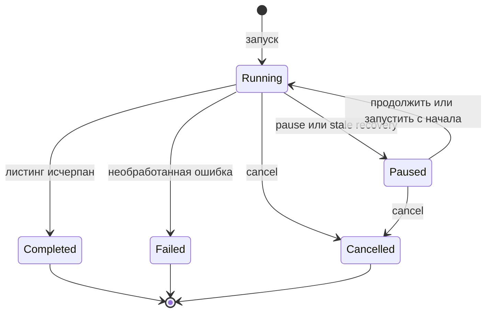
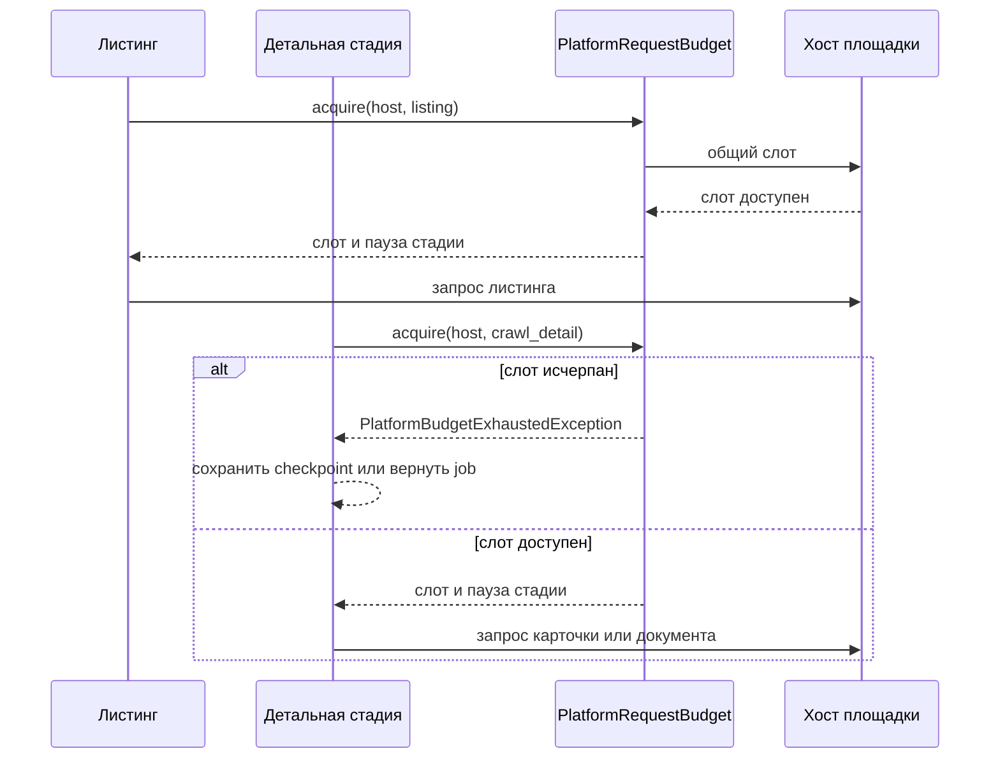
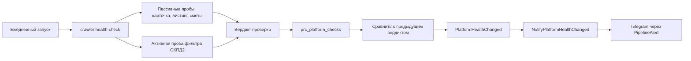

# Краулинг: internals

Краулинг реализован вне плана EST-AI (до его старта) — этот раздел даёт входную карту для
разработчика; полный рефакторинг/переписывание вне scope EST-AI (Scope Excluded P10.2/P10.3:
«диаграммы краулинга»). Бизнес-описание стадий — `docs/workflow/crawling-and-discovery.md`.

## Граница источника

Метод получения данных выбирается профилем, а не ветвлением ядра: площадко-специфичные URL,
форматы и разбор карточки изолированы в адаптерах. Для ЕИС листинг и карточка доступны по HTTP;
браузер остаётся резервной границей для площадки с клиентским рендерингом. Повторный инжест
безопасен по естественному номеру закупки, а курсор и heartbeat позволяют продолжить прерванный
прогон. Конкретные реализации, фильтр профиля и фактические ограничения ЕИС приведены ниже.

## CSV reliability and stage-one operation

ЕИС CSV читается потоком логических записей: quoted CR/LF, `;` и `""` сохраняются внутри поля.
Неравная ширина, незакрытые/некорректные кавычки, пустые/повторные имена колонок и отсутствие
`Реестровый номер закупки`, `Дата размещения`, `Дата обновления` отклоняют весь ответ.
Header-only CSV допустим как пустая выдача; пустое тело, HTML и конечный неуспешный HTTP — нет.
Отсутствие обязательного номера/дат и невозможные календарные даты дают mapping error.
Ошибка не позволяет считать день дренированным. Отвергнутый HTTP/CSV сохраняется отдельным
Fetch с `rows_errors=1` и `_rejection_reason` в `request_params`, под execution lease.
При mapping error атомарный archive ingestion откатывается вместе с cursor/stats/Fetch;
immutable raw object остаётся, повтор читает тот же незавершённый блок.

`CRAWLER_DOWNSTREAM_ENABLED=false` (`crawler.downstream_enabled`, по умолчанию true) отключает
последующие стадии: прямую/пакетную детализацию, backlog, revalidation, retry/recovery,
ручные AI-входы и подготовку дочерних документов архива. Уже поставленные detail и все
`PipelineJob` завершаются до чтения сущности, lease, HTTP и error counters. После включения
обычные due/backlog/recovery заново подбирают durable state; эти no-op jobs не освобождаются
через queue retry. Активную работу флаг не прерывает: для смены режима сначала дождаться
исполнителей. В январском аудите также остаются false оба AI-флага, а worker обслуживает
только `redis_crawl_long/crawl_long`; общий scheduler/Horizon в этом сценарии не запускается.
Флаг не ограничивает listing других профилей и не заменяет выбор утверждённого профиля.

## Raw fetch evidence

Raw CSV и сохранённые HTML snapshots адресуются content-addressed ключом: в пути есть SHA-256
нормализованной request identity и SHA-256 фактических байтов. Поэтому одинаковый replay переиспользует
тот же объект, а разные окна CSV, вкладки или ревизии не могут перезаписать ранее сохранённые bytes.
Путь не содержит query-параметров, URL или учётных данных. Перед тем как `prc_fetches.artifact_ref`
ссылается на объект, write проверяется через read-back; неуспешная запись не создаёт Fetch с ложной ссылкой.

Это неизменяемость в пределах retention носителя raw artifacts, а не обещание бесконечного хранения:
срок хранения и удаление объектов задаются отдельной эксплуатационной политикой.

## Вход: команды-диспетчеры, обход — на очереди (P3.2)

Fresh- и archive-обход исполняются job'ом `App\Jobs\Procurement\CrawlRunJob` на profile-driven
execution lane Horizon — как и AI-пайплайн (`document-pipeline.md`). `standard` использует
`redis/crawl` (`supervisor-crawl`, timeout 300s, retry_after 420s); временный архивный `long` —
`redis_crawl_long/crawl_long` (`supervisor-crawl-long`, 3600s/3900s). Это lease ОДНОЙ job, не
лимит всего crawl: курсор остаётся гарантией resume, а connection оба используют один Redis.
Artisan-команды (`app/Console/Commands/Procurement/`) остались тонкими диспетчерами: резолвят
профиль(и) и диспатчат job, сам обход в процессе команды больше не идёт.

- `crawler:run-fresh {crawler?}` (`RunFreshCrawler`) — диспатчит `CrawlRunJob(mode: Fresh)` по
  профилю(-ям) площадки, обычно из `schedule:work` (`scheduler`-контейнер) или вручную.
- `crawler:run-archive {crawler} {--from=} {--to=}` (`RunArchiveCrawler`) — диспатчит
  `CrawlRunJob(mode: Archive, from, to)` за диапазон дат.
- `crawler:fetch-details {procurement?}` (`FetchDetails`) — тонкий диспетчер `crawl_detail`: с
  явным id ставит одну закупку, без аргумента — ограниченную `dispatch_batch_limit` due-пачку.
  `DetailRefetchSelector` отдаёт сначала ни разу не снятые закупки, затем самые старые
  `detail_fetched_at`, со стабильной развязкой по id; расписание раз в пять минут защищено
  `withoutOverlapping()`.
- `crawler:rescan-backlog` (`RescanBacklog`) — пересканирование зависшего/пропущенного бэклога;
  синхронна.
- `crawler:recover-stale` (`RecoverStaleRuns`, планируется `everyFiveMinutes()`) — поднимает
  `running`-прогоны с протухшим heartbeat в `paused` только без действующего execution lease:
  активный owner не может быть остановлен старым heartbeat. Сравнение heartbeat и lease делает
  PostgreSQL своими часами; упавший воркер с истёкшим lease оставляет точный cursor для resume.

`CrawlRunJob` — checkpoint-requeue (`ShouldBeUniqueUntilProcessing`, тот же приём, что
`EstimateExtractionJob`): бюджет одного запуска — `config('crawler.run.checkpoint_seconds')`
(240с), а `crawler.fresh_max_blocks` — safety cap, но не terminal stop. По исчерпании любого из
них `FreshRunProcessor` выходит с сохранённым курсором и статусом `running`, job самодиспатчится
ровно одним продолжением. `Completed` допустим только после source-safe stop: пустой listing либо
доказанное пересечение known boundary. Для archive `ArchiveWindowScanner` возвращает
`ArchiveWindowScanResult`: только `Drained` разрешает дневной обёртке перейти к следующему дню;
`PlatformBudgetExhaustedException` становится `Checkpointed` через
`CrawlerRunManager::recordCheckpoint()`, а операторский pause/cancel — `Stopped`. Оба исхода
сохраняют текущие день и ценовой стек. Archive продолжает существующий `CrawlRunJob` в том же
execution lane; delta ждёт следующего cron, а backlog — следующего 15-минутного sweep без записи
`backlog_rescanned_at`. `OperatorDebt` сохраняет тот же ценовой стек и не даёт ни перейти к
следующему дню, ни поставить отметку rescan; оператор должен изменить лимит/разрешить источник,
после чего тот же run продолжится с checkpoint. Новый job, retry-loop или sleep для этого не создаются. Для сида архива
2025 long lane остаётся конечным; если фактическая длительность превысит час, не поднимать timeout
молча — снять HTTP/throttle/DB-метрики и принять отдельное решение.

Backlog и delta имеют два уровня защиты от параллельного запуска. Планировщик использует именованный
`withoutOverlapping()` lock в общем production cache, но корректность обеспечивается только
PostgreSQL lease строки `prc_crawler_runs`: процесс получает случайный owner token, продлевает
600-секундный lease с каждым heartbeat и может менять cursor, stats или завершать run только пока
токен совпадает и lease не истёк по часам PostgreSQL. Listing request выполняется вне DB-lock, а
его ingestion вместе со stats и checkpoint проходит в короткой PostgreSQL-транзакции, которая
берёт lock строки run и renews/fences lease до любых записей: takeover ждёт commit/rollback, а
бывший owner после takeover не может сохранить блок. Второй ручной либо multi-host запуск
возвращает busy без обращения к scanner; команда
`crawler:run-delta` отдельно сообщает этот исход. После crash expiry следующий запуск забирает
тот же run и его сохранённый cursor.

Детальная стадия работает отдельным `FetchProcurementDetailJob` на `redis/crawl_detail`
(`supervisor-crawl-detail`, timeout 300s < retry_after 420s). Job — `ShouldBeUnique` по id
закупки и не имеет свойств очередного ретрая: retry остаётся в `detail_*` на закупке. После
успешного `DetailAnalysisProcessor::run()` job передаёт скачанные документы в `PipelineDispatcher`;
исчерпание platform budget возвращает job без error-блока, роста `detail_attempts` или передачи в
мост. Лимит пачки — `crawler.stages.detail.dispatch_batch_limit` (100 по умолчанию, не
калиброван) и проходит через `CrawlSettingsResolver`/`StageSettings`.

Остановить УЖЕ ВЫПОЛНЯЮЩИЙСЯ job средствами Laravel/Horizon нельзя — остановка кооперативна:
`App\Services\Procurement\RunStopGate::signal()` читает `prc_crawler_runs.stop_requested_at`/
`stop_kind` между блоками и HTTP-попытками (`FreshRunProcessor::run()`, `ArchiveWindowScanner::scan()`), сигнал
`Pause` сохраняет курсор и переводит в `paused` (resumable), `Cancel` — в `cancelled`
(терминальный). Флаг выставляет операторское действие в админке (P3.4) — P3.2 несёт только
механизм, кнопок нет. `CooperativeListingSourceMethod` получает `ListingExecutionContext`: deadline
одного slice и checkpoint, который обновляет heartbeat/fences lease и применяет stop. Budget,
throttle и retry waits дробятся максимум по секунде; текущий HTTP ограничен оставшимся deadline
с 5-секундным запасом, но не прерывается мгновенно. Исчерпание deadline даёт Checkpointed,
не Drained. Контрольные listing-пробы без run сохраняют свой ограниченный request budget.

Прогон (`$run`, `App\Enums\Procurement\Crawler\RunStatus`: running/paused/completed/failed/cancelled)
оркеструется `App\Services\Procurement\CrawlerRunManager`.

`startOrResume()` принимает типизированный owner (purpose + subject), а не только `crawler_id`:
running-прогон можно вернуть лишь тому же owner. Создание и recovery гонки unique-индекса происходят
в короткой PostgreSQL-транзакции; recovery create изолирован savepoint, поэтому последующее чтение
не выполняется в aborted transaction. Это не меняет правило «один running на crawler», а запрещает
delta/backlog дописывать курсор или завершать операторский archive-run другого subject.

Диаграмма Д8 использует только `RunStatus`: checkpoint по времени или исчерпанный бюджет не меняют
`running`, а сохраняют курсор и ставят продолжение той же job в очередь.

Курсор несёт и состояние detector-а потолка листинга (`dedup_signature` и число повторов). Fresh
проверяет exact repeat до source-safe terminal conditions; пустой или неизменившийся непустой блок
не равнозначен completed. Для ЕИС суточная «Дата обновления» несёт явную mapper-provenance: same-day
страницы дочитываются до строгого предыдущего дня, а не завершаются по полуночи. Archive
восстанавливает detector при каждом continuation и сбрасывает его только при переходе на другой
ценовой интервал. Поэтому повтор последнего блока ЕИС не маскируется как нормальная остановка и
checkpoint не обходит cap.

## Общий бюджет запросов

`PlatformRequestBudget` — единственный fixed-window счётчик по хосту площадки. Листинг, снятие
карточек, скачивание документов и служебные пробы берут слот из одного ключа; после слота сервис
добавляет паузу конкретной стадии. При отсутствии слота он ждёт только до настроенного предела и
выбрасывает `PlatformBudgetExhaustedException`: текущая стадия сохраняет безопасную точку
продолжения или возвращает задачу без ложной ошибки.

## Наблюдаемость

Каждый HTTP-забор пишет `prc_fetches` через единственный `FetchLogger`: листинг связан с прогоном,
а detail/document — с закупкой. В строке видны стадия, статус ответа, длительность, прокси и ожидание
слота. Суммарное и максимальное ожидание листинга сохраняются в `prc_crawler_runs.stats`.
Для листинга `rows_parsed` и `rows_errors` отделены от business-delta (`rows_new`/`rows_updated`):
повтор уже известной, но корректно распарсенной строки остаётся здоровым наблюдением, а mapping error
не теряется в нулевом delta. `ListingShapeCheck` оценивает именно parse/error share; старые записи с
null-telemetry остаются unknown, а не становятся искусственно healthy или broken.
Операторские сбои пишутся через `OperationLogWriter` в `prc_operation_logs`; read-only витрина
«Краулинг → Operation logs» фильтрует их по уровню, стадии и сущности. Файловые `Log::*` остаются
для разработчика и не заменяются этой витриной.

Каждая HTTP-попытка пишет безопасное событие `Crawler outbound attempt` через `Log::info`: run/crawler,
SHA-256 идентичности host+отсортированных параметров, attempt/max, proxy ID, время/длительность,
HTTP либо закрытую причину транспорта, budget wait и решение retry. URL, credentials и сырые
transport messages туда не попадают; окончательная transport exception тоже содержит только enum.
События идут в настроенный application log, не требуют миграции и не являются новыми Fetch.

После исчерпания сетевых попыток run по-прежнему Failed. `startOrResume` и stale recovery
не выбирают Failed; автоматическая recovery-политика не введена. Нужны согласованные лимит
повторных запусков, eligibility и срок ожидания breaker с сохранением execution context.
До этого оператор после cooldown запускает ограниченное продолжение штатным action/command,
не меняет статус SQL и не сбрасывает proxy health. Это отдельный исход от checkpoint continuation.

## Мост в AI-пайплайн

Точка передачи — `PipelineDispatcher` (`app/Services/Procurement/PipelineDispatcher.php`):
`dispatch()` сразу после `FetchProcurementDetailJob`, `dispatchBacklog()` — everyMinute-поллер бэклога.
`DocumentDownloader` (`app/Services/Procurement/DocumentDownloader.php`) доводит документ до
статуса `downloaded` — с этого момента начинается зона ответственности `document-pipeline.md`
(Д2, узел `PipelineDispatcher`).

## Площадки и извлечение деталей

`Services/Procurement/Eis/**` — ЕИС-специфичные адаптеры (`EisCardUrlBuilder`, `CsvSourceMethod`,
`EisCsvRowMapper`/`EisCsvUrlBuilder`); `Services/Procurement/Detail/**` — процессоры деталей закупки
(`CommonInfoProcessor`, `EventJournalProcessor`, `OrganizationPartiesProcessor`,
`SupplierResultsProcessor`); `ArchiveWindowScanner`/`ProxyResolver`/`PoliteThrottle` — вспомогательная
инфраструктура обхода. Шов `prc_eis_details` подтверждён аудитом схемы БД как расширяемый на другие
источники (не завязан на ЕИС жёстко, D-требование универсальности плана EST-AI).

`CrawlerRuntimeOptions` принимает legacy `records_per_page` и ранее сериализованный `recordsPerPage`,
выдаёт канонический `records_per_page` и отклоняет конфликт значений двух вариантов и неизвестные
ключи. Typed options можно присваивать другому Crawler и сохранять без raw-JSON обхода.

## Типизированный фильтр профиля

`prc_crawlers.filter` хранится прежним `jsonb` (схема не менялась), но наружу отдаётся типизированным
`spatie/laravel-data`-объектом — состав полей определяется площадкой, а не общим мешком ключей.
Резолв класса фильтра — по коду реестра через `CrawlerFilterFactory::for(Registry): class-string<Data>`
(config-карта `crawler.filters`, тот же приём, что `SourceMethodFactory`/`crawler.source_methods`;
`match`-лестниц и `if ($registry->code === …)` в билдере нет). Для ЕИС/44-ФЗ —
`App\Dto\Procurement\Crawler\EisSearchFilter` (`app/Dto/Procurement/Crawler/EisSearchFilter.php`):
этапы закупки (`stageApplications`/`stageCommission`/`stageCompleted`/`stageCancelled`), цена
от/до (`priceFrom`/`priceTo` — `priceTo = 0` запрещён валидацией: у площадки это обнуляет выдачу,
а не снимает ограничение), даты публикации, строка поиска + флаг морфологии. Неизвестный ключ
фильтра отклоняется ДВАЖДЫ — явной проверкой в `EisSearchFilter::validateAndCreate()` (родитель
`spatie/laravel-data` лишние ключи молча игнорирует) и хуком модели `Crawler::booted()` на
`saving` — опечатка оператора не должна дожить до боевого запроса. Только площадко-специфичные
параметры, у которых фильтрующее действие подтверждено живой пробой, входят в контракт; поля со
статусом «не установлено» (например, `okpd2Ids`) в DTO намеренно отсутствуют. Перевод типизированных
полей в конкретные query-параметры площадки (`stageCompleted`→`pc=on`, форматы дат) живёт РОВНО в
билдере площадки (`EisCsvUrlBuilder::filterParams()`) — DTO несёт смысл, не представление площадки.

## Отслеживание изменений: перекрытие, delta-scan, дедуп, метрика отставания

- **Перекрытие окон** — `config('crawler.tracking.window_overlap_days')` (стартовое значение — 2
  суток): и рескан бэклога (`BacklogRescanProcessor::drainWindow()`), и плановый суточный дозор
  сдвигают старт окна назад на эту величину. Источник (ЕИС) отдаёт дату обновления с точностью до
  суток, а расписание работает в UTC против часовых поясов заказчиков по стране — без запаса
  обновление на границе окна теряется.
- **Плановый суточный дозор (delta-scan)** — `App\Services\Procurement\Modes\DeltaScanProcessor`
  (переиспользует `ArchiveWindowScanner`; archive-профиль несёт runtime-настройки, а typed
  `RecoveryScope` сохраняет предметный фильтр исходного fresh-профиля) +
  команда `crawler:run-delta {crawler?}`; регистрация в `routes/console.php` — под флагом
  `config('crawler.tracking.delta_scan_enabled')` (по умолчанию `false`, включается владельцем
  ПОСЛЕ боевого прогона площадки) и cron `config('crawler.tracking.delta_scan_cron')`
  (`'0 23 * * *'` UTC — единственное измерение темпа сдвига выдачи снято ночью).
- **Дедуп внутри блока** — `CsvBlockIngestor::ingest()` схлопывает строки одного блока по реестровому
  номеру ДО инжеста (первая строка выигрывает), считает схлопнутые в `FetchResult::$rowsDuplicated`
  и пишет `Log::warning` при значении > 0; актуально для многолотовых процедур (223-ФЗ), где один
  блок может нести несколько строк на один номер.
- **Метрика отставания** — `prc_crawler_runs.stats` (jsonb, без миграции): `scan_gap_seconds`
  (пауза от завершения предыдущего прогона профиля до старта текущего) и `oldest_update_seen`
  (минимальная «Дата обновления» в снятых блоках), пишутся только fresh-прогоном
  (`CrawlerRunManager::recordScanGap()`/`recordOldestUpdateSeen()`).

## Сиды площадки ЕИС

`database/seeders/Procurement/EisPlatformSeeder.php` заводит площадку `code=eis`, реестр `fz44` и
его `settings` (`procedure_url_types` — сегменты URL по способу закупки, `card_url_templates` —
шаблоны вкладок карточки по типу процедуры); `CrawlerProfileSeeder.php` — два профиля обхода
(архивный, `filter=stageCompleted:true`, `execution_lane=long`, `is_active=true`, запуск явной командой; «свежий поток»,
`filter` пуст — обязан видеть любое обновление, `is_active=false` до решения владельца о запуске
боевого слежения, `execution_lane=standard`, `schedule='*/30 * * * *'`). Оба сидера `updateOrCreate`-идемпотентны, но
`CrawlerProfileSeeder` перезаписывает профиль безусловно — повторный прогон стирает правки,
сделанные оператором в форме краулера.

## Живые ограничения площадки ЕИС

Снято живой разведкой 2026-08-04/05 (`plans/archive/2026.07.31-SYS-INTEGRITY/findings/P4-eis-recon.md`,
`findings/P4-load-baseline.md`):

- Реальный потолок глубины листинга — **5 000** записей на выборку (не ≈10 000, как считалось
  раньше по устаревшей разведке) — за пределом площадка молча повторяет последний блок
  (`dedup_signature` совпадает с предыдущим), а не отвечает ошибкой.
- Блок выгрузки — 500 строк за запрос; троттлинг — 1000–4000 мс между запросами.
- Ценовое дробление архивного обхода: `archive.max_blocks_per_window` откалиброван до **12**
  (наблюдённый максимум — 11 блоков на ценовой интервал); `archive.price_ceiling` (1 млрд ₽) и
  `archive.min_price_interval` (1000 ₽) подтверждены боевым прогоном без изменений.
- **Доверие TLS площадки прошито в образе, не в системном доверенном наборе.** Площадка использует
  сертификат российского удостоверяющего центра; бандл (`docker/php/certs/russian-trusted-ca.pem`)
  копируется в образ фиксированным путём (`docker/php/Dockerfile`, `update-ca-certificates` НЕ
  вызывается — доверие не должно расширяться на прочий исходящий трафик приложения). Единственный
  читатель — `App\Services\Procurement\SourceTlsTrust::optionsFor(string $host)` по карте
  `config('crawler.tls.bundles')`; результат складывается с опциями лизы прокси на обоих боевых
  call-site'ах (`CsvSourceMethod::request()`, `DocumentDownloader::request()`). `verify => false`
  запрещён абсолютно — у правила ровно один носитель.

## Раскладка HTML детальной карточки (снято 2026-08-05)

Вёрстка страницы карточки менялась с последней разведки — актуальная раскладка (селекторы, откуда
берётся каждый блок) снята живой пробой и записана в
`plans/archive/2026.07.31-SYS-INTEGRITY/findings/P4-card-layout.md`; при следующей смене вёрстки источника
пере-снимать оттуда же (карточка не версионируется площадкой явно, признак смены — падение парсера
на живом прогоне, не заранее известная дата). Кратко: вложения — `div.blockFilesTabDocs` →
`div.attachment` → ссылка `filestore` (имя файла — атрибут `title`, не текст ссылки); общие данные
карточки — плоские пары `section.blockInfo__section` (не `dt`/`dd`, как считалось раньше); журнал
событий — `table#event.displaytagTable`; финансирование — год в ЗАГОЛОВКЕ колонки (не в строке);
код классификатора позиции — один код на ячейку, признак КТРУ поверх ОКПД2 — дефис-суффикс, не
пара через слэш. Состав сторон закупки (`org_procurement_parties`) и путь «есть победитель»
вкладки `supplier-results` на этой раскладке не встретились ни на одной снятой карточке — это
**не подтверждено, не факт отсутствия**, парсеры под них не трогались (`[UNVERIFIED]`, снимается
следующим прогоном на карточке нужного вида).

## Транспорт детальной стадии и сторож «пришла не та страница»

`CsvSourceMethod::request()` не передаёт в Guzzle пустой массив `queryParams` — до фикса это молча
стирало query-строку запрошенного URL (в т.ч. `?regNumber=…` карточки), источник отвечал штатной
страницей «не найдено», и она проходила по пайплайну как «карточка снята успешно». Сторож на этот
класс отказа («пришла валидная страница, но не та, что запрошена») — `assertCardPage()` в
`collectTab()`: несоответствие = ответ с ошибкой ИЛИ тело без запрошенного реестрового номера;
на любой вкладке пишется `Log::warning` (вкладка, URL, статус, размер тела), а на `common-info`
дополнительно бросается `App\Services\Procurement\Exceptions\CardPageMismatchException`, которую
ловит `DetailAnalysisProcessor::run()` (переводит в `detail_last_error` + backoff, `markDetailFetched`
не ставится). `CommonInfoProcessor` не создаёт `prc_eis_details`, если разбор дал полностью пустой
результат (все атрибуты `null`, нет строк финансирования, нет позиций) — пустая запись раньше была
неотличима от «карточка снята, данных нет».

## Прокси: слой маршрутизации

Прокси — не список узлов, а слой маршрутизации перед КАЖДЫМ исходящим запросом кроулинга (и LLM,
см. `llm-providers.md`). Единственная точка выдачи — `ProxyResolver::resolve(ProxyScope $scope,
string $target, ?ProxyRequirements $requirements)` (`app/Services/Procurement/Proxy/ProxyResolver.php`),
единственная точка обратной связи — `reportOutcome()`.

- **`ProxyScope`** (`App\Enums\Procurement\Proxy\ProxyScope`) — точка исхода трафика, а не сам узел:
  `CrawlListing`/`CrawlDetail`/`DocumentDownload`/`Llm`. Три HTTP-канала кроулинга
  (`CsvSourceMethod::collectListing`/`collectTab`, `DocumentDownloader::fetch`) и LLM-канал
  (`PoolOutboundProxy`, порт `OutboundProxy`) каждый передаёт свой скоуп резолверу — сам резолвер
  скоуп не выбирает.
- **Отбор кандидата:** фильтр (`is_active`, скоуп в `scopes`, гейт запрещённых стран
  `crawler.proxy.policy.<scope>.forbidden_countries`, гео-политика скоупа
  `crawler.proxy.policy.<scope>.required_country` (`crawl_*`/`document_download` → `RU`, `llm` →
  `null`), требование профиля `ProxyRequirements` при его наличии, глобальный/target-breaker не
  открыт) → score (`ProxyScoreCalculator`, вход —
  `success_ratio`/`latency_ms_avg`/`fails_count`) → weighted random внутри top-K
  (`crawler.proxy.resolver.top_k`), не голый argmax — не забивает лучший узел трафиком.
  `forbidden_countries` и `required_country` складываются союзом (обе гео-политики жёсткие,
  конфликт даёт пустое множество и `NoProxyAvailableException`); пустая политика запретов для
  скоупа `llm` не проходит тихо — резолвер бросает `ProxyPolicyMisconfiguredException`, которую
  `PoolOutboundProxy` не ловит (env-фолбэк LLM не подменяет непроверенный запрет).
- **Двухуровневое здоровье:** глобальное на `prc_proxies` (`open_until`/`open_count`/`fails_count`) —
  разрыв соединения/авторизации прокси/etc, узел плох ВЕЗДЕ; per-target на `prc_proxy_targets`
  (`success_ratio`/`latency_ms_avg`/`consecutive_failures`, EWMA) — 403/429/пустое тело от конкретной
  цели, узел плох для НЕЁ. Пустой пул = узел не выдан ни для одной цели.
- **Circuit breaker** — экспоненциальный cooldown (`open_count` — степень бэкоффа), half-open проба
  через `claimGlobalProbe()`/`claimTargetProbe()` (единственность гарантирует БД: `affectedRows`, не
  блокировка приложения). Таксономия причин отказа — `App\Enums\Procurement\Proxy\ProxyFailureReason`
  (`network_timeout`/`tls_error`/`connect_failed`/`proxy_auth_failed`/`http_403`/`http_429`/
  `empty_body`/`unknown`); уровень реакции (глобальный/target) — `ProxyCircuitBreaker::level()`.
- **Запись outcome** — после завершившегося HTTP `reportOutcome()` открывает короткую транзакцию и
  берёт блокировки всегда в порядке proxy → exact target. Breaker-счётчики и EWMA перечитываются под
  блокировкой, поэтому параллельные каналы не теряют failure/latency sample; разовое auto-disable log
  выпускает только транзакция, которая действительно перевела активный proxy в inactive.
- **Привязка к профилю (`prc_crawlers`):** `use_proxy` (false — намеренный прямой запрос, не отказ)
  и `proxy_country` (ISO 3166-1 alpha-2, желаемая страна узла) потребляются РОВНО на скоупе
  `crawl_listing` (`CsvSourceMethod::collectListing`) — единственном call-site'е, у которого есть
  `$crawler` под рукой. `crawl_detail` (`collectTab`) и `document_download`
  (`DocumentDownloader::fetch`) профиля не видят (детальная стадия и скачивание работают по
  `Registry`/URL, не по профилю, D81) — их гео закрывает ИСКЛЮЧИТЕЛЬНО политика скоупа
  `required_country`, без привязки к конкретному профилю. Колонки скоупа на профиле НЕТ — скоуп
  определяется точкой исхода, а не профилем.
- **`use_proxy = false`** — намеренный операторский режим ТОЛЬКО для `crawl_listing`: обходит ОБЕ
  гео-политики (и `forbidden_countries`, и `required_country`) целиком, резолвер не вызывается,
  уход виден логом (`Log::info`, «профиль отключил прокси»). Для `crawl_detail`/`document_download`
  такого переключателя нет — они всегда идут через резолвер.
- **Пустой пул** никогда не тихий: `NoProxyAvailableException` + `Log::warning` на каждый отказ
  выдачи (нет молчаливого прямого запроса, кроме явного `use_proxy=false` на `crawl_listing`).

## Healthcheck площадки: реакция на смену вердикта

`crawler:health-check` сохраняет каждый результат в `prc_platform_checks`. После сохранения
`PlatformHealthChecker` сравнивает вердикт с последним результатом той же пары «площадка + вид
проверки»: ухудшение до `degraded`/`broken`, восстановление до `ok` и напоминание о неизменившейся
поломке после `crawler.health.repeat_alert_hours` порождают `PlatformHealthChanged`. Его
синхронный автодискаверимый слушатель `NotifyPlatformHealthChanged` передаёт текст в существующий
`PipelineAlert`; второй, часовой рубеж антиспама остаётся в самом транспорте.

Healthcheck не останавливает и не ставит на паузу прогоны: результат — сигнал для человека, а не
команда конвейеру. Telegram не настроен — `PipelineAlert` пишет предупреждение в лог, поэтому
сигнал не исчезает молча.

Д10 описывает сигнализацию, а не автоматическую остановку: healthcheck не ставит прогоны на паузу;
при отсутствии Telegram `PipelineAlert` оставляет предупреждение в логе.

## Ловушки

### SAVEPOINT для recovery unique-violation внутри открытой транзакции

`OrganizationResolver::resolve()` ловит гонку создания организации через «try create → catch
unique violation → find existing». `SupplierResultsProcessor::process()` уже открывает внешнюю
`DB::transaction()`; без вложенной транзакции PostgreSQL после `UniqueConstraintViolationException`
оставляет её в `aborted` state, и повторный поиск не выполнится. Поэтому
`OrganizationStoreRepository::create()` обёрнут во вложенный `DB::transaction()` — Laravel
транслирует его в `SAVEPOINT`/`RELEASE SAVEPOINT`/`ROLLBACK TO SAVEPOINT`, откатывая только
попытку создания. Любой такой recovery-паттерн, способный исполниться внутри чужой транзакции,
должен оборачивать `create()` в собственную транзакцию.

### Хрупкость `participant_ordinal`

Для участника без `organization_id` upsert `prc_bids` использует
`(procurement_id, protocol_id, organization_id, participant_ordinal)`. Номер берётся из текста
ячейки «№ п/п», не DOM-индекса; он стабилен в повторе одного HTML-снапшота, но не гарантирован,
если источник изменит порядок или нумерацию участников. Тогда возможен дубль или перезапись не
той заявки. Это известный принятый риск.

`prc_financing`/`prc_items`/`prc_protocols`/`prc_awards` по-прежнему используют прикладной
`updateOrCreate` без DB unique-индекса: это приемлемо при параллелизме 1, но станет риском при
переносе detail-стадии в очередь. Для `prc_bids` риск DB-подкрепления закрыт двумя частичными
unique-индексами `prc_bids_identified_participant_unique` и
`prc_bids_anonymous_participant_unique` (`NULLS NOT DISTINCT`, миграция
`2026_07_04_100021`); остаётся риск перенумерации источником.

### N+1 на `registry` при пакетной обработке

`DetailRefetchSelector::due()` и `DetailAnalysisProcessor::run()` в пакетном
`crawler:fetch-details` без аргумента делают по одному `SELECT prc_registries` на закупку вместо
batched-запроса. Это низкий impact: справочник содержит единицы строк. При росте размера пачек
вернитесь к вопросу и eager-load'ите `registry`.

### Мост в pipeline не мутирует статус документа

`PipelineDispatcher::dispatch()` не владеет переходом статуса документа. Owner перехода
`downloaded → prepared` — `PrepareDocumentJob::process()` согласно ADR-0009. Мост лишь отбирает и
диспатчит документы со статусом `downloaded`; `DocumentStatus::Queued` намеренно не вводится,
иначе сломаются `scopePendingRetry`, `PipelineStuckCheck::stuckDocuments()` и
`PipelineRetryFailed`, которые полагаются на сохранение `downloaded`.

Один job на документ обеспечивают `ShouldBeUnique`, status-guard и атомарный lease; TTL
unique-лока (`PipelineJob::uniqueFor()`,
`config('ai.pipeline.unique_lock_minutes')`) защищает от вечного лока после смерти воркера.
Рядом остаётся сознательное ограничение: `DetailAnalysisProcessor` использует только
`config('crawler.detail_source_method')` без fallback, так как у `Procurement` нет `crawler_id` и
профиль при нескольких источниках неоднозначен; см. [`open-follow-ups.md`](open-follow-ups.md).

### Проброс `WindowFilter->dateField` через `ListingCursor`

`WindowFilter->dateField` (`publish|update`) должен доходить до `EisCsvUrlBuilder` через
агностичный `ListingCursor.dateField` (`publish|update|null`). `ArchiveWindowScanner` передаёт
значение в каждой итерации, а только `EisCsvUrlBuilder` маппит его в ЕИС-параметры
`publishDateFrom/To` или `updateDateFrom/To`. Не хардкодьте имя ЕИС-параметра в сканере или
процессоре: курсор остаётся площадко-агностичным.

### Неподтверждённые параметры ЕИС update-window API

`updateDateFrom`/`updateDateTo` и точные `price_ceiling`/`min_price_interval` — калибровка на
живых данных, не подтверждённая реальным API-прогоном. Перед первым archive/backlog-прогоном
нужно быть готовым уточнить имена параметров в `EisCsvUrlBuilder`.

### Все HTML-фикстуры карточки синтетические

`tests/Fixtures/Crawler/Card/*.html` — не реальные HTML-дампы ЕИС, а структурные реконструкции
по `research/eis-card-recon.md`. Это относится и к `organizations-block`, и к
`supplier-results.html`. При первом реальном прогоне против ЕИС нужно сверить DOM-селекторы всех
парсеров вкладок с фактической вёрсткой; риск отмечен в §«Раскладка HTML детальной карточки»,
smoke-контроль — операторская задача.

## Смежное

- [`docs/workflow/crawling-and-discovery.md`](../workflow/crawling-and-discovery.md) —
  бизнес-язык, профиль обхода, настройки и путь закупки.
- `document-pipeline.md` — что происходит с документом ПОСЛЕ `downloaded`.
- Терминология: `Platform`, `Crawler`, `CrawlerRun` — `.ai/guidelines/glossary.md`.
