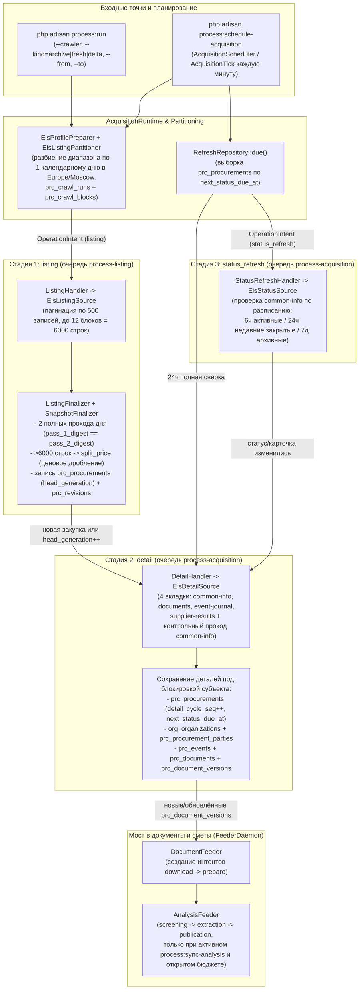
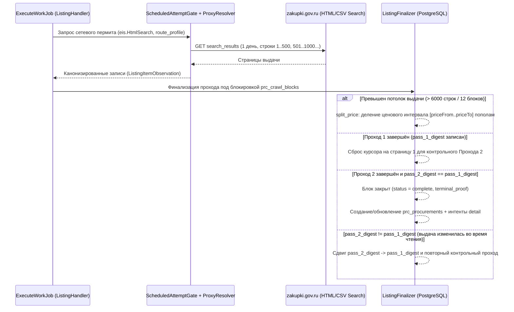

# Краулинг и отслеживание изменений (Process Core Internals)

Этот документ описывает устройство контура сбора закупок (`listing`, `detail`, `status_refresh`),
сетевого шлюза и передачи документов в `download` / `prepare` в архитектуре Process Core.
Бизнес-описание стадий — в [`../workflow/crawling-and-discovery.md`](../workflow/crawling-and-discovery.md);
пошаговый сценарий локального тестирования и продакшен-запуска трёх профилей — в
[`runbooks/archive-run.md`](runbooks/archive-run.md); архитектура очередей, лизов и демонов — в
[`process-core.md`](process-core.md).

## 1. Общая схема процессов сбора и отслеживания изменений

## 2. Два контура сбора: первичный архив и главный продакшен-поток (`UPDATE_DATE`)

В боевой эксплуатации процессы делятся на **первичный контур наполнения/отладки** и **главный постоянный продакшен-контур**:

### Контур 1. Первичный архивный сбор (для начального наполнения базы и тестирования)
1. **Исторический архив за 2025 год (`AcquisitionKind::Archive`, `2025-01-01` .. `2025-12-31`)**:
   - Запускается через `php artisan process:run <crawler_id> --kind=archive --from=2025-01-01 --to=2025-12-31`.
   - Использует фильтр по дате размещения (`publishDateFrom` / `publishDateTo`, `sortBy = PUBLISH_DATE`).
   - `EisListingPartitioner` нарезает диапазон на **1-дневные блоки** (`prc_crawl_blocks`, максимум 400 дней за один вызов).
   - Когда все дневные блоки получают `status = 'complete'`, прогон `prc_process_runs` закрывает `discovery_outcome = 'complete'` и останавливается.
2. **Архив за 2026 год (`AcquisitionKind::Archive`, `2026-01-01` .. текущая закрытая дата)**:
   - Запускается вторым шагом по той же схеме двухпроходной верификации каждого дня.
   - После локальной репетиции, отлова всех краевых случаев парсинга и выборочной проверки смет снимается дамп БД (`pg_dump`), который разворачивается на продакшен-сервер, чтобы продакшен стартовал с уже готовой базой за 2025–2026 гг.

### Контур 2. Главный постоянный продакшен-процесс (`ЕИС 44-ФЗ — свежий поток`, `sortBy = UPDATE_DATE` по убыванию)
- Управляется минутным планировщиком [`runbooks/acquisition-scheduler.md`](runbooks/acquisition-scheduler.md) (`php artisan process:schedule-acquisition`) и профилем `ЕИС 44-ФЗ — свежий поток` (`stages: ['CA', 'PA', 'PC', 'NP']`, `sortBy = UPDATE_DATE`, `sortDirection = desc`, `priceFrom = 100_000`, `priceTo = null`, `okpd2Codes = ['41', '42', '43']`).
- **Жизненный цикл закупки и бизнес-триггер**:
  1. **Появление новой закупки (`Подача заявок` / `CA`)**: как только закупка публикуется на ЕИС, у неё выставляется дата обновления, и профиль `UPDATE_DATE` мгновенно её подхватывает, создавая карточку и запуская `detail`.
  2. **Заблаговременный разбор смет**: если в документации закупки есть сметы, конвейер `download` → `prepare` → `screening` → `extraction` → `publication` разбирает их сразу, пока закупка ещё идёт.
  3. **Отслеживание смены статусов до завершения (`PA` → `PC`)**: при любом изменении извещения, добавлении разъяснений/протоколов или смене этапа на ЕИС обновляется дата обновления (`updatedAt`), а параллельно `status_refresh` (`RefreshRepository::due()`) опрашивает активные закупки по `next_status_due_at`.
  4. **Бизнес-триггер завершения**: как только закупка переходит в статус **завершена (`completed`)** и у неё **есть распознанные сметы (`prc_estimates`)**, это событие служит триггером для запуска следующего бизнес-процесса (поиск поставщиков и коммерческая проработка).

### Защита от повторного парсинга при частом опросе (3 уровня дедупликации и watermark)
При частом запуске профиля `UPDATE_DATE` (например, каждые 5–30 минут) система **не перепарсивает** уже обработанные карточки повторно благодаря трёхуровневому механизму:

1. **Учёт расписания и времени запуска/завершения (`prc_acquisition_schedules` + `prc_process_runs`)**:
   - `prc_acquisition_schedules` хранит `cron_expression` и `next_due_at`.
   - `AcquisitionScheduler::due()` блокирует строку расписания (`FOR UPDATE`) и коалесцирует пропущенные тики (`while ($next <= $now)`), не плодя дублирующиеся прогоны, если предыдущий ещё шёл.
   - Каждый прогон в `prc_process_runs` фиксирует время старта (`created_at`), закрытия (`discovery_closed_at`) и итог (`discovery_outcome = complete | partial`).
2. **Водяной знак покрытия дат (`ListingCoverageRepository`)**:
   - Перед каждым запуском `ListingCoverageRepository::forCrawler()` вычисляет по завершённым блокам `prc_crawl_blocks` (`terminal_proof->>'outcome' = 'complete'`) непрерывный закрытый горизонт `verifiedThrough` и верхнюю границу `observedThrough`.
   - Для `Delta` окно следующего прогона строится через `ListingCoverage::resumeFrom($verifiedOrigin)` от `max(verifiedThrough, observedThrough)` до `today`, поэтому уже закрытые прошлые дни повторно не запрашиваются.
3. **Дедупликация на уровне строки и интента (`snapshot_hash` → `intent_key` → `work_key`)**:
   - Когда прогон заново читает текущий открытый день (`today`), а новых закупок или изменений на ЕИС за последние 5 минут не появилось:
     - `SnapshotFinalizer::persistLocked()` сверяет хэш снимка `$latest?->snapshot_hash === $hash`: если поля и `updatedAt` не изменились, новая ревизия `prc_revisions` **не создаётся** и `head_generation` **не увеличивается**;
     - `ListingFinalizer::detailIntent()` строит детерминированный ключ `intent_key = sha256(detail | procurementId | updatedAt | fingerprint | semanticHash | accessPolicyHash)` со вставкой `ON CONFLICT (intent_key) DO NOTHING`;
     - `WorkFinalizationRepository::storeSuccessors()` проверяет `prc_process_work` по `work_key` (`if ($existing === null)`).
   - В результате при отсутствии изменений на ЕИС создаётся **0 новых задач `detail`** и выполняется **0 повторных HTTP-запросов** к карточкам закупок.

## 3. Двухпроходная стабильность листинга и ценовое дробление (`ListingHandler` / `ListingFinalizer`)

- **Лимит глубины ЕИС**: площадка отдаёт по 500 записей на страницу; при превышении 12 страниц (6 000 строк) за один календарный день `ListingFinalizer` автоматически делит ценовой диапазон `[priceFrom, priceTo]` пополам (до минимального шага `1 000 ₽`), создавая дочерние блоки `prc_crawl_blocks`.
- **Нижняя граница цены и отсутствие верхнего потолка**: в боевых профилях (`EisCrawlerProfileSeeder` и `EisAuditSeeder`) задана нижняя граница `priceFrom = 100_000` (от 100 тыс. ₽) и `priceTo = null` (без верхнего потолка). При `priceTo = null` курсор `EisListingCursor` получает маркер открытой верхней границы (`UNBOUNDED_HIGH_CENTS = 100_000_000_000`), а `EisListingSource` не передаёт `priceToGeneral` в URL запроса и не ограничивает цену сверху (в том числе в правой ветке `[mid, ∞)` при ценовом дроблении `split()`).

## 4. Детальный разбор карточки (`DetailHandler`) и отслеживание изменений

При срабатывании интента `detail` для закупки (`prc_procurements.id`) `DetailHandler` обращается к `EisDetailSource`:

1. **Четыре вкладки + контрольный проход**:
   - Скачиваются 4 вкладки карточки ЕИС: `common-info.html`, `documents.html`, `event-journal.html`, `supplier-results.html`.
   - Сразу после них повторно запрашивается `common-info.html` (`control/common-info`).
   - `ListingSnapshotStability::compare()` сверяет ключевые поля первой вкладки до и после обхода остальных вкладок. Если во время скачивания карточка на площадке изменилась, попытка отклоняется как нестабильная (`detail_control_mismatch`) и ставится на повтор.
2. **Сторож «пришла не та страница»**:
   - Каждая вкладка проверяется на наличие запрошенного `registry_number` в HTML-теле. Если площадка вернула заглушку или страницу ошибки без реестрового номера, бросается `SourceContractException`, и пустые данные не перезаписывают карточку.
3. **Версионирование изменений в БД**:
   - При каждом изменении данных закупки (на листинге, детальном обходе или `status_refresh`) под блокировкой строки `prc_procurements` увеличивается `head_generation` и пишется неизменяемая строка в `prc_revisions`.
   - Новые прикреплённые файлы и изменённые файлы создают записи в `prc_documents` / `prc_document_versions` (`head_generation++`).
   - Обновляется `detail_cycle_seq` и вычисляется следующее время проверки `next_status_due_at`:
     - `now() + 6 hours` — для активных этапов (`submission`, `commission`);
     - `now() + 24 hours` — для недавно закрытых (`< 7` дней);
     - `now() + 7 days` — для архивных терминальных статусов.

## 5. Управление стадиями (`prc_control_scopes`) и отключение платного AI локально

Передача данных между стадиями (`listing` → `detail` → `download` → `prepare` → `screening` → `extraction` → `publication`) управляется двумя механизмами в PostgreSQL (см. [`runbooks/process-controls.md`](runbooks/process-controls.md)):

1. **Регистрация полномочий стадий (`prc_process_handler_holds`)**:
   - `php artisan platform:sync-catalog` регистрирует `listing`, `detail`, `status_refresh`.
   - `php artisan process:sync-documents` регистрирует `download`, `prepare`.
   - `php artisan process:sync-analysis` регистрирует `screening`, `extraction`, `publication` и открывает бюджетный период в `llm_budget_periods`.
   - **Инвариант для локального тестирования**: пока `process:sync-analysis` не запущена, `AnalysisFeeder` не может создать ни одного AI-запроса. Старые переменные `.env` (`AI_SCREENING_ENABLED`, `AI_EXTRACTION_ENABLED`, `CRAWLER_DOWNSTREAM_ENABLED`) в Process Core не используются.
2. **Контрольные скоупы (`prc_control_scopes`)**:
   - Команда `php artisan process:control pause|resume <scope_key> --user=<id> --reason="..." --expected=<version>` позволяет точечно ставить на паузу и возобновлять отдельные этапы или площадки:
     - `acquisition:stage:detail` — пауза разбора карточек (оставляет работать только `listing` для быстрой сверки полноты выдачи);
     - `documents` — пауза скачивания и обработки всех документов (`download`, `prepare`, `screening`, `extraction`, `publication`);
     - `documents:stage:download`, `documents:stage:prepare`, `documents:stage:screening`, `documents:stage:extraction` — поэтапные паузы внутри документного конвейера.

## 6. Сетевой слой, российский VDS-прокси и TLS Минцифры

Все HTTP-запросы к площадкам проходят через `ScheduledAttemptGate` → `ProxyResolver` → `OutboundExecutor`:

- **Профили маршрутов (`prc_network_route_profiles`)**:
  - `EisCrawlerProxySeeder` импортирует прокси из `PLAYWRIGHT_MCP_PROXY_SERVER` в `prc_proxies` и `prc_network_routes` (`secret_ref = 'PLAYWRIGHT_MCP_PROXY_SERVER'`), привязывая его к профилям `eis.audit` и `default`.
  - Стадии `listing`, `detail`, `status_refresh` используют `prc_crawlers.route_profile_id` (при `NULL` — профиль `default`).
  - Стадия `download` (`RuntimeDownloadHandler`) использует профиль `default`.
- **Раздельное здоровье маршрутов и целей**:
  - Состояние сети хранится раздельно в `prc_route_health` (здоровье самого прокси), `prc_target_health` (состояние целевого эндпоинта `eis.HtmlSearch` / `eis.HtmlCard` / `eis.FileDownload`), `prc_route_target_health` (связка маршрут + цель) и `prc_adapter_health`.
- **Обход локального VPN через конфиг и настройки (`LOCAL_VPN_BYPASS_ENABLED` + `OUTBOUND_PROXY_UNIX_SOCKET`)**:
  - На рабочей станции с активным VPN (`amn0`, `tun_*` / `sing-box` strict route) в локальном `.env` включаются `LOCAL_VPN_BYPASS_ENABLED=true` и `OUTBOUND_PROXY_UNIX_SOCKET=/var/www/html/storage/logs/vpn-bypass.sock`.
  - При `make dev:up` (или `make dev:vpn-bypass`) скрипт `docker/scripts/dev-vpn-bypass.sh` автоматически прописывает постоянный маршрут `/32` и правило приоритета `100` в NetworkManager к IP прокси из `PLAYWRIGHT_MCP_PROXY_SERVER` через физический LAN-шлюз, а также поднимает контейнер-мост `agelto_dev-vpn-bypass` (`--network host`), через Unix-сокет которого `PinnedCurlHandler` отправляет трафик к прокси строго в обход любого локального VPN.
  - На продакшене (`LOCAL_VPN_BYPASS_ENABLED=false`, `OUTBOUND_PROXY_UNIX_SOCKET=` пусто) этот механизм полностью отключён, и `PinnedCurlHandler` работает в штатном режиме напрямую.
- **TLS доверие (`SourceTlsTrust`)**:
  - Площадка `zakupki.gov.ru` использует сертификаты НУЦ Минцифры РФ (`docker/php/certs/russian-trusted-ca.pem`). `SourceTlsTrust` подключает этот CA-бандл только для целевых хостов из `config('outbound.http.tls_bundles')`. Использование `verify => false` запрещено.

## 7. Типизированный фильтр профиля и сиды площадки ЕИС

- **`EisSearchFilter`** (`app/Dto/Platforms/Eis/EisSearchFilter.php`):
  - Хранится в `prc_crawlers.filter` (`jsonb`) и декодируется через `ListingFilterCodec` согласно `EisDefinition::acquisitionProfile()`.
  - Поддерживает этапы (`stageApplications`, `stageCommission`, `stageCompleted`, `stageCancelled`), цену (`priceFrom`, `priceTo`), окно дат публикации (`publishedFrom`, `publishedTo`), поисковую строку (`searchString`, `morphology`), коды ОКПД2 (`okpd2Codes`) и сортировку (`sortField`: `Published` / `Updated`, `sortAscending`), охватывая закупки **по всей России** (без региональных ограничений).
  - Неизвестные ключи фильтра отвергаются валидацией до сохранения и до отправки запроса.
- **Сиды площадки (`database/seeders/Platforms/Eis/`)**:
  - `EisPlatformSeeder`: создаёт площадку `eis` (`ЕИС Закупки`).
  - `EisCrawlerProfileSeeder`: создаёт боевые профили `ЕИС 44-ФЗ — архив 2025 (завершённые)`, `ЕИС 44-ФЗ — архив 2026 (завершённые)` (`mode = archive`, `sortBy = PUBLISH_DATE`, `priceFrom = 100_000`, `priceTo = null`) и `ЕИС 44-ФЗ — свежий поток` (`mode = fresh`, `sortBy = UPDATE_DATE`, `priceFrom = 100_000`, `priceTo = null`).
  - `EisCrawlerProxySeeder` и `EisAuditSeeder`: настраивают VDS-прокси и универсальный профиль для контрольного аудита.

## 8. Особенности разбора HTML карточки и известные нюансы

- **Раскладка вкладок карточки ЕИС**:
  - Вложения (`documents.html`): `div.blockFilesTabDocs` → `div.attachment` → ссылка `filestore` (имя файла в атрибуте `title`).
  - Общие сведения (`common-info.html`): секции `section.blockInfo__section`.
  - Журнал событий (`event-journal.html`): таблица `table#event.displaytagTable`.
- **`SAVEPOINT` при создании организаций (`OrganizationResolver`)**:
  - Разрешение и создание организаций заказчиков/участников (`org_organizations`, `org_organization_identifiers`) внутри внешней транзакции оборачивает `create()` во вложенный `DB::transaction()` (`SAVEPOINT`), чтобы перехват `UniqueConstraintViolationException` при параллельной вставке не переводил внешнюю транзакцию PostgreSQL в состояние `aborted`.
- **Переход документа в подготовку**:
  - Согласно [`adr/0009-job-owns-document-transition.md`](adr/0009-job-owns-document-transition.md), статус подготовки версии документа изменяется только хендлером стадии под блокировкой субъекта (`SubjectLockResolver`); фидер (`DocumentFeeder`) создаёт `OperationIntent`, не мутируя доменный статус напрямую. Открытые вопросы задокументированы в [`open-follow-ups.md`](open-follow-ups.md).

## Смежное

- [`../workflow/crawling-and-discovery.md`](../workflow/crawling-and-discovery.md) — бизнес-описание стадий обхода и карточки закупки.
- [`runbooks/archive-run.md`](runbooks/archive-run.md) — пошаговый ранбук локального тестирования (по итерациям со сверкой через Playwright) и продакшен-схемы из 3 профилей.
- [`runbooks/acquisition-scheduler.md`](runbooks/acquisition-scheduler.md) — минутный планировщик `process:schedule-acquisition`.
- [`runbooks/process-controls.md`](runbooks/process-controls.md) — пауза и возобновление стадий (`prc_control_scopes`).
- [`process-core.md`](process-core.md) — архитектура Process Core (очереди, лизы, демоны, блокировки).
- [`document-pipeline.md`](document-pipeline.md) — дальнейший путь документа (`download` → `prepare` → `screening` → `extraction` → `publication`).
- [`adr/0003-row-range-plus-windowed-fallback.md`](adr/0003-row-range-plus-windowed-fallback.md) — пагинация и ценовое дробление выдачи ЕИС.
