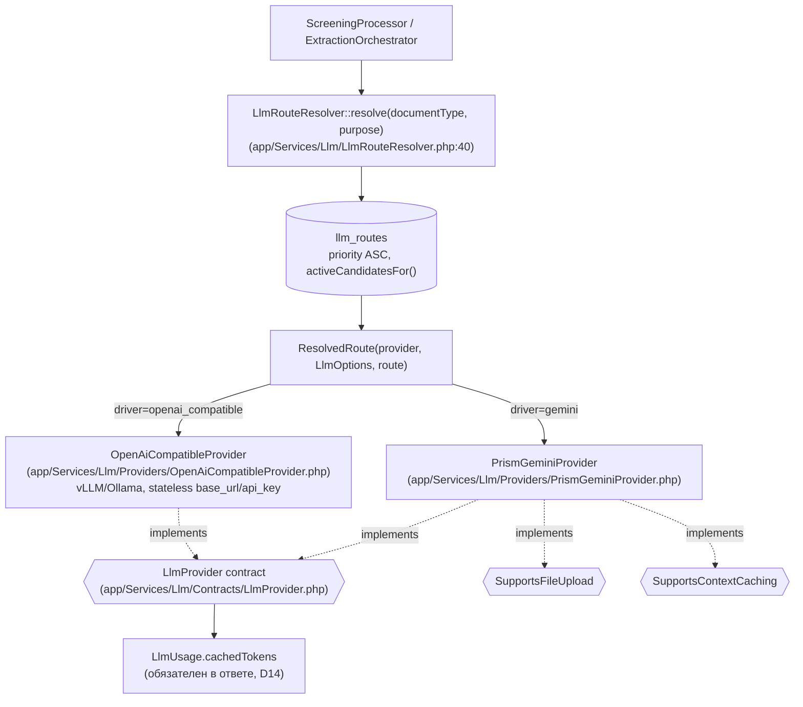

# LLM-провайдеры

P3.10 добавляет staged путь `GeminiGenerateContentClient` → `ProviderWireRequest` →
`AnalysisCallCoordinator::authorize(..., wire)` → `AnalysisProviderSendGate` →
`StructuredCallExecutor`. Gemini-клиент — чистый codec: из immutable operation plan он собирает
`systemInstruction`, отдельный user `contents`, `generationConfig.responseJsonSchema`, output и
thinking bounds. Ключ передаётся только при transport binding. Default origin фиксирован;
явный origin для локальной fixture проходит тот же URL/DNS policy и сетевой permit.
Wire format сверён с [официальным generateContent API](https://ai.google.dev/api/generate-content)
2026-11-02. Выбор production модели, account capabilities и live accuracy этим срезом не проверяются.

Provisional authorization сохраняет immutable SHA-256 wire fingerprint и финансовую reservation,
но не даёт HTTP. `OutboundExecutor::reserveProviderSend` выбирает один маршрут и ждёт network
slot вне транзакции. Финансовый hold проверяется на каждом цикле; network owner проверяет полный
Process prefix вместе с provider control. Joint gate в одной транзакции повторяет current
input/recipe/attempt/lease guards, claims provider и network, создаёт request intent с тем же
UUID и расширяет permit на полный transfer timeout + cleanup. Любой отказ откатывает обе claims.
Доказанный pre-claim отказ отзывает authorization и освобождает not-sent reserve.

После commit возвращается `PreparedProviderTransport` с private Laravel client, закреплённым
cURL/DNS/route, bounded sink, heartbeat и deadline. Только `sendOnce` может использовать capability;
повтор, clone и serialization запрещены. Клиент не повторяет запросы и не следует redirects.
`StructuredCallExecutor` сохраняет raw receipt независимо от optional network observation;
неполученный результат после claim остаётся unknown с удержанным budget. Crash после joint commit
до wire также unknown: отсутствие server receipt не доказывает отсутствие отправленных bytes.
Финансовые факты не отменяют cancel и не дают права публикации.

`T35ProviderJointSendTest` запускается через `make core-test-concurrency`: local real HTTP,
два PHP/PG процесса, pause/handler/account/provider hold/retire/cancel во время slot wait,
rollback второй scope, duplicate capability, late full-timeout coverage и SIGKILL до wire.
Paid stage handlers остаются `handler_not_activated`; runtime cutover legacy providers и
полный parser/publication принадлежат последующим срезам. Caller без owning
`ProviderSendGate` получает typed `Unsupported` и не отправляет запрос.

P3.12 добавляет `GeminiAssetClient`, `ProviderAssetManager` и реальные `llm_file_assets` /
`llm_context_caches`. File identity включает provider/account/API/content SHA-256/MIME;
cache identity дополнительно фиксирует model, system, schema/no-tools policy, representation
и порядок содержимого. `creation_token` ссылается на точный physical call. Account lock и
asset row сериализуют создателей. Истечение lease не разрешает повтор неопределённого create:
сначала нужен receipt/reconcile; возможный remote orphan остаётся финансовым обязательством.

`ProviderCapabilities` — явный snapshot конкретного account/API/model с version, evidence,
expiry и пределами. Production catalog здесь не активируется; неизвестная capability или цена
удерживает send. Unsupported explicit cache, слишком маленький prefix, неизвестный reuse,
невыгодная стоимость и заранее известная expiry выбирают uncached generation до cache send.
Creation резервирует весь разрешённый TTL без скидки на ожидаемую экономию. Refresh — только
отдельная явно запрошенная operation с новым reserve; фонового TTL extension нет.

Проверенный REST subset: bounded multipart upload immutable bytes (до 8 MiB в этом клиенте),
cache POST/PATCH и asset GET. Официальный
[discovery contract](https://generativelanguage.googleapis.com/$discovery/rest?version=v1beta)
объявляет simple multipart для `/upload/v1beta/files`; клиент не открывает resumable session
и не хранит произвольный remote upload URL. Это прикладной предел памяти, не предел Files API.
[Files lifecycle](https://ai.google.dev/gemini-api/docs/files) и
[cache API](https://ai.google.dev/api/caching) сверены 2026-11-02. Explicit caching зависит от
[выбранных API/model](https://ai.google.dev/gemini-api/docs/generate-content/caching), а не от
общего имени провайдера. Все операции проходят существующий joint gate, без SDK retry.

Cached generation посылает `cachedContent` и task-specific user instruction, сохраняя полную
`responseJsonSchema`; system/file prefix в том же запросе не дублируется. Uncached форма
возвращает тот же system и ordered file parts. Asset receipts обрабатывает зарегистрированная
`AssetReceiptPolicy`; они не попадают в generation parser. Usage хранит uncached/cached input,
output, thinking, storage token-hours и явный unknown отдельно. При отсутствии точной цены usage
успех консервативно settles pinned upper bound; 404 сам по себе не доказывает бесплатность.

Для cache404 только зарегистрированная policy с durable per-operation nonbilling proof
разрешает один uncached physical retry: тот же logical key, старый reserve settled 0, новый
reserve и новый joint claim. Production policy такого доказательства по одному статусу не
выдумывает. File lookup404 также требует proof перед invalidation; immutable replacement имеет
одну стабильную identity на frozen run. Повторная delivery не загружает файл повторно.

`T14AssetLifecycleTest` входит в `make core-test-ai`: реальные локальные HTTP и PostgreSQL,
гонка двух процессов, TTL/identity/404 и purpose-specific receipt recovery. Проверки доказывают
wire и deterministic contracts; semantic equivalence на реальной модели и live pricing/model
eligibility не заявляются. Handler checkpoint consumption, publication и снятие legacy writers
остаются атомарному P3.13 cutover. Двойной clean install проверяет текущий additive schema.

Транспортный LLM-слой — `App\Services\Llm\**`. Контракт `LlmProvider` не завязан на конкретного
вендора (D14): сегодня Gemini через Prism (`PrismGeminiProvider`), OpenAI-совместимый адаптер
(`OpenAiCompatibleProvider`) — задел под vLLM/Ollama (локальная LLM, `docs/dev/ai/training-loop.md`)
и любой OpenAI-протокольный провайдер без изменения домена.

Каждый физический вызов остаётся воспроизводимым: хранится выбранный маршрут, модель, набор версий
промтов, usage и ссылка на сырой payload. Это позволяет независимо менять провайдера для дешёвого
скрининга и полного извлечения, а затем сравнивать основной и теневой результат до переключения
маршрута.

## Д6 — LLM-слой: роутинг и адаптеры

Capability-based кэширование (D14): промт всегда prefix-stable (`PromptComposer`); опциональный
cache-hint интерпретируется адаптером — Gemini → `cachedContents` (`SupportsContextCaching`,
частично подключён — см. Known Deviations `ExtractionOrchestrator`), OpenAI/vLLM → no-op/
автоматический prefix-cache; `usage.cachedTokens` обязателен в ответе независимо от адаптера.
`shadowRoute()` (`app/Services/Llm/LlmRouteResolver.php:69`) — теневой маршрут для сравнения
с локальной LLM (P9.4, `ShadowDispatch`).

## Роутинг

`llm_routes` хранит кандидатов `(document_type, purpose) → model`, `priority ASC` внутри группы —
`LlmRouteResolver::resolve()` берёт первый активный. Стартовый роутинг (D4, сиды `AiRoutingSeeder`):
скрининг → `gemini-2.5-flash-lite`, извлечение → `gemini-2.5-flash`, эскалация по флагу сложности
или провалу валидации → `gemini-2.5-pro`. Discovery-путь (windowed fallback, D30/D37) — отдельный
`EstimateLlmPurpose::Discovery`, свой маршрут, свой промт-шаг (`EstimatePromptStep::ExtractionDiscovery`) — НЕ
переиспользует screening-маршрут (разные роли: «что за документ» vs «где границы смет»).

## Транспорт: Prism за фасадом

Прямых вызовов `prism-php/prism` за пределами `Providers/` нет (D8/D14) — домен зависит только от
`LlmProvider`. Причина выбора Prism вместо first-party `laravel/ai` — устоявшийся typed API Gemini
(files + context caching) против 0.x/preview статуса `laravel/ai` на момент решения (research/G §1);
контракт держится адаптер-совместимым с обоими на будущее.

## Особенности провайдеров

У проекта есть два транспорта, но не две одинаковые реализации. Маршрут выбирает провайдера из
`llm_providers`, а не этот документ; ниже зафиксировано только поведение, подтверждённое
адаптерами и конфигом.

| Провайдер | Что умеет и как это влияет на маршрут | Основание |
|:--|:--|:--|
| Gemini (`PrismGeminiProvider`) | Единственный текущий адаптер, реализующий загрузку файлов и explicit context cache. Для моделей с `supports_files_api=true` preflight допускает upload; размер и страницы сверяются до него. Все шесть записей Gemini в `ai.capabilities.*` имеют `max_request_file_mb=50` и `max_pages=1000`; у `gemini-3.5-flash` дополнительно задан `max_output_tokens=65536`. | `config('ai.capabilities.gemini-2.5-flash-lite.max_request_file_mb')`, `config('ai.capabilities.gemini-2.5-flash-lite.max_pages')`, `config('ai.capabilities.gemini-3.5-flash.max_output_tokens')`; значения остальных Gemini-ключей того же имени — в `config('ai.capabilities.*')`. |
| OpenAI-совместимый (`OpenAiCompatibleProvider`) | Это stateless адаптер для vLLM/Ollama и других OpenAI-совместимых endpoint'ов: file upload и explicit context cache он не реализует. Для таких моделей capability-запись, включая транспортные лимиты, сейчас не задана; маршрут не получает выдуманных лимитов по аналогии с Gemini. | `App\\Services\\Llm\\Providers\\OpenAiCompatibleProvider`; отсутствие соответствующих записей в `config('ai.capabilities.*')`. |

У Gemini транспортные таймауты, polling Files API и TTL cache задаются отдельно в
`config('ai.gemini.*')`; они не являются capability модели и не участвуют в выборе представления.
Если preflight видит превышение capability-лимита, `ExtractionPreflight` выбирает оконный путь или
терминальный `unprocessable(provider_limit_*)`, а не пытается отправить файл вслепую.

## Capability-матрица моделей и лимиты (D27, D29)

`config('ai.capabilities.<model>')` — не только цены и параметры кэша, но и ТРАНСПОРТНЫЕ лимиты:
`max_request_file_mb` (Gemini=50), `max_pages` (Gemini=1000), `supports_files_api`, `eol_date`,
`successor`. `ExtractionOrchestrator` делает **preflight ДО upload** (`ExtractionPreflight::decide()`)
— размер файла + число страниц (`qpdf --show-npages`) против лимитов активного маршрута → решение
целиком/окнами/`unprocessable(provider_limit_*)`. EOL-мониторинг: каждая активная модель маршрута
несёт `eol_date`; `config('ai.model_eol_warn_days')` (default 30) — порог алерта «модель маршрута
приближается к EOL» (линия 2.5 умирает 2026-10-16, преемники 3.x уже прописаны в конфиге
закомментированной строкой рядом).

**Риск EOL канала (мониторинг, не работа этой фазы).** Страница нашего канала (`generateContent`,
через который Prism шлёт `response_schema`) помечена вендором «Gemini Generate Content API
(Legacy)»; рядом — новый Interactions API с иной формой параметра (`response_format` вместо
`generationConfig.response_schema`), см. `findings/P2-vendor-structured-output.md` §9 плана
`2026.07.31-SYS-INTEGRITY`. Факт зафиксирован как вход EOL-контура (`config('ai.capabilities')`,
выше) — смена канала вендора миграцией не планируется, решение остаётся за мониторингом.

## Исходящий прокси

Домен `Llm` не знает про прокси-пул/скоупы/страны — только про узкий порт `OutboundProxy`
(`App\Services\Llm\Contracts\OutboundProxy::optionsFor(string $host): array`), реализованный
адаптером `PoolOutboundProxy` (`app/Services/Procurement/Proxy/PoolOutboundProxy.php`) со стороны
прокси-слоя: адаптер резолвит узел для скоупа `ProxyScope::Llm` через `ProxyResolver` и фолбэчит на
`config('ai.gemini.proxy')`, если пул для LLM пуст. Подробнее про сам слой маршрутизации —
`crawling-pipeline.md`.

## Учёт стоимости

`llm_calls` пишет usage (prompt/completion/cached tokens) на КАЖДЫЙ физический вызов —
`LlmCallRecorder`. `ai:cost-report {--days=7}` (`CostReportCommand`) агрегирует расход по
провайдеру/маршруту/шагу за окно; конвертация в рубли — по конфигурируемому курсу (боевой курс не
заведён — открытый вопрос плана). `ai:caches {list|prune} [--hits] [--window=]` (`CachesCommand`) —
живые/осиротевшие explicit-кэши и доля implicit cache-хитов по purpose (usage-based, не отдельная
таблица). Реальные тарифы активных маршрутов, порядок величины стоимости документа и
неоткалиброванные лимиты аккаунта — [`ai/economics.md`](ai/economics.md) (зеркалится в Brain по решению владельца D89).

## Смежное

- Как строится промт, который уходит в вызов — [`ai/prompts.md`](ai/prompts.md) (Д3).
- Канон контрактов и алгоритм извлечения смет — [`ai/estimate-extraction.md`](ai/estimate-extraction.md).
- Feature-карточки конкретных AI-шагов — [`ai/feature-card-screening.md`](ai/feature-card-screening.md),
  [`ai/feature-card-estimate-extraction.md`](ai/feature-card-estimate-extraction.md).
- Диагностика ошибок Gemini — [`runbooks/gemini-errors.md`](runbooks/gemini-errors.md).

## P3.8: staged canonical contract

`Dto/Llm/Requests/StructuredTask<T>` pins a response Data class, `PromptSnapshot`, task purpose
and a typed semantic validator. `JsonSchemaGenerator::generate(..., canonical: true)` reads PHP
schema attributes, including decimal patterns and bounds, and emits the complete draft 2020-12
contract. Nullable fields without defaults are required; unknown properties are rejected at every
object level. `CanonicalSchemaValidator` uses pinned `opis/json-schema` 2.6.0 before Data hydration.
Only root-local, acyclic `$defs` references are accepted. Schema and response sizes, JSON depth,
schema traversal and validation duration are bounded; no network/file resolver is registered.
The elapsed validation limit rejects over-budget results; it is not a preemptive CPU interrupt.

`ProviderSchemaCompiler` produces an explicit subset plus paths of every local-only constraint.
Unknown keywords fail compilation; the complete canonical schema still validates the raw response.
This compiler is staged and does not replace the active Prism transport or claim its wire behavior.
`StructuredTaskValidator` reads stored JSON and has no send/retry/continuation API. Unknown finish
reasons and unexpected content are unsupported; safety/refusal, empty output, MAX_TOKENS, schema
errors and semantic errors are distinct decisions. MAX_TOKENS accepts no prefix rows.

The Opis package/version/PHP requirement and absence of published package advisories were checked
against [Packagist](https://packagist.org/packages/opis/json-schema) and the
[official validator API](https://opis.io/json-schema/2.x/php-validator.html) on 2026-11-02.
Composer's full audit may report unrelated locked dependencies; that is recorded separately in
stage evidence. No model ID, provider capabilities or production route is changed here.

## Additive request ledger (P3.9)

The generic `RequestLedger` / `RequestRepository` use canonical provider request/call tables,
independently of legacy `llm_calls`. Provisional authorization is owned by Procurement's
`AnalysisCallCoordinator`; Llm imports no Procurement types. Authorization alone grants no HTTP
capability. The joint provider/network gate and runtime activation belong to later cutovers.

Every physical operation has its own original-period reservation, immutable pinned pricing,
send token/epoch and deterministic receipt upload intent. Unknown is never zero charge or an
automatic retry. The default unknown threshold is one; multiple already claimed calls can become
unknown concurrently. Exact receipt capture is allowed after cancel, with financial history only.
A daily CSV reconciliation cannot release an individual reserve. Explicit replay requires an
actor/reason/command and a new durable replay intent; duplicate commands deduplicate and the old
unknown obligation remains charged/reserved. Use the ledger replay entrypoint so an orphan receipt
is inspected before allocating an intent.

Receipt policies must be explicitly registered by the owning provider package. The default
classification is unknown; HTTP 404/429/503 alone proves no nonbilling. The P3.9 fixture policy
exists only in tests. The bounded local receipt backend rejects unsupported remote storage,
partial envelopes, changed hashes and mismatched physical/purpose/epoch identities.
See [process-core](process-core.md#p3-9-financial-and-receipt-recovery) for recovery and limits.
