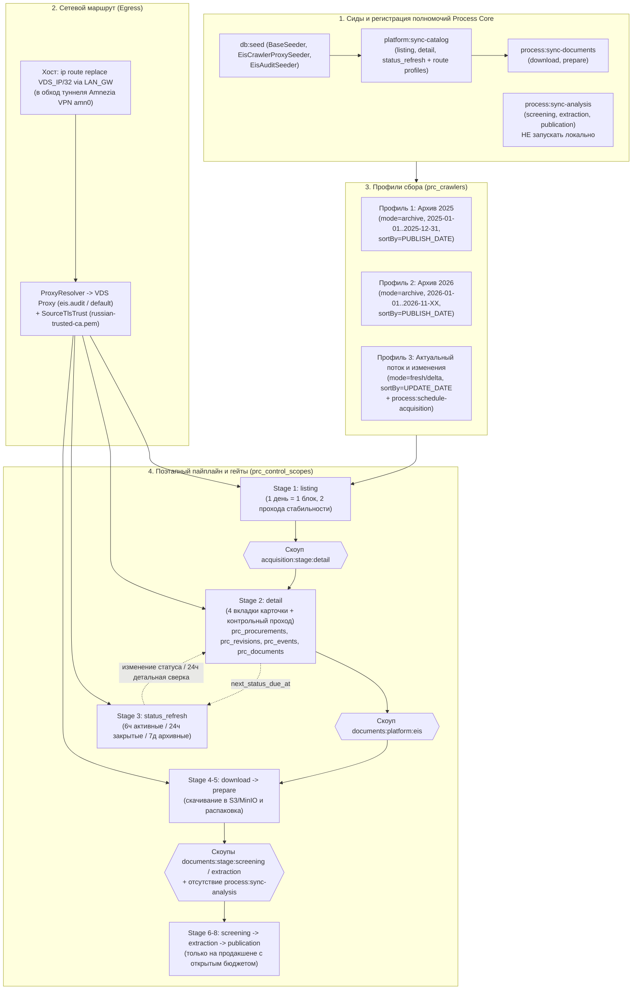

# Runbook: локальная репетиция и продакшен-запуск обхода ЕИС (Process Core)

## Symptoms

Нужно провести поэтапную локальную репетицию пайплайна госзакупок ЕИС (`zakupki.gov.ru`) без расхода бюджета на платный AI (парсинг смет), сверить полноту выдачи через Playwright, либо запустить продакшен-схему из трёх профилей (архив за прошлый год, архив за текущий год и непрерывное отслеживание созданных/обновлённых закупок).

## Схема контура и управления стадиями



## Triage (предварительная проверка перед стартом)

1. **Прямой маршрут до российского VDS в обход локального VPN (`amn0`)**:
   - В `.env` задан `PLAYWRIGHT_MCP_PROXY_SERVER=http://user:pass@<VDS_IP>:3128`.
   - Если на рабочей станции запущена Amnezia VPN (`amn0` перехватывает `0.0.0.0/1` и `128.0.0.0/1`), добавьте на хосте статический маршрут `/32` к IP вашего VDS через физический роутер локальной сети (либо добавьте `<VDS_IP>/32` в исключения раздельного туннелирования Amnezia VPN):
     ```bash
     # Узнать физический шлюз LAN (например, 192.168.31.1 dev enp3s0)
     ip route show | grep default
     # Направить трафик к VDS напрямую мимо amn0
     sudo ip route replace <VDS_IP>/32 via <LAN_GW> dev <LAN_IF>
     # Проверить, что маршрут идёт через физический интерфейс, а не amn0
     ip route get <VDS_IP>
     ```
   - Благодаря этому и Docker-контейнеры (`app`, `horizon`), и браузер Playwright на хосте обращаются к VDS напрямую без двойного туннелирования.
2. **Доверие TLS Минцифры РФ**:
   - Контейнер содержит бандл `docker/php/certs/russian-trusted-ca.pem` (`SourceTlsTrust`, настройка `outbound.http.tls_bundles.eis`); отключение проверки сертификата (`verify => false`) в коде запрещено.
3. **Защита от случайного списания средств за AI локально**:
   - Старые переменные `.env` (`AI_SCREENING_ENABLED`, `AI_EXTRACTION_ENABLED`, `CRAWLER_DOWNSTREAM_ENABLED`) не управляют стадиями Process Core.
   - Локально **не запускайте** `php artisan process:sync-analysis` и дополнительно держите на паузе контрольные скоупы `documents:platform:eis` (или `documents:stage:screening` и `documents:stage:extraction` через [`process-controls.md`](process-controls.md)).
4. **Проверка привязки прокси-маршрута и потолка цены**:
   - `EisCrawlerProxySeeder` создаёт прокси-маршрут и привязывает его к профилям `eis.audit` и `default` (обеспечивая маршрутизацию через VDS для `listing`, `detail`, `status_refresh` и `download`).
   - Во всех боевых профилях `EisCrawlerProfileSeeder` и `EisAuditSeeder` задана нижняя граница `'priceFrom' => 100_000` (от 100 тыс. руб.) и `'priceTo' => null` (без верхнего потолка цены). При `priceTo = null` (`EisListingCursor::UNBOUNDED_HIGH_CENTS`) `EisListingSource` не отправляет `priceToGeneral` в ЕИС и не ограничивает НМЦК сверху (включая правую ветку `[mid, ∞)` при ценовом делении `split()`).

## Fix: пошаговый сценарий локального тестирования (по итерациям)

Все отчёты и сверки итераций сохраняйте в локальную папку `/Audits/` (включена в `.gitignore`).

### Шаг 0. Первичные сиды, синхронизация каталогов и запуск демонов

```bash
# 1. Применить миграции и базовые сиды (площадка ЕИС, ОКПД2, базовые профили, промпты)
docker compose exec app php artisan migrate
docker compose exec app php artisan db:seed --class=Database\\Seeders\\BaseSeeder

# 2. Зарегистрировать VDS-прокси из PLAYWRIGHT_MCP_PROXY_SERVER и профиль аудита
docker compose exec app php artisan db:seed --class=Database\\Seeders\\Platforms\\Eis\\EisCrawlerProxySeeder
docker compose exec app php artisan db:seed --class=Database\\Seeders\\Platforms\\Eis\\EisAuditSeeder

# 3. Зарегистрировать сетевой каталог и хендлеры acquisition + documents (БЕЗ process:sync-analysis!)
docker compose exec app php artisan platform:sync-catalog
docker compose exec app php artisan process:sync-documents

# 4. Поднять воркеры очередей и 4 демона Process Core
docker compose up -d horizon process-relay process-reconciler process-feeder process-projector
```

### Итерация 1. Только поиск закупок (`listing`) + сверка через Playwright

1. Поставьте на паузу детальный обход карточек (`acquisition:stage:detail`) и весь документный пайплайн (`documents`), чтобы отработал только `listing`:
   ```bash
   docker compose exec app php artisan process:control pause acquisition:stage:detail \
     --user=1 --reason="Итерация 1: тестируем только listing и сверяем количество" --expected=1

   docker compose exec app php artisan process:control pause documents \
     --user=1 --reason="Локальный тест без скачивания файлов и без AI" --expected=1
   ```
2. Запустите прогон на выбранном тестовом окне (например, январь 2025 или первые 10–15 дней января):
   ```bash
   docker compose exec app php artisan process:run <profile_id> \
     --kind=archive \
     --from=2025-01-01 \
     --to=2025-01-31
   ```
3. Отслеживайте прохождение двух проходов (`pass 1` и `pass 2`) по каждому дневному блоку:
   ```bash
   docker compose exec app php artisan process:status --platform=eis
   ```
   Каждый закрытый день в `prc_crawl_blocks` должен перейти в `status = 'complete'` с заполненным `terminal_proof` (`pass_1_digest === pass_2_digest`).
4. **Сверка через Playwright**:
   - Откройте `zakupki.gov.ru` через Playwright (с тем же прокси `PLAYWRIGHT_MCP_PROXY_SERVER`) и выставите идентичные фильтры профиля (`fz44`, регионы заказчика Москва `5277335` и МО `5277327`, ОКПД2 `41, 42, 43` (`okpd2Ids=8873919,8873920,8873921&okpd2IdsWithNested=on`), этап `PC`, слова-исключения `капитальн`, `ремонт`, `сметн`, `проектно-изыск`, `инженерн`, диапазон дат размещения).
   - *Примечание по UI ЕИС*: в веб-интерфейсе ЕИС чекбокс `#okpd2IdsWithNested` («Искать с учетом вложенных») по умолчанию снят для ОКПД2 — перед открытием дерева в браузере его нужно отметить вручную, тогда как в коде `EisListingFilter::query()` параметр `okpd2IdsWithNested=on` передаётся всегда автоматически.
   - Сравните итоговое число результатов на сайте ЕИС с `SELECT count(*) FROM prc_procurements;` в базе.
   - Убедитесь, что в `prc_operation_intents` для всех найденных закупок созданы интенты `stage = 'detail'`, ожидающие снятия паузы.

### Итерация 2. Парсинг карточек (`detail`) без скачивания и AI

1. Снимите паузу со стадии `acquisition:stage:detail` (оставив `documents` на паузе):
   ```bash
   docker compose exec app php artisan process:control resume acquisition:stage:detail \
     --user=1 --reason="Итерация 2: запуск парсинга карточек detail" --expected=2
   ```
2. Демон `process-feeder` автоматически подаст накопленные интенты `detail` в очередь `process-acquisition`.
3. Для каждой закупки `DetailHandler` и `EisDetailSource` скачивают 4 вкладки карточки (`common-info`, `documents`, `event-journal`, `supplier-results`) и выполняют контрольный запрос первой вкладки (`control/common-info`), проверяя, что карточка не изменилась во время чтения.
4. Проверьте результат в БД:
   - `prc_procurements`: заполнены `status`, `source_stage`, `initial_price`, `detail_cycle_seq >= 1`, рассчитан `next_status_due_at`.
   - `prc_revisions`: записаны ревизии карточки.
   - `org_organizations`, `org_organization_identifiers`, `prc_procurement_parties`: созданы организации заказчиков и связи ролей.
   - `prc_events`: заполнен журнал событий закупки.
   - `prc_documents` и `prc_document_versions`: сохранены метаданные всех прикреплённых файлов и смет, но само скачивание (`download`) удерживается паузой на `documents`.
   - *(Опционально)* Чтобы проверить скачивание и распаковку документов на 1–2 карточках без запуска платного AI: поставьте на паузу `documents:stage:screening` и `documents:stage:extraction`, затем снимите паузу с `documents`.

### Итерация 3. Проверка главного профиля отслеживания (`ЕИС 44-ФЗ — свежий поток`, `sortBy = UPDATE_DATE`) и `status_refresh`

В боевом режиме главный постоянный процесс — это профиль **`ЕИС 44-ФЗ — свежий поток`** (`sortBy = UPDATE_DATE` по убыванию) в связке со `status_refresh`:

1. **Главный поток по дате обновления (`AcquisitionKind::Delta` / `Fresh`, `sortBy = UPDATE_DATE`)**:
   - Опрашивает выдачу ЕИС по оси `updateDateFrom` / `updateDateTo` (`stages: ['CA', 'PA', 'PC', 'NP']`).
   - Отслеживает весь жизненный цикл закупки:
     1. Вышла новая закупка (`Подача заявок` / `CA`) → профиль сразу подхватывает её, выполняет `detail` и заранее запускает разбор смет (`download` → `prepare` → `screening` → `extraction` → `publication`);
     2. У закупки изменилась документация или статус (`PA` → `PC`) → на ЕИС обновилась дата обновления → `SnapshotFinalizer::persistLocked()` фиксирует изменение, увеличивает `prc_procurements.head_generation`, создаёт ревизию `prc_procurement_revisions`, а `ListingFinalizer::detailIntent()` открывает новый интент `detail`;
     3. Закупка перешла в статус **завершена (`completed`)** и у неё есть распознанные сметы (`prc_estimates`) → срабатывает бизнес-триггер запуска поиска поставщиков.
   - **Защита от повторного парсинга при частом опросе (каждые 5–30 минут)**:
     - Расписание в `prc_acquisition_schedules` (`next_due_at`) и `prc_process_runs` (`created_at`, `discovery_closed_at`, `discovery_outcome`) фиксируют старт и завершение каждого прогона и коалесцируют пропущенные тики крона (`AcquisitionScheduler::due()`).
     - `ListingCoverageRepository` ведёт водяной знак (`verifiedThrough`, `observedThrough`, `resumeFrom()`), не запрашивая повторно уже закрытые дни.
     - При перечитывании текущего открытого дня неизменившиеся строки отсекаются на трёх уровнях: `SnapshotFinalizer` (`$latest?->snapshot_hash === $hash`), `ListingFinalizer::detailIntent()` (`ON CONFLICT (intent_key) DO NOTHING`, где `intent_key` включает `updatedAt`) и `WorkFinalizationRepository::storeSuccessors()` (`work_key`). Если на ЕИС ничего не обновилось, создаётся **0 новых задач `detail`** и выполняется **0 повторных HTTP-запросов к карточкам**.
   - Запуск локальной проверки дельты за окно дат (и повторный контрольный запуск для проверки `0` дублей `detail`):
     ```bash
     docker compose exec app php artisan process:run <fresh_or_delta_profile_id> \
       --kind=delta \
       --from=2026-11-05 \
       --to=2026-11-07
     ```
2. **Регламентный опрос статуса и перепроверка карточки (`status_refresh` + 24ч `detail`)**:
   - Команда [`process:schedule-acquisition`](acquisition-scheduler.md) выбирает закупки, у которых наступил `next_status_refresh_at`:
     - каждые **6 часов** — для активных закупок (`submission`, `commission`);
     - каждые **24 часа** — для недавно завершённых (`< 7` дней);
     - каждые **7 дней** — для старых терминальных закупок;
     - дополнительно каждые **24 часа** назначается полный повторный `detail`, чтобы обнаружить новые протоколы и документы, опубликованные в карточке.
   - Локальная проверка без ожидания таймера: сдвиньте `next_status_refresh_at = now() - interval '1 minute'` у 3–5 тестовых закупок и выполните `docker compose exec app php artisan process:schedule-acquisition`.

## Схема запуска: локальный прогон архива → бэкап БД → продакшен

1. **Контур 1 — Первичный архивный сбор (для наполнения базы и отладки)**:
   - **Профиль 1 (`ЕИС 44-ФЗ — архив 2025 (завершённые)`)**: режим `archive`, сортировка по дате публикации (`PUBLISH_DATE`), диапазон `2025-01-01` .. `2025-12-31`.
   - **Профиль 2 (`ЕИС 44-ФЗ — архив 2026 (завершённые)`)**: режим `archive`, сортировка `PUBLISH_DATE`, диапазон `2026-01-01` .. текущая закрытая дата (`2026-11-07`).
   - Оба архивных профиля прогоняются локально по двум уровням (`listing` + `detail` при паузе на `documents`), в процессе устраняются все ошибки парсинга карточек, после чего проводится выборочное тестирование смет (`operator_selective_hold`).
   - По завершении локальной отшлифовки создаётся дамп базы (`pg_dump -Fc`), который переносится и разворачивается на продакшен-VDS (см. `Tasks/deploy.md`), чтобы продакшен стартовал с уже готовой выверенной базой за 2025–2026 гг.
2. **Контур 2 — Главный постоянный продакшен-процесс (`ЕИС 44-ФЗ — свежий поток`)**:
   - На продакшене поверх развёрнутой базы включается (`is_active = true`) профиль `ЕИС 44-ФЗ — свежий поток` (`sortBy = UPDATE_DATE` по убыванию) и расписание в `prc_acquisition_schedules`.
   - Планировщик `php artisan process:schedule-acquisition` в фоновом режиме отслеживает появление новых закупок и изменение статусов существующих закупок, запускает разбор новых смет и фиксирует переход закупок со сметами в статус `completed`.

### Выборочный запуск разбора смет (`operator_selective_hold`)

После первичного массового обхода `listing` и `detail` за 1,5 года (при поставленном на паузу гейте `documents`) в `prc_process_work` накапливаются задачи `download` для всех найденных документов. Чтобы запускать скачивание и AI-разбор (`screening` -> `extraction` -> `publication`) выборочно по целевым закупкам, а не по всему архиву сразу:

1. Переведите все накопленные задачи `download` в управляемое удержание (`deferred` с кодом `operator_selective_hold`):
   ```sql
   UPDATE prc_process_work
   SET state = 'deferred',
       next_attempt_at = '2099-01-01 00:00:00+00',
       reason_code = 'operator_selective_hold',
       updated_at = clock_timestamp()
   WHERE stage = 'download'
     AND state IN ('ready', 'deferred');
   ```
2. Разблокируйте `download` только для целевых закупок (по списку `reg_number`, региону, НМЦК или названию документа):
   ```sql
   UPDATE prc_process_work w
   SET state = 'ready',
       next_attempt_at = clock_timestamp(),
       reason_code = 'operator_selective_release',
       updated_at = clock_timestamp()
   FROM prc_procurement_documents d
   JOIN prc_procurements p ON p.id = d.procurement_id
   WHERE w.stage = 'download'
     AND w.subject_id = d.id
     AND p.reg_number IN ('0360100030126000001');
   ```
3. Откройте `documents`, `documents:stage:download` и `documents:stage:prepare` (при необходимости удерживая `documents:stage:screening` и `documents:stage:extraction` до готовности представлений `ready_for_screening`), после чего разблокируйте AI-стадии для выбранных версий файлов.

## Rollback

- Для остановки активного прогона или стадии используйте `php artisan process:control pause <scope_key>` либо `php artisan process:control cancel-run <process_run_uuid>` (см. [`process-controls.md`](process-controls.md)).
- Все изменения в рамках конкретного прогона связаны с `prc_process_runs` и фиксируются в неизменяемом журнале `prc_process_transitions`.

## Escalation и диагностика по доменным логам на продакшене

- Логи пайплайна разделены по доменным каналам в `storage/logs/`:
  - `network-YYYY-MM-DD.log` и `system-warnings-YYYY-MM-DD.log`: транспортные сбои (`network.transport_failure`) и срабатывания сетевых предохранителей (`network.circuit_opened` по `prc_route_health`, `prc_target_health`, `prc_route_target_health`).
  - `platforms-YYYY-MM-DD.log` и `system-warnings-YYYY-MM-DD.log`: предупреждения парсера карточек ЕИС (`EisDetailSource`) с точным указанием `reg_number`, вкладки (`tab`), класса исключения, файла и строки при `schema_mismatch` или `Completeness::Partial`.
  - `process-YYYY-MM-DD.log` и `system-errors-YYYY-MM-DD.log`: непредвиденные исключения в обработчиках (`work.handler_fault` из `WorkRunner`) и открытие инцидентов (`process.incident_opened` в `prc_incidents`).
- Если `process:status --platform=eis` показывает задачи в статусе `blocked` или открытые инциденты в `prc_incidents`, используйте `php artisan process:diagnose <work_or_run_uuid>` и проверьте `storage/logs/system-errors-*.log` / `storage/logs/system-warnings-*.log`.
- При деградации маршрута (`prc_route_health` / `prc_route_target_health` в состоянии `open`) проверьте доступность VDS-прокси и таблицу маршрутизации хоста (`ip route get <VDS_IP>`).
- Подробное устройство классов и таблиц пайплайна описано в [`../crawling-pipeline.md`](../crawling-pipeline.md) и [`../process-core.md`](../process-core.md).
