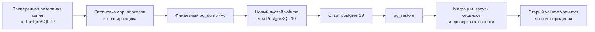

# Обновление окружения: PHP 8.6, PostgreSQL 19, Silo

Страница описывает переход существующей установки на текущую целевую среду и то, что меняется
для разработчика и оператора. Новая установка ничего отсюда не требует: достаточно
[чистой установки](../getting-started.md) или [подготовки сервера](../../operators/production/server-setup.md).

## Целевые версии

| Компонент | Было | Стало | Где закреплено |
|:--|:--|:--|:--|
| PHP | 8.5 (`composer.json`: `^8.4`) | 8.6 (`serversideup/php:8.6-fpm-nginx` по digest) | `docker/php/Dockerfile`, `composer.json` (`^8.6`) |
| pcov (только dev) | PECL 1.0.12 | сборка с закреплённого коммита upstream | `ARG PCOV_COMMIT` в `docker/php/Dockerfile` |
| PostgreSQL | 17 | 19 (`postgres:19` по digest + `pg_partman`) | `docker/postgres/Dockerfile` |
| Redis | 7 | 8.12 (alpine, по digest) | Compose-файлы |
| Объектное хранилище | MinIO (`minio/minio`) | Silo (`pgsty/silo`, форк MinIO) | Compose-файлы, стадия `mc` в Dockerfile |
| Node.js | 24 (bookworm), 22 (alpine) | 26 (trixie, alpine) | Dockerfile, Compose, CI |
| Laravel / Filament / Livewire | 13.44 / 5.8 / 4.4 | 13.44 / 5.12 / 4.4 | `composer.lock` |
| Pest / Larastan | 5.0 / 3.13 | 5.3 / 3.15 (PHPStan `max`, строже флаги) | `composer.lock`, `phpstan.neon` |

Каждый образ закреплён по тегу и digest. Обновление образа — отдельный коммит, который меняет
тег и digest вместе.

## Переход на PostgreSQL 19 {#postgresql-19}

Сменилась раскладка volume. Образы PostgreSQL 18+ объявляют `VOLUME /var/lib/postgresql`, а
данные лежат в `/var/lib/postgresql/<major>/docker`. Поэтому volume `pgsql_data` теперь
монтируется в `/var/lib/postgresql`, а переопределение `PGDATA` удалено. Если в корне volume
лежит кластер старой версии (`PG_VERSION` в корне), entrypoint PostgreSQL 19 отказывается
стартовать. Это намеренное fail-fast поведение: старые данные не подхватываются молча.

Обновление выполняется через логический дамп. `pg_upgrade` между образами не используется.



1. Сделайте и проверьте резервную копию по [процедуре бэкапа](../../operators/production/backups.md).
   Без проверенного восстановления не продолжайте.
2. Закройте внешний трафик. Из каталога старого релиза укажите его действующие
   `ENV_FILE`, `COMPOSE_PROJECT_NAME` и `IMAGE_TAG` по инструкции развёртывания.
   Выполняйте дальнейшие команды в Bash. Запишите имя подключённого тома PostgreSQL 17
   и тег старого релиза в журнал операции.

   ```bash
   prod=(docker compose --env-file "${ENV_FILE:?}" -p "${COMPOSE_PROJECT_NAME:?}" -f docker-compose.prod.yml)
   docker inspect --format '{{range .Mounts}}{{println .Destination .Name}}{{end}}' "$("${prod[@]}" ps -q postgres)"
   "${prod[@]}" stop app horizon scheduler process-relay process-reconciler process-feeder process-projector
   ```

3. Снимите финальный дамп в новый файл с ограниченным доступом. Продолжайте после
   успешного завершения `pg_dump` и проверки восстановления по процедуре резервирования.

   ```bash
   umask 077
   "${prod[@]}" exec -T postgres sh -ec 'pg_dump -U "$POSTGRES_USER" -d "$POSTGRES_DB" -Fc' > agelto-pg17.dump
   ```

4. Остановите `postgres`, переключитесь на конфигурацию и образы нового релиза.
   Сохраните исходное имя Compose-проекта. В его постоянном `ENV_FILE` задайте
   `PG_VOLUME_NAME` новым уникальным именем, например `agelto_prod_pg19`. Обновите также
   экспортированный `IMAGE_TAG`. Проверьте через `"${prod[@]}" config --volumes` и
   `config --images` выбор ресурсов. В `config --format json` поле `volumes.pgsql_data.name`
   должно указывать на новый том. Проверьте через `docker volume ls`, что имя свободно.
   Остальные тома, включая хранилище объектов, должны принадлежать прежнему проекту.
5. Поднимите только PostgreSQL и проверьте версию сервера.

   ```bash
   "${prod[@]}" up -d --wait --no-deps postgres
   "${prod[@]}" exec -T postgres sh -ec 'psql -U "$POSTGRES_USER" -d "$POSTGRES_DB" -Atc "SHOW server_version"'
   ```

6. После подтверждения 19.x восстановите дамп в новую пустую БД. При ошибке восстановление
   в одной транзакции откатится.

   ```bash
   "${prod[@]}" exec -T postgres sh -ec 'pg_restore -U "$POSTGRES_USER" -d "$POSTGRES_DB" --no-owner --single-transaction --exit-on-error' < agelto-pg17.dump
   ```

7. Сверьте контрольные количества записей и расширения со старой БД. Выполните миграции
   одноразовым сервисом приложения. Поднимите сервисы данных и выполните шаги запуска приложения,
   хранилища и воркеров по [процедуре развёртывания](../../operators/production/deployment.md).
   После первого heartbeat планировщика выполните `prod:readiness` и `prod:doctor` с параметрами
   текущего релиза. Проверьте доступ к ранее сохранённым объектам и только затем откройте трафик.
8. Сохраните старый том и дамп до подтверждения перехода. До открытия записи откат возможен
   возвратом тега и конфигурации PostgreSQL 17 с исходным томом. После открытия записи потребуется
   отдельно перенести изменения, поступившие в PostgreSQL 19.

Что изменилось для разработки. Каталог PostgreSQL 18+ хранит ограничения NOT NULL строками
`contype = 'n'` в `pg_constraint`, а `pg_dump` печатает `CONSTRAINT <name> NOT NULL` для
неименованных по умолчанию ограничений. Inventory схемы стенда это учитывает
(`tests/Support/ProcessCore/catalog.sql`, `SchemaInventory::withoutNotNullConstraintNames()`),
поэтому `make core-test-install` сравнивает схему одинаково на любой поддерживаемой версии.
Ожидаемая major-версия стенда задана одной константой `POSTGRES_MAJOR` в `rig.py`.

Для локальной dev-базы проще всего снять дамп, удалить dev-volume и выполнить bootstrap заново:
dev-данные не являются источником истины.

## Переход с MinIO на Silo {#minio-silo}

Образы `minio/minio` и `minio/mc` пропали с Docker Hub, а `quay.io/minio` не отдаёт их анонимно.
Стек переведён на Silo (`pgsty/silo`), поддерживаемый форк MinIO community edition. Имя
сервиса `minio`, переменные `MINIO_*`, секрет `minio_root_password`, порты и volume
`minio_data` не менялись. Клиент `mc` в PHP-образе берётся из того же образа Silo
(`/usr/bin/mcli`).

1. Сделайте резервную копию объектов (`mc mirror` текущего состояния в отдельное место) по
   [процедуре бэкапа](../../operators/production/backups.md).
2. Обновите релиз: сервис `minio` пересоздаётся на образе Silo с тем же volume `/data`.
3. Проверьте `mc admin info`, наличие bucket и чтение нескольких известных объектов, затем
   `app:readiness`.
4. Если Silo не принимает существующий каталог данных, остановите сервис, поднимите Silo на
   новом volume и перенесите объекты через `mc mirror` из резервной копии.

Trivy сообщает CVE-2026-39414 для образа Silo по пути Go-модуля. Это ложное срабатывание:
исправление есть в релизах Silo начиная с 2026-04-17 и завершено в 2026-06-18. Исключение
ограничено одним файлом `.github/trivy/silo.trivyignore` и имеет срок действия до 2027-05-31.

## PHP 8.6 и инструменты разработки

- PECL-релиз pcov 1.0.12 не собирается на PHP 8.6. Стадия `development` собирает pcov из
  закреплённого коммита upstream (`ARG PCOV_COMMIT`). Вернуться на PECL можно, когда выйдет
  релиз с исправлением.
- Консольные команды регистрируются лениво через `#[AsCommand(name: ...)]`: без этого атрибута
  Laravel создаёт все команды при каждом запуске `artisan`. Архитектурный тест
  `ConsoleCommandLazyLoadingTest` требует атрибут у каждой команды.
- Монотонное время берётся из `App\Support\Time\Monotonic`, а не из прямого `hrtime(true)`.

## Проверка после обновления

```bash
make core-test-up && make core-test-install
make core-test-shard SHARD=1/4   # и остальные шарды
make core-quality
```

Полный CI на ветке — финальное доказательство. Локальные шарды его не заменяют.
