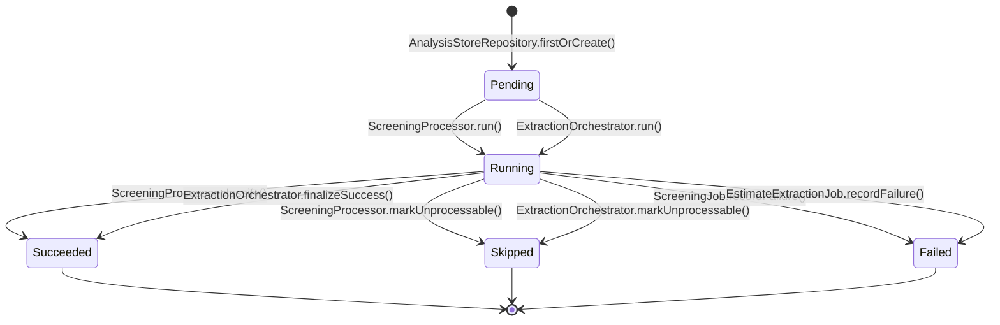
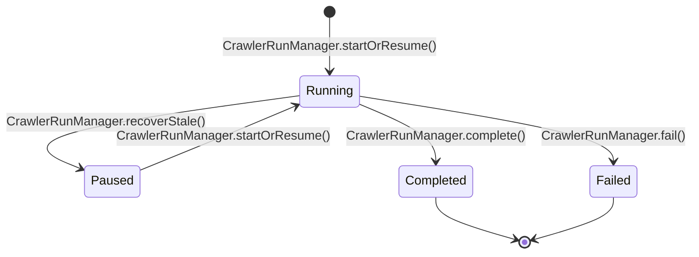

# Пять осей состояния домена: карта

Слова `status`/`stage`/`state`/`step` в проекте читаются как одно понятие, но это **пять разных
осей**, три разных класса — не рисуются одинаково. У ни одного из пяти enum'ов нет метода
`allowedTransitions()`/`canTransitionTo()`/`transitions()` (`grep` по `app/Enums/Procurement/**/*.php`
= 0) — переходы нигде не декларируются на enum'е, они выполняются присваиваниями в job'ах/сервисах.
Каждое ребро диаграмм ниже подтверждено конкретным `file:line`, перепроверенным чтением файла
(`plans/archive/DOMLANG` P8.1, `verified:✅ 2026-07-10`, разведка — `plans/archive/DOMLANG/findings/P8-status-writers.md`).

| Ось | Класс | Как представлена здесь |
|:--|:--|:--|
| `DocumentStatus` (8 кейсов) | guarded pipeline-FSM, **уже нарисован** | ссылка на Д1 (`document-pipeline.md`), не дублируется |
| `AnalysisStatus` (5 кейсов) | guarded FSM | новая диаграмма ниже |
| `RunStatus` (5 кейсов) | guarded FSM | новая диаграмма ниже |
| `ProcurementStatus` (7 кейсов) | **не guarded-FSM** — задаётся внешним маппингом | классификация, без transition-графа |
| `PipelineStage` (3), `AnalysisStep` (2) | не статус — ось-измерение | раздел «это не FSM» |

Нотация диаграмм ниже: только `Class.method()` (mermaid трактует `::` как разделитель метки
состояния и ломает парсер; workaround зафиксирован уже в Д1, `document-pipeline.md`).

## AnalysisStatus — `pending → running → succeeded|failed|skipped`

`app/Enums/Procurement/Ai/AnalysisStatus.php`: `Pending` / `Running` / `Succeeded` / `Failed` /
`Skipped`. Терминальность — по конвенции (методов `isTerminal()`/`isFailed()` на enum'е нет).

Писатели (перепроверены чтением файла):

| Переход | Метод | file:line |
|:--|:--|:--|
| `[*] → Pending` | `AnalysisStoreRepository::firstOrCreate()` | `app/Repositories/Procurement/AnalysisStoreRepository.php:35` |
| `[*] → Pending` (re-run, `parent_analysis_id`) | `AnalysisStoreRepository::createRerun()` | `app/Repositories/Procurement/AnalysisStoreRepository.php:61` |
| `Pending → Running` (screening) | `ScreeningProcessor::run()` | `app/Services/Procurement/Screening/ScreeningProcessor.php:64` |
| `Pending → Running` (extraction) | `ExtractionOrchestrator::run()` | `app/Services/Procurement/Analyzers/Estimate/ExtractionOrchestrator.php:84` |
| `Running → Succeeded` (screening) | `ScreeningProcessor::classify()` | `app/Services/Procurement/Screening/ScreeningProcessor.php:222` |
| `Running → Succeeded` (extraction) | `ExtractionOrchestrator::finalizeSuccess()` | `app/Services/Procurement/Analyzers/Estimate/ExtractionOrchestrator.php:700` |
| `Running → Skipped` (unprocessable, screening) | `ScreeningProcessor::markUnprocessable()` | `app/Services/Procurement/Screening/ScreeningProcessor.php:255` |
| `Running → Skipped` (unprocessable, extraction) | `ExtractionOrchestrator::markUnprocessable()` | `app/Services/Procurement/Analyzers/Estimate/ExtractionOrchestrator.php:720` |
| `Running → Failed` (screening, attempts исчерпаны) | `ScreeningJob::recordFailure()` | `app/Jobs/Procurement/ScreeningJob.php:104` |
| `Running → Failed` (extraction, attempts исчерпаны) | `EstimateExtractionJob::recordFailure()` | `app/Jobs/Procurement/Analyzers/Estimate/EstimateExtractionJob.php:102` |

`Skipped` в обоих случаях выше пишется **вместе** с переводом `DocumentStatus` в `Unprocessable`
(`markUnprocessable()` пишет оба статуса — см. Д1) — это не отдельная неудача анализа, а
констатация «документ необрабатываем» (D32/D38), спроецированная на ось анализа.

Особый писатель вне диаграммы: `AnalysisStoreRepository::createShadow()`
(`app/Repositories/Procurement/AnalysisStoreRepository.php:80`) создаёт shadow-анализ (`is_shadow =
true`) сразу в `Running`, минуя `Pending`, — параллельный теневой прогон вне партиционирующего
`unique`-индекса `(document_version_id, step) WHERE superseded_at IS NULL AND is_shadow = false`,
не альтернативный старт основного FSM.

Ось `AnalysisStep` (`Screening`/`Extraction`) ортогональна статусу — см. раздел «это не FSM».

## RunStatus — единственный писатель `CrawlerRunManager`

`app/Enums/Procurement/Crawler/RunStatus.php`: `Running` / `Paused` / `Completed` / `Failed` / `Cancelled`.
`isTerminal()` = `Completed`/`Failed`/`Cancelled` (`RunStatus.php:18-24`). Все переходы — в одном
сервисе, `app/Services/Procurement/CrawlerRunManager.php`.

Писатели (перепроверены чтением файла):

| Переход | Метод | file:line |
|:--|:--|:--|
| `[*] → Running` (первый старт, `UniqueConstraintViolationException` — гонка резолвится тем же запросом) | `CrawlerRunManager::startOrResume()` | `app/Services/Procurement/CrawlerRunManager.php:48` |
| `Paused → Running` (resume) | `CrawlerRunManager::startOrResume()` | `app/Services/Procurement/CrawlerRunManager.php:40` |
| `Running → Paused` (протухший heartbeat, timeout из `config('crawler.heartbeat_timeout_seconds')`) | `CrawlerRunManager::recoverStale()` | `app/Services/Procurement/CrawlerRunManager.php:131` |
| `Running → Completed` | `CrawlerRunManager::complete()` | `app/Services/Procurement/CrawlerRunManager.php:104` |
| `Running → Failed` | `CrawlerRunManager::fail()` | `app/Services/Procurement/CrawlerRunManager.php:112` |

`Cancelled` — в enum'е присутствует, но писателя нет: `grep -rn 'RunStatus::Cancelled' app/` = 0
вхождений вне определения кейса. Ребро на диаграмме **не рисуется** — недостижимый кейс,
forward-provision без названного продюсера (аналогично классу `Awarded`/`Unsuccessful` у
`ProcurementStatus`, но без docblock-декларации D5/D13 — это находка P8.1, не решённый статус;
если появится источник (напр. ручная отмена прогона оператором), кейс требует нового писателя, а
не молчаливого ребра по аналогии).

## DocumentStatus — уже нарисован (Д1)

`app/Enums/Procurement/Document/DocumentStatus.php` (8 кейсов: `Discovered`/`Downloaded`/`Prepared`/
`Screened`/`Extracted`/`Ignored`/`Failed`/`Unprocessable`) — guarded pipeline-FSM с диаграммой в
`docs/dev/document-pipeline.md` (раздел «Д1 — FSM документа»). Не дублируется здесь: канон рёбер
и их писателей — там.

## ProcurementStatus — внешне маппится, не guarded-FSM

`app/Enums/Procurement/ProcurementStatus.php` (7 кейсов: `Bidding`/`Evaluation`/`Awarded`/
`Completed`/`Cancelled`/`Unsuccessful`/`Unknown`; ЕИС не выделяет отдельного этапа «до подачи
заявок» — публикация извещения сразу даёт «Подача заявок», недостижимый кейс без источника из
предыдущей ревизии решений плана удалён, D16).

`prc_procurements.status` **не имеет ни одного внутреннего transition-гарда**. Значение целиком
задаёт `StatusMappingService::resolve(registryId, sourceStage)` (`app/Services/Procurement/
StatusMappingService.php:18-31`): резолвит пару `(registry_id, source_stage)` через
`prc_status_mappings` (`firstOrCreate`, незнакомая пара → `canonical_status = 'unknown'`, D17), и
это значение пишется на **каждой ревизии** через `ProcurementStoreRepository::storeProcurement()` и
`::updateProcurementHead()` параметром, вычисленным маппером. Рисовать рёбра вида `Bidding -->
Evaluation` означало бы приписать enum'у transition-гард, которого в коде нет, — тот же класс
искажения, что spec drift, закрытый в P6.

Единственные реальные, анкорённые отношения:

- **Резолв** — `StatusMappingService.resolve()` → `ProcurementStatus` (см. выше), не переход.
- **Классификация** — `ProcurementStatus.php:36-50`: `isTerminal()` (`Completed`/`Cancelled`/
  `Unsuccessful`) и `isFailed()` (`Cancelled`/`Unsuccessful`).
- **Порядок этапов ЕИС** — прозой, не enforced приложением: «Подача заявок» (`Bidding`) → «Работа
  комиссии» (`Evaluation`) → «Закупка завершена» (`Completed`) / «Закупка отменена» (`Cancelled`);
  это процедура источника (`RAG:✅ 2026-07-10`, `plans/archive/DOMLANG/findings/P2-eis-stages.md`), не
  transition-граф приложения. `DetailRefetchSelector.php:23` читает `{Evaluation, Awarded}` как
  критерий рескана — чтение, не переход.
- **Forward-provision** (`ProcurementStatus.php` docblock, DOMLANG D5/D13): `Awarded` и
  `Unsuccessful` — кейсы с названным будущим продюсером (detail-слой / `prc_protocols`), ещё не
  подключённым парсером. Оба кейса сейчас встречаются в коде только как элементы read-side
  констант (`DetailRefetchSelector::RESCAN_STATUSES`, `CsvSourceMethod::FINALIZING_STATUSES`) —
  writer'а, присваивающего их значением, нет.

## Не FSM: `PipelineStage` / `AnalysisStep`

Обе оси — измерения маршрута/шага, не статусы с переходами.

- **`PipelineStage`** (`app/Enums/Procurement/Document/PipelineStage.php`: `Prepare`/`Screening`/
  `Extraction`) — стадия конвейера-диспетчера, не статус документа. Фабрики: `forDocumentRetry()`
  (`:26`) всегда возвращает `Prepare` — документы ретраятся только на стадии подготовки;
  `fromAnalysisStep()` (`:31`) — чистое сопоставление `AnalysisStep → PipelineStage`. Связана с Д2
  (`docs/dev/document-pipeline.md`, раздел «Д2 — стадии, очереди, lease/retry»,
  `PipelineDispatcher`). `ProcessStage` в коде не существует (`grep` = 0), упоминать не следует.
- **`AnalysisStep`** (`app/Enums/Procurement/Ai/AnalysisStep.php`: `Screening`/`Extraction`) — какой
  шаг анализа выполняется для сессии `Ai\Analysis`; ортогонален `AnalysisStatus` (см. выше) — одна
  сессия несёт `step` и прогоняет свой `pending → running → terminal` в его рамках.
