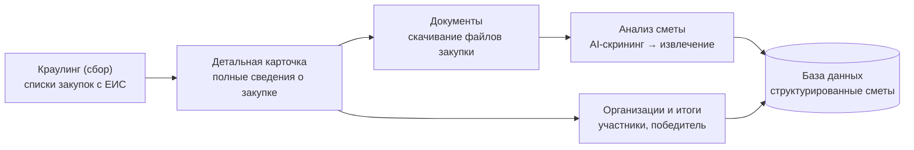

# Agelto — обзор

## Что делает Agelto

Agelto каждый день ходит на портал государственных закупок (ЕИС, zakupki.gov.ru) и приносит оттуда домой всё, что там опубликовано по интересующим нас разделам (44-ФЗ и 223-ФЗ): сами закупки, их документы, а из документов — сметы (детальные списки материалов, объёмов и цен). Дальше система силами ИИ (LLM) разбирает эти сметы построчно и кладёт результат в базу данных в виде структурированных таблиц, а не «пачки PDF».

Итоговая цель — не хранить у себя копию ЕИС ради архива, а получить машиночитаемую базу смет, по которой дальше можно искать нужные позиции (например, «где в госзакупках упоминается кабель такой-то марки») — этим уже занимаются следующие продуктовые слои поверх системы (см. [[01_Business/concept-and-monetization]]).

## Для кого это

- **Внутренние операторы** — люди, которые следят за качеством работы пайплайна через админку (Filament), донастраивают источники, разбирают ошибки.
- **Датасет для собственной AI-модели** — накопленные сметы с эталонной разметкой в перспективе позволяют обучить более дешёвую локальную модель взамен внешнего LLM-провайдера.
- Публичный клиентский интерфейс (для менеджеров по продажам, ищущих лиды) — это надстройка над данным пайплайном, находится за пределами этой документации.

## Пайплайн одним абзацем

Всё начинается с обхода реестра закупок (краулинг): система периодически скачивает списки закупок с ЕИС и находит новые/изменившиеся записи. Для каждой такой закупки отдельным шагом снимается полная карточка — не только общие сведения, но и участники, финансирование, протоколы и итоги. У карточки есть документы (файлы) — они скачиваются, и каждый прогоняется через AI: сначала дёшево (это вообще смета или нет?), и если да — то дорого и подробно (разбор каждой строки сметы). Параллельно с этим по итогам закупки фиксируются организации-участники и победитель. Всё это время у закупки бережно хранится история изменений — ничего не перезаписывается молча.

## Пайплайн на схеме

## Из чего состоит система (по-простому)

| Часть | Что делает |
|---|---|
| Сбор (краулинг) | Периодически скачивает списки закупок с ЕИС, находит новое/изменившееся |
| Детальный анализ | По найденной закупке снимает полную карточку: участники, деньги, протоколы, итоги |
| Документы | Скачивает файлы закупки, определяет их тип, при необходимости готовит к разбору (архивы, конвертация) |
| ИИ-анализ смет | Дёшево отсеивает нецелевые документы, дорого и подробно разбирает найденные сметы построчно |
| Админка | Операторский интерфейс — статус пайплайна, ручные действия, донастройка источников и AI-провайдеров |

## Куда смотреть дальше

- Бизнес-слой (концепция, рынок, финансы) — [[01_Business/_index]].
- Пользовательские сценарии и термины (жизненный цикл закупки, сбор данных, документы и сметы, глоссарий) — [[02_Workflow/_index]].
- Техническая документация для разработчиков (архитектура, схема БД, пайплайны, админка) — [[03_Dev/_index]].

Технические детали «как это реализовано» — в `docs/03_Dev/*`, здесь их сознательно не дублируем.
