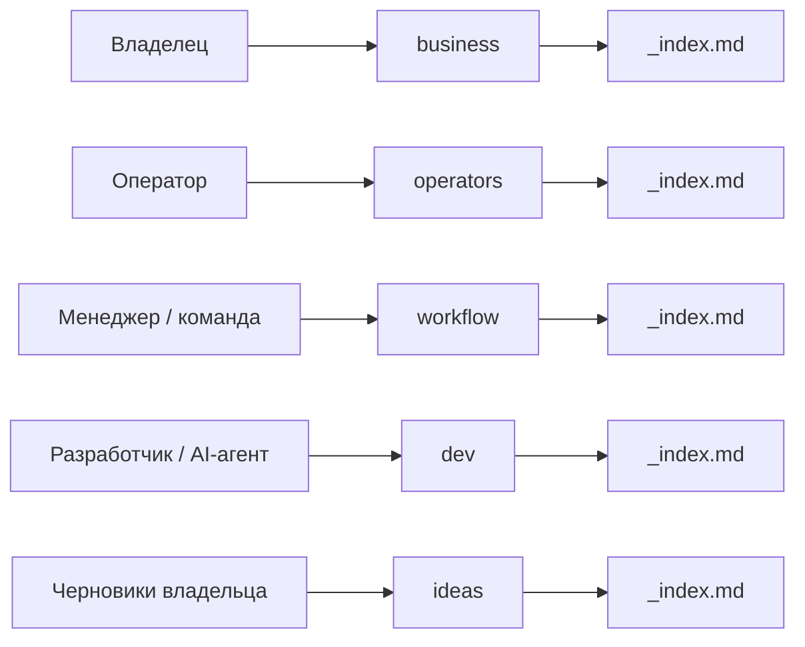

# Документация Agelto

Это рабочая книга Agelto: от смысла продукта и бизнес-процессов до работы с системой,
production-сервером и кодом. Верхнее меню выбирает большой маршрут, а левое меню показывает
содержание выбранной книги. Никакой пункт меню не является механизмом доступа: портал доступен
только после входа и проверки права «Документация».

## Выберите маршрут

| Нужно понять или сделать | Начните здесь | Что будет дальше |
|---|---|---|
| Зачем существует продукт и что в приоритете | [Продукт](/business/) | Ценность, дорожная карта, риски. |
| Как закупка превращается в проверенный результат | [Бизнес-процессы](/workflow/) | Сбор данных, документы и сметы, качество AI. |
| Работать в админке или поддерживать production | [Эксплуатация](/operators/) | Операторские сценарии и цельное руководство по серверу и релизам. |
| Разрабатывать и менять систему | [Разработка](/dev/) | Локальный запуск, архитектура, пайплайны, AI и инженерные команды. |

## Самые частые задачи

| Задача | Страница |
|---|---|
| Подготовить сервер и выполнить первый релиз | [Production: полное руководство](operators/production/deployment.md) |
| Выпустить уже собранный образ без сборки на сервере | [Сценарии повторного релиза](operators/production/deployment.md#5-повторный-релиз-уже-настроенного-окружения) |
| Понять, почему изменение кода всё-таки требует нового образа | [Граница immutable-образа](operators/production/deployment.md#что-на-самом-деле-означают-классы-релиза) |
| Проверить результат AI-разбора | [Проверить AI-анализ](operators/how-to/check-ai-analysis.md) |
| Запустить проект локально | [Локальный запуск](dev/getting-started.md) |
| Понять архитектуру и границы доменов | [Архитектура](dev/architecture.md) |
| Настроить модели, маршруты и промты | [Нейросети и маршруты моделей](dev/llm-providers.md) → [Промты](dev/ai/prompts.md) |

## Как читать эту документацию

Каждая крупная тема начинается с вводной страницы и затем идёт в естественном порядке. Короткие
страницы остаются только справочниками, альтернативами и аварийными инструкциями; они не должны
быть необходимы, чтобы закончить основной сценарий. Если в тексте не хватает шага, команды,
проверки или схемы, это дефект документации — исправляйте его в канонической главе, а не прячьте
в новую заметку.

Редакторам: [правила ведения](meta/editing.md) и [каркас документации](meta/structure.md).
Владельцу: [черновики и входящие идеи](/ideas/).
