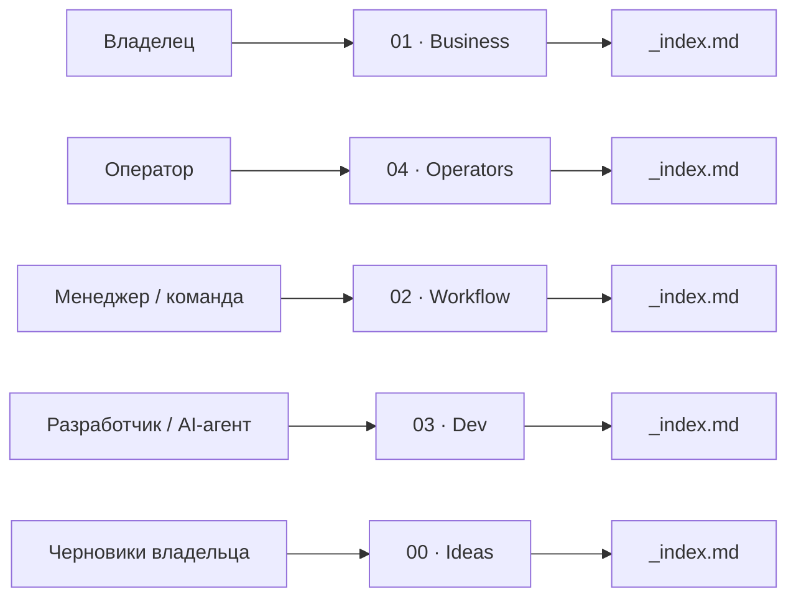

# Документация Agelto

Портал по домену закупок (краулинг → извлечение смет), инфраструктуре и разработке AI-пайплайна.
Начните с маршрута своей роли: каждый раздел доступен отсюда не более чем за два перехода.

## Для кого что читать

| Роль | С чего начать |
|---|---|
| **Владелец/менеджмент** | [Обзор продукта](01_Business/overview.md) → [дорожная карта](01_Business/roadmap.md) → [процессы бизнес-языком](02_Workflow/_index.md) |
| **Оператор админки** | [Роутер операторов](04_Operators/_index.md) → [статусы и колонки](04_Operators/reference/statuses.md) → SOP в [how-to/](04_Operators/how-to/) |
| **Разработчик** (новый в проекте) | [Требования и запуск](03_Dev/getting-started.md) → [архитектура](03_Dev/architecture.md) → [пайплайн своей задачи](03_Dev/_index.md) |
| **DevOps** | [Docker: обзор](03_Dev/docker/index.md) → [production](03_Dev/docker/production.md) → [деплой](03_Dev/process/deploy.md) |
| **AI-агент** | [Устройство `.ai/`-контура](03_Dev/ai-context/index.md) → [сценарии работы](03_Dev/ai-context/scenarios.md) |

## Быстрые ссылки: работа с продуктом

| Задача | Страница |
|---|---|
| Установить и запустить локально | [Требования и локальный запуск](03_Dev/getting-started.md) |
| Понять путь документа/сметы | [Document & Estimate Pipeline](02_Workflow/document-and-estimate-pipeline.md) |
| Разобраться в терминах домена | [Глоссарий](02_Workflow/glossary.md) |
| Понять, как готовятся промты | [Промты и качество](02_Workflow/prompts-and-quality.md) |
| Проверить результат AI-разбора | [Проверить AI-анализ](04_Operators/how-to/check-ai-analysis.md) |
| Что-то сломалось (dev) | [Troubleshooting](03_Dev/troubleshooting.md) |
| Что-то сломалось (Docker) | [Docker troubleshooting](03_Dev/docker/troubleshooting.md) |

## Быстрые ссылки: поддержка документации

| Задача | Страница |
|---|---|
| Шпаргалка команд | [Commands](03_Dev/commands.md) |
| Как править документацию | [Правила редактирования](meta/editing.md) |
| Куда класть новый файл | [Канон каркаса](meta/structure.md) |

## Карта разделов

- [00_Ideas](00_Ideas/_index.md) — черновики владельца (vault-канон, наполняется владельцем).
- [01_Business](01_Business/_index.md) — обзор продукта, риски и дорожная карта (аудитория: владелец).
- [02_Workflow](02_Workflow/_index.md) — доменные процессы бизнес-языком.
- [03_Dev](03_Dev/_index.md) — техническая документация, пайплайны, Docker, runbooks и ADR.
- [04_Operators](04_Operators/_index.md) — операторские SOP и справочник статусов админки.
- [Meta-документация](meta/editing.md) — правила редактирования и каркас дерева.
