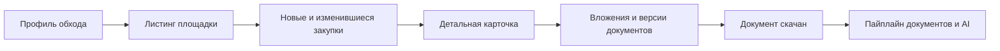
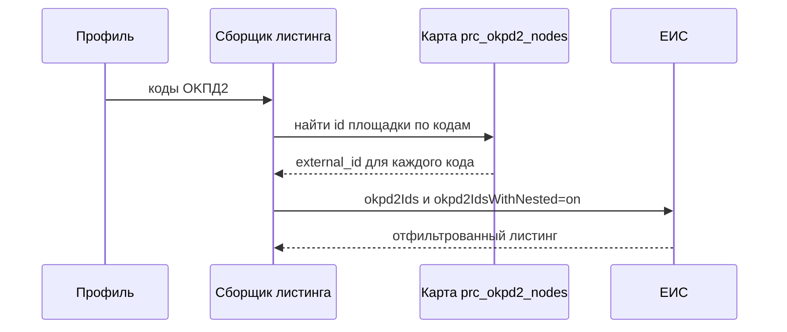
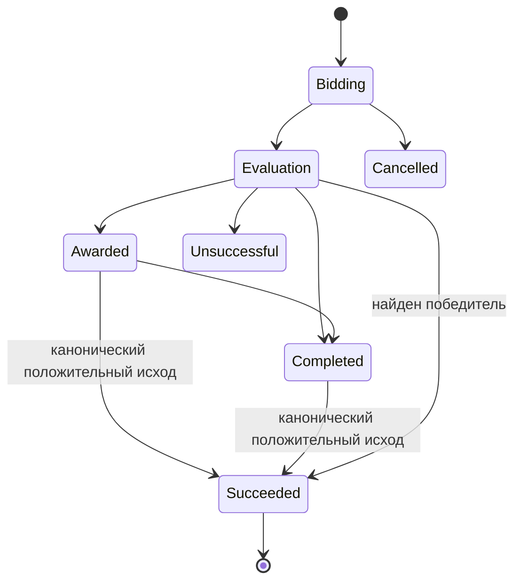

# Краулинг и обнаружение

Data-only площадка не делает обход доступным: crawler profile требует typed definition с exact
platform/registry capability. Missing mapping завершается fail-closed без EIS fallback; checklist,
диагностика и test template: [`platform-extension.md`](../dev/platform-extension.md).

Это первая стадия конвейера — до неё EST-AI (AI-анализ документов) не подключается. Задача
краулинга — найти закупки на площадках-источниках и скачать приложенные к ним документы.

## Контур обхода

Профиль обхода задаёт, какую часть площадки и как часто проверять. Система читает листинг,
сохраняет новые и изменившиеся закупки, затем отдельно снимает их карточки и вложения. Скачанная
версия документа передаётся в следующий контур, где её готовят и анализируют; сам краулинг на этом
заканчивается. Технические очереди, лимиты и точки передачи описаны в
[`dev/crawling-pipeline.md`](../dev/crawling-pipeline.md).

## Площадка, краулер, прогон

- **Площадка (Platform)** — сайт-источник данных о закупках (например, реестр ЕИС).
- **Краулер (Crawler)** — настроенный профиль обхода одной площадки: что искать, с какой
  периодичностью, какие фильтры.
- **Прогон (CrawlerRun)** — один запуск краулера. У прогона есть статус (идёт/завершён/провален),
  время начала/окончания и «пульс» — отметка, что процесс жив, а не завис.

## Что происходит на этой стадии

1. Краулер обходит площадку и находит закупки — новые или изменившиеся с прошлого прогона.
2. Для каждой найденной закупки система сохраняет её карточку (номер, статус, участники, лоты) и
   список приложенных документов. Удаление ранее известных исходных вложений допускается только
   после полного снимка вкладки: защитная страница, изменённый selector или испорченная строка
   оставляют уже известные вложения без изменений. Файлы, извлечённые из архива, не являются
   вложениями площадки и не участвуют в этой сверке.
3. Новые документы скачиваются на диск (объектное хранилище). Для существующего ЕИС `uid`
   действует bounded revalidation: новая ревизия закупки сразу ставит уже известные вложения в
   очередь повторной проверки, а страховочный селектор раз в шесть часов берёт не более 25
   документов, чья последняя проверка старше 30 дней (значения допускают конфигурацию). Снятые
   документы, future backoff, permanent failure и активный lease исключаются. Совпавший SHA-256
   только обновляет время последней проверки и сохраняет текущую pipeline-стадию; новые bytes
   создают новую `DocumentVersion`, переводят документ в `Downloaded` и возвращают его в обычную
   подготовку.
4. Как только версия документа успешно скачана — она готова к следующей стадии, AI-анализу
   (`document-and-estimate-pipeline.md`).

Неизменность bytes для одного ЕИС `uid` публично не подтверждена. Owner-authorized P4.1 завершился
ветвью `insufficient_evidence`: ЕИС не ответила в пределах трёх последовательных transport-timeout
на A1 и B2, поэтому отсутствие counterexample не трактуется как гарантия. Fail-closed результат —
bounded revalidation выше; до controlled production его независимо принимает P4.2.

CSV читается логическими записями, поэтому многострочный текст в кавычках не уменьшает число
закупок. Ошибочный HTTP, HTML, повторное пустое тело, неверный заголовок или повреждённая
структура CSV не означают пустой день. Только корректный CSV с одним заголовком подтверждает
пустую выдачу. Отсутствие номера, даты размещения или обновления считается ошибкой строки.

При ошибке преобразования или сохранения строки листинга блок считается неполным.
Сырой ответ и счётчик ошибок сохраняются, прогон приостанавливается до продвижения курсора.
Отвергнутый HTTP/CSV-ответ получает отдельный Fetch с причиной отказа и ссылкой на сырьё,
без ingestion. Ошибка структуры ответа не разрешает продвижение курсора.
Повторная обработка уже сохранённых строк идемпотентна; непрочитанная строка не пропускается
ради успешного статуса. После задержки повторяется тот же блок; серия отказов включает
ожидание или остановку этапа до оператора. Пороги брейкера не разрешают пропуск данных.
Метка `source_suspended` снимается при фактическом допуске воркера, поэтому ошибка отправки
job в очередь не теряет возобновление. Ошибку формата нужно исправить до успешного завершения блока.

Листинг ЕИС получает deadline запуска: он ограничивает ожидание общего бюджета площадки,
таймаут HTTP и паузы между повторами. Для архивного профиля один deadline действует на все
дни текущего запуска. Исчерпание времени даёт checkpoint с прежним курсором, затем продолжение.
Один HTTP 404 карточки обрабатывается общей ограниченной политикой повторов. Недоступный
эталон структуры карточки считается ошибкой конфигурации и не разрешает запись результатов разбора.

Полнота позиций детальной карточки сверяется с итогом «Итого (N записей)» самой таблицы.
Раскрываемые `truInfo_*`-строки со сведениями заказчика не являются позициями и не меняют
их порядковые номера. Повреждённая строка позиции, отсутствующий итог или несовпадение
числа позиций оставляют snapshot неполным; закупка не получает успешный `detail_fetched_at`.

Для первого этапа задаётся `CRAWLER_DOWNSTREAM_ENABLED=false`: последующие dispatch и
уже поставленные document/detail jobs не начинают работу. Оба AI-флага также остаются
выключены. Смена флага не прерывает уже исполняющийся запрос; переход требует остановки
работающих downstream workers. При включении обычные backlog/due/recovery подбирают данные снова.

Организации common-info связываются по внешним идентификаторам площадки через общий
контракт `(platformCode, type, value)`. Разбор и форматы кодов ЕИС принадлежат её адаптеру;
общий реестр организаций хранит их в `org_organization_identifiers`. Секция «Размещение
осуществляет» задаёт размещающую организацию и её явную роль (заказчик, уполномоченный орган,
уполномоченное учреждение и др.). При отдельном заказчике его название и ИКЗ берутся вместе
из блока «Требования заказчика»; раскрываемые строки `truInfo_*` служат проверкой согласованности.
Контактные данные размещающей организации не переносятся на другого заказчика. Неизвестная роль,
отсутствующий идентификатор или противоречие запрещают сверку/удаление прежних сторон;
такой detail-проход остаётся retryable и не получает новую отметку `detail_fetched_at`.
Для совместной закупки сохраняется каждая роль заказчика; одиночный `customer_org_id` заполняется
только при единственном заказчике. Сверка common-info сохраняет роли из других вкладок.

## Прокси

Запросы к площадкам могут идти через прокси-узел — система сама выбирает подходящий узел под
конкретный запрос (по стране, доступности, недавним отказам) и учитывает исход, чтобы реже выдавать
проблемные узлы. У профиля три явных режима: «Профиль» использует его привязанные узлы,
«По умолчанию» — один общий nullable default-узел, «Напрямую» — осознанный opt-out. Настроенный,
но недоступный профильный или default-узел останавливает запрос: он не заменяется другим узлом и не
переключается напрямую. В evidence каждого fetch сохраняется источник `profile`/`default`/`direct`.

## Настройки обхода: три уровня

Настройка живёт там, где её смысл: профиль определяет намерение конкретного обхода, площадка —
её ограничения, а конфигурация — общие безопасные правила исполнения. Поэтому изменение
расписания профиля не меняет лимит для всей площадки, а изменение общего лимита не расширяет
предметную выборку профиля.

| Параметр | Где живёт | На что влияет | Кто читает |
|:--|:--|:--|:--|
| Режим, расписание, активность, фильтр и диапазон дат | Профиль обхода | Что и когда искать; fresh — короткий актуальный поток, archive — ограниченный исторический диапазон | Диспетчер запуска и листинг |
| Режим прокси, страна и привязки | Профиль обхода; nullable default ID — в typed settings | `profile`/`default`/`direct` для листинга, карточки и документов; configured source fail-closed | `ProxyResolver` и все crawler call sites |
| Лимит запросов и паузы стадий | Площадка, с общим fallback в конфигурации | Общий темп запросов к хосту и интервалы между ними | Общий бюджет запросов |
| Пороги и эталон healthcheck | Площадка и конфигурация | Когда наблюдение считает площадку исправной, деградировавшей или сломанной | Ежедневный healthcheck |
| TLS-доверие, таймаут checkpoint и размер пачки деталей | Конфигурация | Безопасность соединения и границу работы одной очередной задачи | HTTP-клиенты и jobs |

## Фильтр профиля — типизированный, свой у каждой площадки

Что именно искать на площадке (этапы закупки, диапазон цены, дата публикации) задаётся в форме
краулера полями, которые площадка реально понимает — не свободным набором ключ-значение. У каждой
площадки/реестра — свой набор полей (площадка ЕИС по 44-ФЗ: этапы «подача заявок»/«работа
комиссии»/«завершена»/«отменена», цена от/до, даты публикации, строка поиска); опечатка в имени
поля отклоняется формой сразу, а не тихо игнорируется площадкой. Верификация фактов ЕИС —
2026-08-04/05 (`plans/archive/2026.07.31-SYS-INTEGRITY/findings/P4-eis-recon.md`).

Для ОКПД2 профиль хранит понятные человеку коды, а не внутренние идентификаторы ЕИС. Перед
запросом система сверяет их с картой площадки; отсутствующий код останавливает запрос и требует
сначала обновить карту, чтобы фильтр не стал незаметно шире.

## Отслеживание изменений: перекрытие окон и суточный дозор

Обход «свежего потока» (fresh) идёт короткими интервалами (по умолчанию каждые 30 минут) и ловит
почти все обновления влёт. На случай простоя (площадка недоступна, воркер стоял) есть два
подстраховывающих механизма:

- **Рескан бэклога** — если свежий обход упёрся в потолок глубины выдачи площадки (не успел дойти
  до последнего известного обновления), система запускает точечный архивный обход окна простоя.
  Окно рескана берётся с запасом на пару суток назад (перекрытие) — источник (ЕИС) отдаёт дату
  обновления только с точностью до суток, и часовые пояса заказчиков по стране расходятся с
  расписанием сервера; без запаса обновление на границе окна рискует остаться незамеченным.
- **Суточный дозор (delta-scan)** — плановый ежесуточный проход по тому же окну «вчера/сегодня с
  запасом», независимо от того, случился ли простой. Выключен по умолчанию до первого боевого
  прогона площадки — включение обхода на всю страну посреди ещё не законченной настройки означало
  бы непрерывный боевой трафик к источнику.

  Backlog и delta допускают только одного execution owner на строку run. Планировочный lock —
  вспомогательный; действительная защита — PostgreSQL lease с owner token и едиными часами БД.
  Пока lease действителен, stale-recovery не паузит run. Второй запуск получает отдельный outcome
  `busy` и не вызывает scanner. HTTP-запрос листинга выполняется вне DB-lock, но его ingestion,
  stats и checkpoint записываются в короткой row-locked PostgreSQL-транзакции после renew/fence
  lease: takeover ждёт commit/rollback. После expiry новый owner продолжает сохранённый checkpoint.

Повторный проход по уже виденному обновлению ничего не портит: система сравнивает хэш значимых
полей закупки и, если ничего не изменилось, просто отмечает «видели снова» — новой записи в
истории не создаётся.

Fresh не объявляет выдачу полной лишь потому, что один непустой блок не изменил бизнес-данные.
Пустой листинг — безопасная граница; для политики «только актуальные данные» суточная дата
обновления пересекает границу только на строго предыдущих сутках. Точность даты передаёт маппер,
а не эвристика по `00:00:00`, поэтому следующая страница тех же суток дочитывается. Исчерпание
`fresh_max_blocks` сохраняет курсор и остаётся `running`: та же job продолжает обход отдельным
slice, пока не будет доказан terminal stop.

## Статус закупки и положительный исход

Статус, пришедший с площадки, приводится к каноническому статусу закупки и каждое изменение
остаётся в истории. Положительный исход фиксируется один раз: когда статус стал `awarded` или
`completed`, либо когда в результате определения поставщика появился победитель. После этого
создаётся событие «закупка состоялась» для витрин и подписчиков.

## Сиды площадки: ЕИС заводится данными, не миграцией

Площадка ЕИС, её реестр 44-ФЗ и два профиля обхода (архивный — для обучающего корпуса за 2025 год,
и «свежий поток» — для боевого слежения, изначально выключен до решения владельца) заводятся
сидером, не миграцией — это обычные данные, не структура схемы. Повторный прогон сидера безопасен
(не плодит дублей), но перезаписывает ручные правки профиля, сделанные оператором в админке —
об этом стоит помнить при повторном `db:seed`.

## Живые ограничения площадки ЕИС (снято 2026-08-04/05)

- Глубина выдачи одного запроса листинга ограничена **ровно 5 000** записей (не «около 10 000», как
  считалось раньше) — за пределом площадка молча повторяет последний блок вместо ошибки; система
  детектирует это сравнением с предыдущим блоком.
- Блок выгрузки — 500 строк за запрос.
- Площадка использует сертификат российского удостоверяющего центра — доверие к нему прошито в
  образе приложения (не системным доверенным набором), подробности — `docs/dev/crawling-pipeline.md`.
- Как запустить контрольный архивный обход и что при этом смотреть — `docs/dev/runbooks/archive-run.md`.

## Устойчивость к сбоям

Обход площадки может прерваться (сеть, блокировка, перезапуск). Прогон умеет возобновляться с
места остановки, а не начинать с нуля — это важно для больших площадок, где полный обход занимает
часы. Если прогон завис (нет «пульса» долгое время) или регулярно падает — это видно оператору
в разделе «Прогоны» админки (`operators/reference/statuses.md`).

Пауза/отмена проверяется между HTTP-попытками и во время ожиданий, heartbeat продлевает
execution lease. Текущий запрос ограничен deadline очередного slice. Исчерпание времени
сохраняет день для continuation, но сетевое исчерпание попыток оставляет Failed: автоматический
повтор Failed ещё не согласован. Операторское продолжение после cooldown не сбрасывает
proxy health и не заменяет Failed на Paused SQL-запросом.

## Где почитать про internals

Технические детали (job'ы, очереди, курсор возобновления, общий бюджет запросов, healthcheck и
дробление по цене для больших выборок) —
[`dev/crawling-pipeline.md`](../dev/crawling-pipeline.md). Этот раздел — для понимания
процесса, не для настройки кода.

Что происходит с документом ПОСЛЕ скачивания (подготовка → анализ → извлечение сметы) —
`document-and-estimate-pipeline.md`.

## Полнота и порядок наблюдений

Fresh останавливается при изменении профиля между блоками. Повтор после ошибки сохраняет
позицию; архивный повтор начинает неполное окно с начала. Архив подтверждает окно только после
двух совпадающих полных проходов. Плановый delta-scan включён и повторно читает перекрывающиеся
окна обновления; для fresh-профиля нужен активный архивный профиль того же реестра. Отсутствие
такого профиля теперь даёт ненулевой код команды, а не успешный пропуск работы.

Такой обход исправляет пропуски при сдвиге offset между чтениями. Он не является транзакционным
снимком внешней площадки: удалённую до первого наблюдения запись восстановить невозможно;
постоянно меняющееся окно остаётся незавершённым и требует повторного чтения.

Дата с точностью до дня хранится как интервал источника. При конфликте внутри этих суток
выбирается последнее HTTP-наблюдение; это не доказательство точного времени редакции площадки.
Детали контрактов, обновления БД и проверок описаны в [internals](../dev/crawling-pipeline.md).

## P2.14: canonical identity и extension persistence

Primary identity — точный `(platform_id, source_identity_type, source_identity_value)`.
RegistryDefinition задаёт type; IdentityResolver проверяет platform/registry по trusted catalog.
Значение opaque: ведущие нули, регистр, пробелы и Unicode representation сохраняются.
Clean baseline использует text COLLATE "C", UNIQUE tuple и composite registry/platform FK.
Общие DTO и procurement больше не содержат registry_number/ikz/etp_number/registry_guid;
для отображения служит source_identity_value, остальные identifiers принадлежат EisDetailExtension.

SnapshotFinalizer::lockIdentities вызывается в caller transaction до work lock: сначала
все deduplicated advisory keys в signed64 порядке, затем existing subject rows по id.
После owner fence persistLocked использует тот же transaction-bound handle и не начинает
транзакцию или HTTP. INSERT ON CONFLICT по exact identity constraint и locked reread
не требуют повторного fetch; 23505 не добавлен в transient retry policy.
Legacy block ingestor не поглощает persistence exceptions: весь block откатывается,
а raw artifact подготавливается до publication transaction.
Legacy ingest entrypoint сохраняется до producer cutover P2.18. Новый stage handler здесь
не активируется; P2.15/P2.16 подключают listing/detail/status publication к этим primitives.

EisExtensionPersister — единственный application writer prc_eis_details. Registry выбирает
точный typed writer; ошибка откатывает canonical revision/events и cursor вместе с extension.
CompleteEmpty common-info может очистить прежние common fields; listing metadata не
обнуляется отсутствующими полями. Старые detail consumers используют тот же writer.
EIS UI fields загружаются через registered UI extension, без EIS imports в shared resource.

T41 проверяет opaque values/collation, platform и registry separation, FK rejection,
forced advisory hash collision, ON CONFLICT и два PostgreSQL contenders с одним physical
fixture HTTP на block и двумя domain commits. T42 проверяет rollback revision/events/cursor,
caller transaction и negative writer ownership fixtures. core-test-acquisition теперь запускает
эти текущие assertions; полная группа acquisition принимается в P2.19.
Schema inventory фиксирует фактические три изменённые таблицы; marker current_item остаётся
последним полностью активированным carrier stage, без ранней активации future carriers.
Двукратный isolated install и полную regression запускает conductor (V3/V4).

## P2.15: listing coverage до активации P2.18

Новый `ListingHandler` получает одну immutable page assignment и делает fetch вне
транзакции. `ListingFinalizer` под Process ownership сохраняет summaries, detail intents,
page receipt, cursor successors и required run edges вместе с transition/outbox.
Невалидный ответ не продвигает cursor. Старые runtime consumers переключаются в P2.18.

EIS planner использует inclusive rows с 1, default block 500 (локальные bounds 1..1000),
дневные окна и decimal price bisection с перекрытием midpoint. Число 5000 не является
доказательством конца: overflow/repeated page требует split либо явного incomplete debt.
Начальный план ограничен 400 окнами, страницы — 12 на pass, passes — 3, split depth — 20,
общий allocation budget — максимум 10000. Не размещённый хвост остаётся durable debt.

Закрытый partition complete только после двух последовательных непрерванных полных
passes с одинаковыми identity+revision/content fingerprints. Повтор после takeover
не засчитывает прерванный pass как stability proof. Open day сохраняется observed;
после source-local closing boundary он попадает в due reconciliation даже после
долгого простоя. Offset pagination остаётся best-observed: overlap и повторные scans
снижают риск пропусков, но не доказывают атомарный снимок изменяемого источника.

`ListingCoverageRepository` восстанавливает verified/observed watermarks и debt из
immutable assignments и fenced receipts в `prc_crawl_blocks`; отдельной mutable
watermark authority нет. Publish/update имеют разные stream keys; меняющийся horizon
не меняет stream identity. Verified watermark не перескакивает незакрытый gap,
recovery сохраняет filter snapshot, access policy, adapter version и decimal bounds.
Split parent не закрывает discovery, пока не учтены все дочерние blocks. Required
detail works удерживают drain run отдельно от закрытия discovery.

Для P2.16 `ListingStoreRepository::detailReference(intentId)` возвращает сохранённый
`ListingDetailReference` с opaque locator/revision/fingerprint. Detail intent dedup
учитывает content и policy; несовместимый concurrent intent остаётся pending. Его
активация/retirement и detail/status handlers принадлежат P2.16/P2.18. Listing не
запускает document pipeline. Схема P2.15 использует существующие subject carriers.

## P2.16: части карточки и повторяемые циклы

`DetailHandler` сохраняет каждую полную независимую часть как immutable artifact и
fenced checkpoint. Повтор продолжает недостающие части того же intent/pass; partial,
transport defer и stale ownership не публикуют смешанную карточку и не удаляют старые
стороны, документы или результаты поставщика. В конце повторно читается контрольная
часть. При несовпадении начинается новый bounded pass (максимум три); согласованный
revisionless snapshot помечается `bounded_revalidated`, а не доказанным атомарным
снимком источника. Изменение отдельной вкладки и ABA контрольной части могут остаться
незаметными. Hashes и fetched_at каждой части остаются в сохранённом результате.

`RefreshRepository` под lock закупки атомарно выделяет cycle/intent/work, required
run link, закрывает конечный discovery и переносит next_due. Неизменившийся статус
завершает собственный цикл; следующий due создаёт новую работу и новый fetch.
Настраиваемый `RefreshPolicy` задаёт стартовые интервалы 6 часов для активных, 24 часа
для недавно закрытых (30 дней), 7 дней для старых terminal и 24 часа для полной
detail revalidation. Cadence не заменяет request-layer status capacity cap.

Status publication меняет canonical head через revision/event finalizer. Ответ к
уже изменившемуся head сохраняется только как observation и назначает reconciliation.
Полный detail revalidation читает supplier/results/documents даже при неизменном
common-info. В этом срезе новые document references сохраняются в coherent snapshot;
их catalog handoff и переключение runtime остаются у следующих owning пунктов.
Старые документные записи здесь не удаляются и downloader не вызывается.

Mapping сохраняет порядок exact registry → platform default → unknown. Один новый
raw status открывает один incident на platform/registry/hash; item budget не тратится.
`StatusRemapper` перечитывает текущий source_stage под subject lock и проверяет
expected head. Исправленный mapping публикует обычную revision и status_changed;
bulk UPDATE статуса не используется. Любая новая canonical revision увеличивает
head_generation, чтобы старые detail результаты не заменяли текущую голову.

Real runtime registration, pending-intent activation и legacy owner removal остаются
P2.18. Текущие tests подключают новые handlers/codecs/finalizers явно; production
schedule не активирован. Проверки T12/T17/T40 включают реальные PostgreSQL barriers
для двух due schedulers и обоих порядков remap/new-head, checkpoint takeover и
rollback при отказе mandatory journal.
