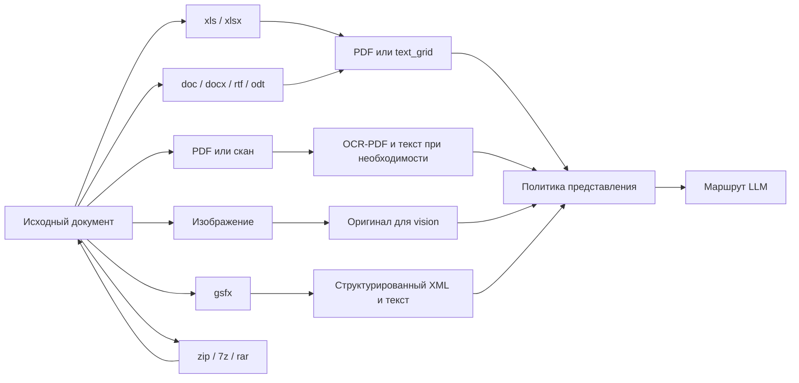
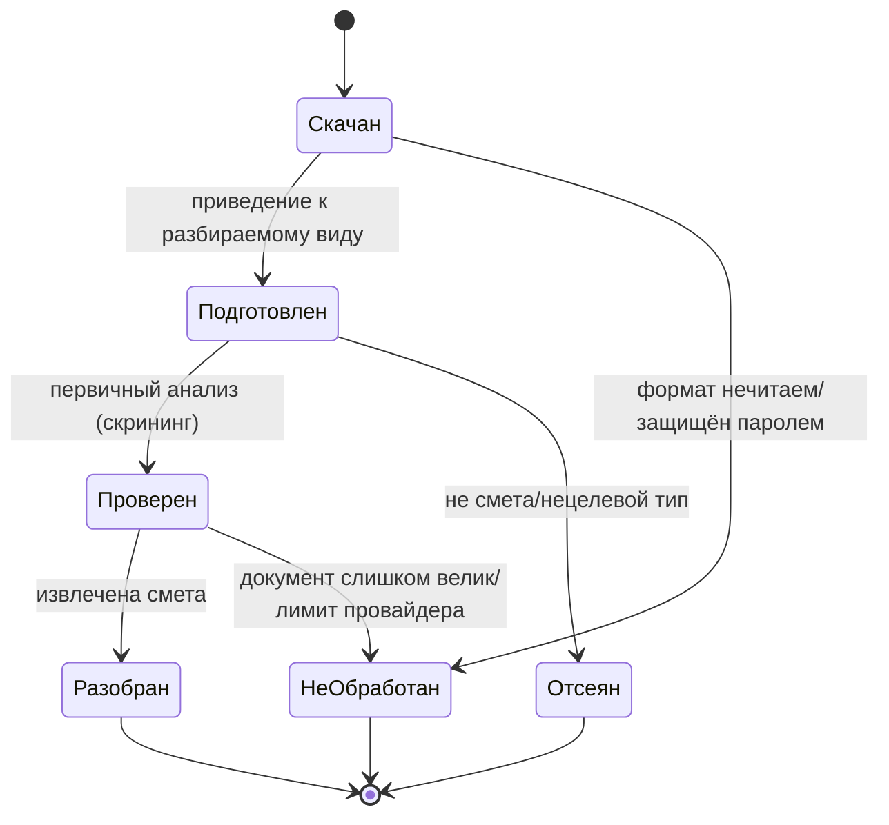

# Путь документа и сметы

> Runtime cutover P3.5: source discovery publishes canonical references/intents.
> `DocumentFeeder` → common admission/outbox → `ExecuteWorkJob` → `DownloadHandler` → immutable
> version/blob → `PrepareHandler`. Download and prepare have independent document controls;
> acquisition pause/health does not gate downloaded bytes. Revalidation is a document producer,
> not an acquisition callback. `PipelineDispatcher`, `PipelineRecoveryReconciler`, the ordinary
> document jobs and `crawler.downstream_enabled` are removed.
>
> Install authorities/storage with `process:sync-documents`. Real AI is explicitly pending
> `handler_not_activated` until its recipe/financial ledger cutover. The current typed preparation
> runtime handles PDF page batches; other formats are explicitly blocked pending typed adaptation.
> Historical algorithm descriptions below describe the retained format/AI safety corpus, not
> alternate execution owners. See [process-core](../dev/process-core.md#p35--independent-document-runtime).

Как скачанный документ (см. `crawling-and-discovery.md`) превращается — если в нём есть смета —
в структурированные строки, которые можно анализировать.

Файл считается скачанным только после успешной записи immutable object в хранилище; затем одной
короткой транзакцией фиксируются версия, статус и событие. Повтор того же хэша также проверяет
объект и долечивает неполный database-state, не создавая вторую версию или событие.
То же правило действует для каждого подготовленного представления: пока object write не
подтверждён, representation не появляется в БД и документ не может стать `prepared`.

## Действующий документный контур

Единственный producer `DocumentFeeder` создаёт ready work и циклы revalidation. Общий Process
владеет admission, lease, checkpoint, повторной доставкой, recovery и финализацией. Download
атомарно публикует immutable revision и отдельный prepare work/run; повторный tick не сбрасывает
blocked/terminal history. Связи закупка↔document, version↔blob, representation↔version/recipe/range
и run↔required work сохраняются в БД. `Document.status` — проекция, а не разрешение на исполнение.

После verified bytes общий PDF `PrepareHandler` работает независимо от acquisition pause,
retired source targets и происхождения документа. Это активированный typed runtime. XLS/XLSX,
office, images, GSFX и архивные стратегии сохраняют format/safety corpus, но ещё не подключены
к typed runtime: получают явный `blocked(policy_review)`, без успешной фиктивной конвертации.
Проверки archive lineage и hostile formats не следует считать runtime конвертацией этих форматов.

Prepare сохраняет полный source page count, original page anchors и coverage manifest. Native
text и OCR text объединяются по исходным страницам. Failed/unrecognized/not-attempted required
ranges и truncation запрещают complete representation; успешный exit инструмента и quality label
не доказывают semantic accuracy сметы. Повтор продолжает только pending batches. Bytes, диск,
recipe и range каждого опубликованного representation неизменны.

| Стадия | slice / job / Horizon / retry_after / lease, секунды |
| --- | --- |
| Download | 300 / 320 / 340 / 390 / 420 |
| Prepare | 240 / 260 / 280 / 330 / 360 |
| Screening/extraction, зарезервированная policy | 270 / 290 / 310 / 360 / 390 |

Текущие queues и timing authority задают `StageQueueMap`, `config/process.php` и
`config/documents.php`. Старые `redis_prepare/doc_prepare`, whole-file OCR timeout 1800 s и
lease/status retry через `PipelineRecoveryReconciler` не являются текущим execution interface.

Successful prepare атомарно создаёт pending screening intent с `handler_not_activated`.
Production screening/extraction/publication пока не активированы. Fixture handler в тесте может
прочитать настоящий prepared text и завершиться через `WorkFinalizer` в временный PostgreSQL
sink; это проверяет общие guards, transaction rollback и отсутствие duplicate accepted result.
Никаких provider requests, analysis windows, смет или current-analysis pointers этот sink не пишет.
Подробные assertions и границы приёмки: [document acceptance](../dev/runbooks/document-acceptance-p36.md).

## Сохранённые алгоритмы и форматный корпус

Следующие разделы описывают форматные/AI алгоритмы и их исторические safety fixtures.
Они не объявляют эти стратегии активированными typed handlers. Исторические AI recovery tests
исполняются только в frozen test-only harness; production AI будет проверяться своим owning
cutover. Это самостоятельная оговорка P3.5, а не доказательство будущего AI runtime.

## Д13 — форматы, представления и модель

### 2. Первичный анализ (скрининг)

Дешёвая и быстрая модель смотрит на первые несколько страниц документа и определяет: это смета,
что-то другое, или непонятно.

- **Явно смета** — документ идёт дальше, на полное извлечение.
- **Явно не смета** (например, само извещение о закупке, протокол, техзадание без сметы) —
  документ помечается своим типом и на этом останавливается — извлекать нечего.
- **Непонятно** — документ отсеивается как нецелевой.
- **Пограничный случай** (модель не уверена — не «явно да», но и не «явно нет») — вместо тихого
  отбрасывания система либо перепроверяет более сильной моделью, либо помечает документ
  «нужно ревью» — оператор увидит его отдельно и решит сам (`operators/how-to/review-estimate.md`).

Скрининг сохраняет краткое содержание, точные теги и число видимых смет (`none`, `single`,
`multiple` или `unknown`). Это не число страниц или файлов внутри архива: архив сначала становится
набором отдельных документов. Модель описывает факты, а система сама записывает решение: извлечь,
оставить как известный не-сметный тип, отправить на ревью или отсечь. Поэтому текст модели не может
самостоятельно обойти правило отсечения или запустить извлечение.

### 3. Извлечение сметы

Если документ прошёл скрининг как смета — начинается собственно извлечение:

1. **Паспорт** — шапка сметы: номер, наименование, единица измерения итога и т.п.
2. **Строки** — построчное содержимое: разделы, позиции, количества, цены, суммы. Для обычных
   документов это делается по всему документу целиком; для очень больших документов (сотни
   страниц, несколько смет вперемешку в одном файле) система сначала находит границы каждой
   сметы внутри документа окнами, а затем разбирает каждую смету отдельно — постепенно, не
   упираясь в ограничения одного запроса к AI-провайдеру.
3. **Итоги** — сверка сумм по разделам и по смете целиком.

После извлечения бэкенд (не модель) детерминированно проверяет полноту (все ли строки собраны)
и арифметику (сходятся ли суммы). Если что-то не сходится — смета не отбрасывается, но помечается
«подозрительная» и видна оператору для ревью, а не выдаётся как безусловно верная.

**Отдельно от сметы целиком, помечается и КАЖДАЯ ПОЗИЦИЯ** (например, строка, которую AI не смог
разобрать из-за плохого скана исходника): AI прямо говорит «эту строку и вот эти её поля я не смог
прочитать», вместо того чтобы молча вернуть пустоту, неотличимую от «поле в документе и правда
пустое». Бэкенд добавляет к этому свои находки (найденную арифметическую нестыковку раздела,
пропуск в нумерации) — обе причины видны оператору напротив конкретной позиции в витрине смет,
а не только общим статусом сметы.

## Терминальные исходы

Каждый документ рано или поздно приходит к одному из финальных состояний:

- **Разобран** — смета успешно извлечена (возможно, с пометкой «подозрительная», если суммы не
  сошлись).
- **Отсеян** — документ не смета (или скрининг не смог определить тип).
- **Развёрнут** (`expanded`) — архив успешно превратился в дочерние документы; сам архив дальше не
  анализируется, а каждый дочерний файл проходит обычную подготовку.
- **Не смогли обработать** (`unprocessable`) — документ принципиально не поддаётся разбору:
  нечитаемый формат, защищён паролем, слишком большой или превышает лимиты AI-провайдера даже
  для разбора окнами. Это НЕ технический сбой (который автоматически повторяется) — это
  констатация факта, видимая оператору (`operators/reference/statuses.md`,
  `operators/how-to/restart-failed-run.md`).
- **Ошибка (failed)** — временный технический сбой (например, недоступен провайдер) — такие
  документы автоматически подхватываются повторной попыткой. Вложение, не скачанное из-за
  временной ошибки, остаётся `discovered` до наступления backoff и затем попадает в отдельную
  ограниченную download-job; для этого не нужна новая редакция закупки.

## Д1-lite — путь документа (без job'ов и error-блока)

Полная версия с job'ами, очередями и error-блоком (для разработчика) — `docs/dev/document-pipeline.md` (Д1).

Как готовятся промты, которыми пользуется модель на каждом шаге — `prompts-and-quality.md`; полный
канон контрактов ответов и алгоритма извлечения —
[`dev/ai/estimate-extraction.md`](../dev/ai/estimate-extraction.md).

## Immutable storage staging (P3.1)

The acquisition catalog remains the single logical document catalog. New storage primitives record
source revisions separately from content-addressed blobs: A→B→A means three observations and two
blobs. A current-head CAS prevents a stale observation from replacing a newer source head.
Representations pin their preparation recipe, range, tool version, original coverage and disk;
missing source ranges remain explicitly incomplete.

Upload/spool byte ceilings are durable reservations, not queue-slot counters. An uncertain put or
unconfirmed cleanup retains its reservation. Immutable bytes and their references do not depend on
crawler availability. GC and reference acquisition share one deletion gate; existing historical
references prevent deletion, and a deletion-marked object cannot receive a new reference.

P3.5 activates runtime download/prepare and removes the additive NULL legacy tuple. Every surviving
writer now records canonical blob/revision or recipe/range metadata, an explicit disk and bytea
hashes; see [process-core.md](../dev/process-core.md). No new runtime toggle was introduced.

### Новый download owner (P3.2, активация в P3.5)

Canonical references скачиваются через `Document/DownloadHandler` и общий network executor.
Source hook возвращает только bounded binary fetch plan; refresh signed URL ограничен одним
вызовом. Capacity резервируется до HTTP, bytes проверяются и сохраняются immutable до
publication. Общий `WorkFinalizer` атомарно принимает revision/blob, завершает acquisition intent
и назначает следующий revalidation due. Same bytes не создают лишнюю revision; возврат A после B
создаёт новую revision с прежним blob. Revalidation всегда выполняет полный content recheck.
Ошибка сети откладывает download/revalidation без item failure и без изменения существующих
bytes. После получения bytes source availability больше не участвует в финализации.

С P3.5 runtime consumers используют этого owner и независимый feeder; ordinary document jobs
и прежний dispatcher удалены. PDF Prepare/OCR подключён к тому же Process execution.
Подробные guards и граница приёмки: [process-core](../dev/process-core.md).

### Page-batched prepare (P3.3, подключение в P3.5)

Новый PDF prepare работает по immutable version/blob. Каждый batch сохраняет текст с исходными
`[page:N]` anchors и page manifest до guarded checkpoint; restart продолжает pending ranges.
Native text берётся из PDF, OCR sidecar не заменяет полный текст. Повторные ошибки делятся до
singleton с конечным budget. Truncation, skipped/failed/unrecognized required pages сохраняют
incomplete coverage и дают `blocked(document_quality)`; порог 10% меняет только quality label.
Текущий safe default не разрешает degraded input. Original bytes остаются неизменными.

Конвертеры выполняются под независимым bounded supervisor с TERM/KILL/reap и cooperative lease
tick. Tmp quota освобождается после подтверждённой остановки и удаления workspace; смерть PHP
сама по себе этого не доказывает. Оставшиеся локальные workspaces допускают повторный cleanup
по сохранённым stop/owner receipts. Подробности и граница runtime activation —
[process-core](../dev/process-core.md#p33-page-batched-prepare-runtime-cutover-p35).
