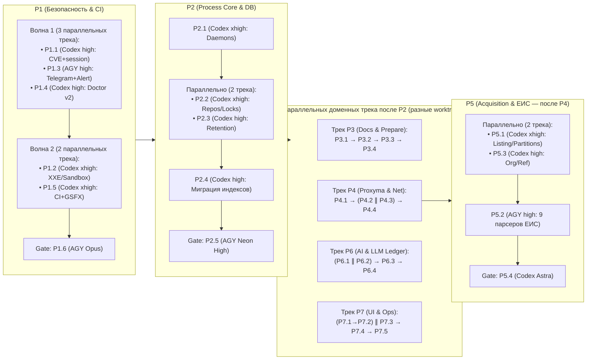

# План 08: Оркестрация выполнения через SKM (`planner` + `orch conduct`) и матрица CODEX GPT-6.2 ↔ AGY

**План в SKM Native Planner:** `2026.11.25-№1-AUDIT-HARDENING` (короткий ID: **`PLAN2`**)  
**Расположение в workspace:** `plans/2026.11.25-№1-AUDIT-HARDENING/`  
**Структура:** **7 фаз (`P1`–`P7`)**, **32 пункта** (25 пунктов реализации + 7 независимых кросс-провайдерных `Review Gate`), сгруппированных в файлово-независимые батчи.

---

## 1. Принципы подбора исполнителей и ревьюэров (CODEX GPT-6.2 ↔ AGY)

### 1.1 Проверенные идентификаторы моделей на этой машине
- **CODEX (`provider: "codex"`):**
  - `codex/gpt-6.2-sol/xhigh` (`class: frontier`) — сложные инварианты конкурентности, блокировки PostgreSQL, S3 crash-recovery, биллинг LLM Ledger, песочница/XXE и унификация CI.
  - `codex/gpt-6.2-sol/high` (`class: implementation`) — точечные бэкенд-исправления PHP/SQL/миграции/Docker/Nginx/Doctor, а также независимое ревью фаз, реализованных AGY.
  - `codex/gpt-6.2-astra/high` (`class: frontier`) — глубокое архитектурное и финальное ревью (`P5.4`, `P7.5`).
  - `codex/gpt-6-luna/low` (`class: economy`) — вспомогательные роли (`context-scout`, `report-fixer`, `registrar`), т.к. `antigravity` в `orch roles matrix` поддерживает только `executor`, `bounded-implementer` и `reviewer`.
- **AGY (`provider: "antigravity"`):**
  - **Важное ограничение транспорта (`agy-transport.py:104`):** `effort` строго из `{low, medium, high}` (**`xhigh` запрещён** и отклоняется `aicore/provider/models.py`).
  - `antigravity/claude-opus-4-6-thinking/high` (`class: frontier`) — независимый security- и финансовый ревьюэр (`P1.6` security/CVE/XXE/CI, `P6.4` LLM Ledger/billing/holdout) и `correction`-маршрут для сложных AGY-пунктов.
  - `antigravity/gemini-4-neon-high/high` (`class: frontier`) — исполнитель для задач с широким межфайловым контекстом (Filament UI/AzGuard RBAC, 9 парсеров ЕИС, архивы/стратегии `prepare`, Eval/Gold/Extraction) и независимый ревьюэр для Codex-фаз (`P2.5`, `P4.4`).
  - `antigravity/gemini-4-neon-medium/medium` (`class: implementation`) — ограниченные изменения среднего риска (SSRF/DNS/Sentry/logging, тестовая гигиена и синхронизация документации).

### 1.2 Правило кросс-провайдерной независимости
- **Ни один провайдер не ревьюит собственный код:**
  - Фазы/пункты, выполненные **CODEX GPT-6.2**, проходят независимый `Review Gate` на **AGY** (`claude-opus-4-6-thinking/high` или `gemini-4-neon-high/high`).
  - Фазы/пункты, выполненные **AGY**, проходят независимый `Review Gate` на **CODEX GPT-6.2** (`gpt-6.2-sol/high` или `gpt-6.2-astra/high`).
- **Correction route (`route.correction`):** при провале проверок или замечаниях ревью исправление закрепляется за frontier-маршрутом владельца (`codex/gpt-6.2-sol/xhigh` или `antigravity/claude-opus-4-6-thinking/high`) без скрытых fallback-переключений.

---

## 2. Изоляция контекста (`plan/items/*.md`) и карта параллелизма

Чтобы каждый исполнитель видел **только** своё ТЗ и свои целевые файлы (без раздувания контекста), все 32 пункта вынесены в отдельные компактные файлы `plan/items/<ID>.md` (~1–2 КБ каждый), а в `PLAN2` для каждого пункта задан строгий `reads` (только свой `plan/items/<ID>.md`) и явный write-set `task_files`. Проверка `swissknifeman planner check PLAN2` проходит с **0 errors, 0 warnings**.

### Где можно безопасно распараллеливать (непересекающиеся `task_files`)



- **На одной ветке (общий working tree):** запускайте батчи последовательно (`orch conduct run`), чтобы не было конфликтов индекса Git.
- **В параллельных `git worktree`:** можно одновременно вести до **3 треков в P1** (`P1.1 ∥ P1.3 ∥ P1.4`, затем `P1.2 ∥ P1.5`), **2 трека в P2** (`P2.2 ∥ P2.3`), **4 доменных трека после P2** (`P3 ∥ P4 ∥ P6 ∥ P7.1–P7.3`), и **2 трека внутри P4/P5/P6/P7** (`P4.2 ∥ P4.3`, `P5.1 ∥ P5.3`, `P6.1 ∥ P6.2`, `P7.1–P7.2 ∥ P7.3`).

---

## 3. Матрица фаз, пунктов, батчей и назначений (`PLAN2`)

| Фаза | Зависимости | Батч | Пункты | Исполнитель (`route`) | Correction / Review Gate | Ворота фазы |
|---|---|---|---|---|---|---|
| **P1** Безопасность (CVE, XXE/Sandbox, Telegram) и CI/Doctor | — | B1 | `P1.1`, `P1.4` | `codex/gpt-6.2-sol/high` | `codex/gpt-6.2-sol/xhigh` | `composer audit` = 0, `pnpm audit --audit-level=high` = 0, `make core-quality`, `ci-contract.sh` |
| | | B2 | `P1.2`, `P1.5` | `codex/gpt-6.2-sol/xhigh` | `codex/gpt-6.2-sol/xhigh` | |
| | | B3 | `P1.3` | `antigravity/gemini-4-neon-high/high` | `antigravity/claude-opus-4-6-thinking/high` | |
| | | B4 | **`P1.6` (Review)** | **`antigravity/claude-opus-4-6-thinking/high`** | Read-only gate | |
| **P2** Process Core, 4 демона, БД-индексы и Retention | `P1` | B1 | `P2.1`, `P2.2` | `codex/gpt-6.2-sol/xhigh` | `codex/gpt-6.2-sol/xhigh` | `make core-test-execution`, `core-test-concurrency`, `core-test-install`, `EXPLAIN` |
| | | B2 | `P2.3`, `P2.4` | `codex/gpt-6.2-sol/high` | `codex/gpt-6.2-sol/xhigh` | |
| | | B3 | **`P2.5` (Review)** | **`antigravity/gemini-4-neon-high/high`** | Read-only gate | |
| **P3** Документы, S3 Crash-Recovery и Prepare | `P1`, `P2` | B1 | `P3.1` | `codex/gpt-6.2-sol/xhigh` | `codex/gpt-6.2-sol/xhigh` | `make core-test-documents`, `make core-quality` |
| | | B2 | `P3.2`, `P3.3` | `antigravity/gemini-4-neon-high/high` | `antigravity/claude-opus-4-6-thinking/high` | |
| | | B3 | **`P3.4` (Review)** | **`codex/gpt-6.2-sol/high`** | Read-only gate | |
| **P4** Cutover `Proxyma`, сеть и наблюдаемость | `P1`, `P2` | B1 | `P4.1`, `P4.2` | `codex/gpt-6.2-sol` (`xhigh`/`high`) | `codex/gpt-6.2-sol/xhigh` | `make core-test-network`, `core-test-observability` |
| | | B2 | `P4.3` | `antigravity/gemini-4-neon-medium/medium` | `antigravity/gemini-4-neon-high/high` | |
| | | B3 | **`P4.4` (Review)** | **`antigravity/gemini-4-neon-high/high`** | Read-only gate | |
| **P5** Acquisition, листинг, ЕИС, `Organization`, `Reference` | `P2`, `P4` | B1 | `P5.1`, `P5.3` | `codex/gpt-6.2-sol` (`xhigh`/`high`) | `codex/gpt-6.2-sol/xhigh` | `make core-test-acquisition`, `core-test-platforms` |
| | | B2 | `P5.2` | `antigravity/gemini-4-neon-high/high` | `antigravity/claude-opus-4-6-thinking/high` | |
| | | B3 | **`P5.4` (Review)** | **`codex/gpt-6.2-astra/high`** | Read-only gate | |
| **P6** AI-пайплайн, биллинг Gemini (LLM Ledger), Eval/Gold | `P2` | B1 | `P6.1` | `codex/gpt-6.2-sol/xhigh` | `codex/gpt-6.2-sol/xhigh` | `make core-test-ai`, `make core-quality` |
| | | B2 | `P6.2`, `P6.3` | `antigravity/gemini-4-neon-high/high` | `antigravity/claude-opus-4-6-thinking/high` | |
| | | B3 | **`P6.4` (Review)** | **`antigravity/claude-opus-4-6-thinking/high`** | Read-only gate | |
| **P7** Filament UI, AzGuard RBAC, Docker/Nginx/Ops и гигиена | `P1`, `P2` | B1 | `P7.1`, `P7.2` | `antigravity/gemini-4-neon-high/high` | `antigravity/claude-opus-4-6-thinking/high` | `make core-test-regression`, `core-test-faults`, `DocsIntegrityTest`, `ingress-backup-contract.sh` |
| | | B2 | `P7.3` | `codex/gpt-6.2-sol/high` | `codex/gpt-6.2-sol/xhigh` | |
| | | B3 | `P7.4` | `antigravity/gemini-4-neon-medium/medium` | `antigravity/gemini-4-neon-high/high` | |
| | | B4 | **`P7.5` (Review)** | **`codex/gpt-6.2-astra/high`** | Read-only gate | |

---

## 4. Готовые профили `--options` (`plan/skm/*.json`) и проверенные команды запуска

Все 32 пункта `PLAN2` прошли живой `swissknifeman orch conduct preflight` (**32/32 `admitted: true`**, `swissknifeman planner check PLAN2` → **0 errors, 0 warnings**).

### Готовые профили запуска (`plan/skm/`)
- `plan/skm/codex-impl.json` — `codex/gpt-6.2-sol/high` (`implementation`)
- `plan/skm/codex-frontier.json` — `codex/gpt-6.2-sol/xhigh` (`frontier`)
- `plan/skm/codex-review-sol.json` — `codex/gpt-6.2-sol/high` (`review-only`)
- `plan/skm/codex-review-astra.json` — `codex/gpt-6.2-astra/high` (`review-only`, `frontier`)
- `plan/skm/agy-impl.json` — `antigravity/gemini-4-argon-high/high` (`implementation`)
- `plan/skm/agy-frontier.json` — `antigravity/gemini-4-argon-high/high` (`frontier`)
- `plan/skm/agy-review-opus.json` / `agy-review-neon.json` — `antigravity/gemini-4-argon-high/high` (`review-only`, `frontier`)

> **Оптин безопасности SKM для AGY (`conductor.md:2192-2235`):**
> - Для запуска AGY-исполнителя передаётся `SKM_ORCH_AGY_UNSAFE_EXECUTOR=accept-unisolated-network-docker-host-reads`
> - Для запуска AGY-ревьюэра передаётся `SKM_ORCH_AGY_UNSAFE_REVIEWER=accept-unisolated-network-docker-host-reads`
> - Проектный `local/config.toml` уже настроен: `codex` + `antigravity` включены, `provider = "codex"`, `reviewer = "antigravity/gemini-4-argon-high/high"`, `questions = "queue"`, `[orch.advisor] enabled = false`.

### Команды запуска фазы P1 (проверенные на `preflight`)

```bash
# Батч B1 (Codex implementation — P1.1, P1.4):
swissknifeman orch conduct run --plan PLAN2 --items P1.1 P1.4 \
  --scenario solo --options plan/skm/codex-impl.json

# Батч B2 (Codex frontier — P1.2, P1.5):
swissknifeman orch conduct run --plan PLAN2 --items P1.2 P1.5 \
  --scenario solo --options plan/skm/codex-frontier.json

# Батч B3 (AGY frontier — P1.3; можно параллельно с B1 в отдельном worktree):
SKM_ORCH_AGY_UNSAFE_EXECUTOR=accept-unisolated-network-docker-host-reads \
swissknifeman orch conduct run --plan PLAN2 --items P1.3 \
  --scenario solo --options plan/skm/agy-frontier.json

# Батч B4 (AGY Review Gate — P1.6):
SKM_ORCH_AGY_UNSAFE_REVIEWER=accept-unisolated-network-docker-host-reads \
swissknifeman orch conduct run --plan PLAN2 --items P1.6 \
  --scenario review-only --options plan/skm/agy-review-opus.json
```

### Отслеживание, вопросы и восстановление

```bash
swissknifeman orch conduct status           # состояние текущего прогона
swissknifeman orch conduct observe --follow # поток событий
swissknifeman orch conduct questions        # открытые вопросы (questions = "queue")
swissknifeman orch conduct gates            # квоты провайдеров
swissknifeman orch conduct resume           # продолжение после остановки
swissknifeman planner reconcile PLAN2       # закрытие фаз и плана
```
