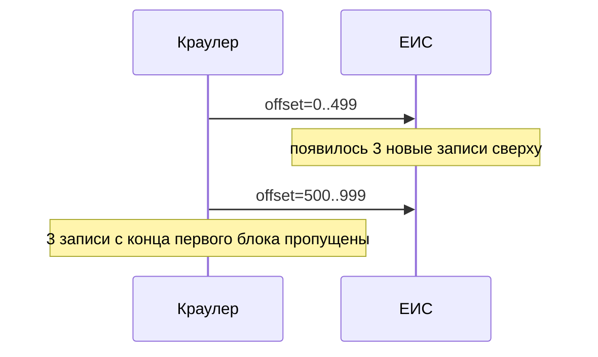
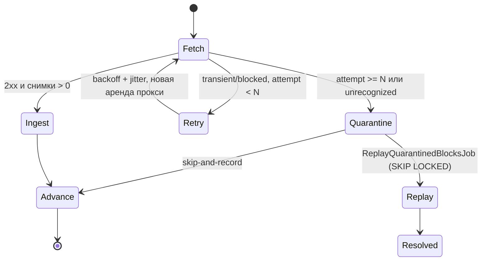
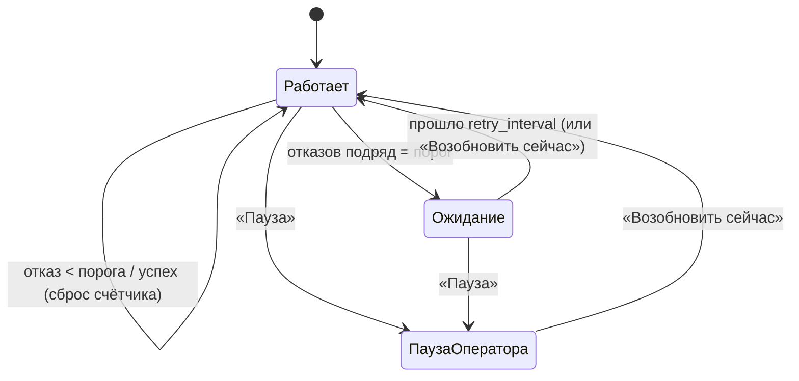

# Аудит: надёжность краулера/парсеров, безопасность, БД

Дата: 2026-10-07. База: `main` @ `6f8a80a4`. Ветка с исправлениями: `audit/fixes-1`.
Фокус: долгоживущий, отказоустойчивый сбор открытых данных ЕИС (44-ФЗ/223-ФЗ), корректность
алгоритмов, соответствие документации (`docs/dev`, `docs/workflow`) коду, безопасность.

Шкала: **P0** — блокер запуска/потеря данных; **P1** — высокий риск в долгом прогоне;
**P2** — средний; **P3** — улучшение.

## 1. Итог

| Метрика | `main` (+фикс сборки тестов) | `audit/fixes-1` |
|---|---|---|
| Pest (`--parallel`, 6 процессов) | 1739 тестов: 1729 ✓, 2 ✗, 7 error, 1 skip | 1807 тестов: 1800 ✓, 1 ✗, 5 error, 1 skip (до §7: 1765/1757 ✓) |
| PHPStan (max, larastan) | 0 ошибок | 0 ошибок |
| Pint `--test` | ✗ (2 файла в `docker/host`) | ✓ |
| `composer audit --locked` | 5 advisories (1 high) | чисто |
| `migrate` на пустой БД с pg_partman | **падает** (миграция 100093) | ✓ (83 миграции, повторный запуск — no-op) |

Оставшиеся падения зависят от окружения, а не от кода: Horizon/Redis readiness,
`pg_stat_statements` не в `shared_preload_libraries`, тесты с PostgreSQL-подпроцессами, которым нужны
S3/MinIO-креды; при `--parallel` они ещё и гоняются между собой. На `main` без первого коммита
весь набор вообще не стартовал (warning `use ZipArchive;` на этапе сборки тестов).

Секреты: gitleaks (10 находок) и trufflehog (137) по всей истории. **Реальных секретов нет**, всё
ложноположительное: 40-символьные SHA коммитов в `plans/` и lock-файлах, `MINIO_ROOT_PASSWORD=placeholder`,
публичный DKIM-ключ, примерные DSN в тестах и документации skills.

## 2. Исправлено в ветке `audit/fixes-1`

| Коммит | Sev | Суть |
|---|---|---|
| `dbabb37b` test(prepare) | P1 | `tests/Unit/Procurement/Prepare/XlsxResourceGuardTest.php`: убран `use ZipArchive;` в глобальном пространстве имён. Warning обрывал весь набор при сборке тестов. |
| `1a959852` fix(crawler) | **P0** | `app/Services/Procurement/Eis/CsvSourceMethod.php:553` `parseCsv`: раньше строки резались по `\n`, и запись с переводом строки внутри кавычек ломалась. Теперь `fgetcsv` на `php://temp` с `escape: ''` по RFC 4180. `rowsTotal` считает все записи источника, поэтому `ArchiveWindowScanner` больше не считает окно «исчерпанным» досрочно, если блок неполный из-за битых строк. Битые записи считаются в `rows_errors` (`ListingBatch::$rowsMalformed`). |
| `b912df60` fix(procurement) | P1 | `ProcurementIngestProcessor::isOlderThanHead`: снимок старше головы (повтор старого блока, догон архива) больше не откатывает карточку, а только обновляет `last_seen`. Для точности «день» сравнение идёт по календарным датам. |
| `fc9ed809` fix(documents) | P1 | `DocumentDownloader`: `Http::retry()` обходил `PlatformRequestBudget`, отчёт о прокси и журнал `prc_fetches`. Теперь каждая попытка берёт слот бюджета, сообщает результат прокси и пишется в журнал. Отброшенный ответ закрывается, чтобы не текли дескрипторы. |
| `b077c1fa` fix(scheduler) | P1 | `routes/console.php`: любая artisan-команда, включая `package:discover` в `composer install`, падала без БД. Невалидный cron молча превращался в `*/30`, что расходилось с формой в админке. Теперь недоступная БД логируется один раз, невалидный cron пропускается с `Log::error`, пустое расписание не регистрируется. |
| `bc3b50cd` fix(crawler) (пересмотрено в `9c2e4d4c`) | **P0** | `CsvBlockIngestor`: на 403, 5xx или HTML-заглушке курсор уходил вперёд, и блок терялся навсегда. Теперь при ответе не 2xx и при непустом блоке, из которого не разобрано ни одного снимка, бросается `ListingBlockRejectedException`, но уже после записи в `prc_fetches`. |
| `22aac324` fix(db) | **P0** | Миграция `2026_09_10_100093_repair_partition_coverage` падала на чистой БД: партиции pg_partman `_pYYYYMMDD` пересекались по диапазонам. Теперь каждая партиция создаётся в SAVEPOINT, SQLSTATE 42P17 пропускается. |
| `85b27fad` + `refactor(db)` | P1 | `Proxy::$password` хранился открытым текстом и попадал в `toArray()`/JSON. Теперь стоит cast `encrypted` и `#[Hidden]`, `ProxyResolver` расшифровывает пароль сам. По решению владельца (БД пересоздаётся с нуля, наследия нет) отдельная data-миграция удалена: колонка `text` в `2026_07_04_100040_create_prc_proxies_table` хранит шифртекст с момента создания. |
| `b617fb4c` style(docker) | P3 | Pint для `docker/host/backup/backup-objects.php` и `docker/host/mail/smtp-smoke.php`. |
| `feat(crawler)` EisSourceClock | P1 | Часовой пояс источника берётся из конфигурации: `crawler.platforms.eis.source_timezone`, env `EIS_SOURCE_TIMEZONE`, по умолчанию `Europe/Moscow`, есть в `.env.example`. «Наивные» дата-время ЕИС (CSV-листинг, журнал событий, протокол итогов) читаются в нём и хранятся в UTC. Календарные даты без времени не сдвигаются. Явная метка «МСК±N» в журнале событий имеет приоритет (МСК = UTC+3). Тесты: `tests/Unit/Procurement/Eis/EisSourceClockTest.php`. |
| `e1e07261` feat(crawler) | P1 | Классификация отказов листинга (`ListingFailureKind`) и чистая политика брейкера источника (`SourceCircuitPolicy`, closed/open/half-open + ручная пауза). Упрощено в раунде 4, см. §7. |
| `f54a62e6` feat(crawler) | P1 | Таблицы `prc_source_circuits` (брейкер на площадку) и `prc_source_incidents` (журнал), `SourceCircuitController`, `SourceIncidentRecorder`, событие `SourceIncidentRecorded`. |
| `9c2e4d4c` fix(crawler) | **P0** | Пересмотр `bc3b50cd`: локальный плохой блок → инцидент + пропуск (skip-and-record), прогон продолжается; системный отказ → брейкер открыт, прогон на паузе (`source_circuit_open`), курсор не двигается. `ListingBlockRejectedException` удалён. |
| `8ca9fd04` feat(crawler) | P1 | Автовозобновление: `crawler:source-circuits` каждую минуту, `SuspendedRunResumer`. |
| `feaaca2f` feat(admin) | P1 | Filament: «Источники: состояние» (пауза/возобновить сейчас/пороги) и «Источники: инциденты» (фильтры, «Принято», бейдж). Права в `OperatorRole`. |
| `b0185113` feat(crawler) | P1 | Preflight CSV-блока: обязательные колонки (`ListingSchemaAware`), HTML вместо CSV → отказ до маппинга строк. |
| `b11afeb0` fix(procurement) | P1 | Дата обновления без времени — сутки источника; исправлена ошибка МСК/UTC в проверке устаревшего снимка и пороге «только свежие» (§8). |
| `05897dc6` refactor(crawler) | P1 | Упрощение раунда 4: брейкеры листинга и карточек, без half-open, детерминированная классификация, инциденты вне транзакции блока (§7). |
| `b6a457d4` feat(detail) | P1 | Preflight вкладок карточки по эталону `eis-baseline.json` (`CardLayoutPreflight`): структурные якоря, инцидент `CardLayoutDrift`, вкладка с дрейфом не разбирается. |
| `chore(deps)` | P1 | Патч-обновления без `--with-dependencies`: filament 5.8.4 (CVE-2026-104181, MFA без повторного ввода пароля), laravel 13.35 (CVE-2026-102279), commonmark 2.10.3 (high: квадратичный DoS в GFM-таблицах), flysystem 3.36 (CVE-2026-102601). |

Для каждого поведенческого фикса есть тест, который падал на старом коде.

## 3. Рекомендации (не менялось — нужно решение или это больше «очевидного фикса»)

### 3.1 Ретраи и backoff — P1
`CsvSourceMethod.php:440-506` (`requestWithRetries`/`waitBeforeRetry`): фиксированная задержка
`retryDelayMs` (по умолчанию 500 мс). Нет экспоненты и jitter, `Retry-After` игнорируется,
на всех попытках используется одна и та же аренда прокси. В долгом прогоне это синхронные
повторы, которые бьют в уже лежащий источник.

```php
private function backoffMs(int $attempt, ?Response $r, int $baseMs = 500, int $capMs = 30_000): int
{
    $retryAfter = $r?->header('Retry-After');
    if (is_numeric($retryAfter)) {
        return min($capMs, (int) $retryAfter * 1000);
    }
    // AWS "full jitter"
    return random_int(0, min($capMs, $baseMs * (2 ** ($attempt - 1))));
}
```
Помимо этого: на 407/429/5xx и ConnectionException через прокси брать новую аренду прокси.
Ссылки: [AWS — Exponential Backoff and Jitter](https://aws.amazon.com/blogs/architecture/exponential-backoff-and-jitter/),
[Google SRE — Handling Overload](https://sre.google/sre-book/handling-overload/),
[RFC 9110 §10.2.3 Retry-After](https://www.rfc-editor.org/rfc/rfc9110#field.retry-after).

### 3.2 Бюджет времени fresh-шага — P1
`CrawlRunJob`: checkpoint 240 с при timeout 300 с. Один блок может занять до 5 попыток × 30 с
плюс повтор на пустое тело, а у fresh-листинга нет `deadlineAt`, как у архива. В итоге
воркер убивается по timeout посреди блока. Рекомендация: передавать `deadlineAt = start + checkpoint`
во все HTTP-вызовы fresh, как это уже сделано в архиве.

### 3.3 Fencing записи в fresh-режиме — P1 (расхождение с docs)
Документация обещает, что все записи курсора и ingest идут под execution lease. В коде
`withinExecutionLease` используется только в `ArchiveWindowScanner.php:147`. `FreshRunProcessor`
пишет без fencing, и «зомби»-воркер после истечения lease может перезаписать курсор нового владельца.

```php
$this->runs->withinExecutionLease(run: $run, callback: fn () => $this->ingestor->ingest($batch, $run));
```
И условие на уровне SQL: `UPDATE prc_runs SET cursor = ? WHERE id = ? AND owner_token = ?`, проверять число затронутых строк.
См. [Kleppmann — fencing tokens](https://martin.kleppmann.com/2016/02/08/how-to-do-distributed-locking.html).

### 3.4 Ложное «source_exhausted» — P1
`FreshRunProcessor.php:124`: пустое тело 200 после одного повтора завершает прогон как исчерпанный.
У ЕИС пустое тело часто означает троттлинг или WAF. Рекомендация: считать это `transient`,
а завершать прогон только после N подряд пустых ответов и при совпадении с ожидаемым total (если он доступен).

### 3.5 Offset-пагинация по «живому» списку — P2
Новые записи сдвигают offset, и строки на стыке блоков пропускаются. Варианты: перекрытие блоков
(`offset - overlap`, дубли гасит `snapshot_hash`) или keyset по `(updated_at, reg_number)`, если источник
его позволяет.



### 3.6 Часовой пояс источника — исправлено (см. §2), осталось
Решение владельца: TZ задаётся через env `EIS_SOURCE_TIMEZONE` (по умолчанию `Europe/Moscow`), хранение в UTC.
Осталось:
1. Разовый probe по известной закупке: сравнить время из CSV с карточкой, где есть метка «МСК±N».
2. Счётчик и лог для дат, которые не удалось разобрать: сейчас поле молча становится `null`.
3. Если колонки БД `timestamp without time zone`, перейти на `timestamptz`, пока БД пересоздаётся.

### 3.7 Кодировка — P2
`CsvSourceMethod.php:139`, `GsfxReader.php:81`: Windows-1251 захардкожена. Рекомендация: проверять
`Content-Type; charset` и `mb_check_encoding($body, 'UTF-8')` до конвертации.

### 3.8 Rate limiting — P2
`PlatformRequestBudget::acquire` (`:37`) на каждом запросе читает crawler/proxy из БД и использует
фиксированное окно `RateLimiter`, что даёт двойной burst на границе окон. Рекомендация: кэшировать
настройки с TTL 30–60 с и перейти на GCRA или token bucket в Redis (Lua).

### 3.9 БД: upsert и уникальность — P1
`updateOrCreate` для `prc_financing`/`prc_items`/`prc_protocols`/`prc_awards` без уникальных индексов
(в docs это признано) при параллельных воркерах даёт дубли. До запуска можно позволить:

```sql
CREATE UNIQUE INDEX CONCURRENTLY prc_items_proc_pos_uq ON prc_items (procurement_id, position_number);
-- затем в коде:
-- Item::upsert($rows, uniqueBy: ['procurement_id','position_number'], update: [...]);
```
Аналогично `participant_ordinal`: ключ лучше строить из стабильного идентификатора участника (ИНН/КПП),
а не из порядка в источнике. Для очередей на БД используйте `FOR UPDATE SKIP LOCKED`.
[PostgreSQL INSERT … ON CONFLICT](https://www.postgresql.org/docs/17/sql-insert.html#SQL-ON-CONFLICT).

### 3.10 Воркеры и память — P2
`config/horizon.php:211-260`: `maxJobs=0`, `maxTime=0`, остаётся только `memory=128`. Для недельных
прогонов стоит включить переработку воркеров, например `maxJobs=500` и `maxTime=3600`.

### 3.11 Наблюдаемость — P2
Метрики на источник: доля 4xx/5xx, malformed, отклонённые блоки (`ListingBlockRejectedException`),
отставание курсора от «сейчас», возраст последнего успешного блока. Алерт, если по прогону нет прогресса дольше 2× checkpoint.

### 3.12 Безопасность и CI — P2/P3
- `.github/workflows/ci.yml:186`: `trivy-action` закреплён на v0.9.2, это очень старая версия. Обновить по SHA.
- `docker/php/Dockerfile:3`: `minio/mc:latest` не закреплён. Закрепить по digest.
- `docker/host/backup/backup-objects.php:14`: `allFiles()` грузит весь список объектов в память, хэши копий не сверяются. Перейти на потоковый листинг и сверку ETag/sha256.
- 7z/unar: путь записи передаётся как шаблон. Сейчас это закрыто валидацией `*?[]` и ведущего `-`; оставить тест-регресс.
- Хорошо сделано: XML с `LIBXML_NONET`, распаковка архивов с лимитами, `Process` с массивом аргументов, allowlist целей (`SourceTargetValidator`) против SSRF.

## 4. Не удалось проверить и почему

- **Статус CI на GitHub**: API Actions вернул 404/403 для используемого токена.
- **Поведение живого ЕИС** (TZ, пустые 200, лимиты): живые запросы к источнику не выполнялись.
- **Тесты с PostgreSQL-подпроцессами и Horizon readiness**: нужны MinIO/S3 и запущенный Horizon. В песочнице это отдельная инфраструктура.
- **`pnpm audit`**: corepack не смог создать кэш в песочнице.
- **`tia-baseline` в CI** использует `ENV_FILE=.env`, которого нет в чистом checkout. Похоже на ошибку, но без запуска CI не подтверждено.

## 5. Решения владельца

Принято 2026-10-07:
- Пустое или невалидное расписание **не запускается** (оставлено как в `b077c1fa`).
- Наследия нет, БД пересоздаётся: data-миграция шифрования паролей прокси удалена, колонка шифруется с создания.
- Часовой пояс источника читается из env `EIS_SOURCE_TIMEZONE` (по умолчанию `Europe/Moscow`), хранение в UTC.

- Сбор не останавливается на локальных проблемах: skip-and-record с инцидентом. Глобальные отказы
  ставят этап на ожидание (~10 мин, настраивается) с ручным возобновлением из админки (§7).
- Раунд 4: без half-open; детерминированная классификация; независимые брейкеры листинга и
  карточек; карточка без базовых селекторов не обрабатывается; инциденты пишутся вне
  транзакции блока; устаревший снимок пропускается, ошибка МСК/UTC исправлена (§8).

Открыто:
1. Пункты «Нужно обсудить» из §7.4.
2. Репозиторий вендора `axiomasoft/azguard-private` **публичный**: GitHub API отдаёт 200 без авторизации. Это намеренно?

## 6. Строгий отказ плохих блоков листинга: плюсы, минусы, доработка

> **Статус:** раздел описывает поведение `bc3b50cd` и варианты на момент решения. По решению
> владельца реализован не `fail()`/карантин, а skip-and-record + брейкер источника (§7). Шаги 1, 4
> и частично 5 ниже реализованы в другом виде; шаги 2 (повторы блока), 3 (карантин) и 6 (полнота) отложены.

Контекст (коммит `bc3b50cd`). `CsvBlockIngestor::ingest` (`app/Services/Procurement/CsvBlockIngestor.php:156,163`)
сначала пишет попытку в `prc_fetches`, затем бросает `ListingBlockRejectedException`, если:
- HTTP-статус ответа не 2xx (`forHttpStatus`);
- непустой блок не дал ни одного снимка (`forUnrecognizedFormat`: HTML-заглушка, капча, сменился формат CSV).

Курсор при этом не двигается. Дальше исключение уходит по общему пути:
- `FreshRunProcessor.php:141` и `ArchiveRunProcessor.php:73` ловят `Throwable` и вызывают
  `CrawlerRunManager::fail()` (`:515`). Прогон получает статус `failed`, и это терминальный статус:
  автоматического resume у `failed` нет.
- `CrawlRunJob` сознательно не ретраится очередью: у него нет `$tries`/`$backoff`, ретраи живут в домене.
- До ингестора блок уже прошёл HTTP-ретраи `CsvSourceMethod::requestWithRetries` (`:440`): до 5 попыток
  с фиксированной паузой на одной аренде прокси, со слотом `PlatformRequestBudget` на каждой попытке.

### Плюсы в контексте проекта
1. **Нет тихой потери данных.** Раньше 403/503 или HTML-страница WAF давали 0 строк, и курсор
   уходил вперёд. В архиве (`ArchiveWindowScanner`) `rowsTotal < block_size` ещё и закрывал интервал
   как «исчерпанный», то есть целый день или ценовой интервал выпадал навсегда, и никто об этом не знал.
   Полнота корпуса (цель «весь 2025 год») важнее, чем зелёный статус прогона.
2. **Ошибка видна.** Статус `failed` с текстом, строка в `prc_fetches` с кодом и прокси. Всё это
   уже есть в админке и в отчётах `doctor`/readiness, отдельные метрики не нужны.
3. **Детерминированный resume-point.** Курсор стоит ровно перед плохим блоком. Повторный прогон
   (или будущий resume) начинает с него, а `snapshot_hash` и проверка «старее головы» (`b912df60`)
   делают повтор идемпотентным.
4. **Ранний сигнал о смене формата.** `forUnrecognizedFormat` ловит schema drift ЕИС (переименованные
   колонки, другая кодировка) с первого блока, а не после недели «пустых» прогонов.
5. **Честнее для бюджета и прокси.** Прогон не продолжает долбить источник, который уже отвечает
   403/капчей. В долгом прогоне это снижает риск бана пула прокси.

### Минусы и риски
1. **Один блок валит весь прогон.** Для недельного архивного прогона это дорого: временный 503
   на 1 блоке из тысяч останавливает всё до ручного вмешательства, потому что `failed` терминален.
   Сейчас нет промежуточного состояния «пауза, повтор позже».
2. **Poison block и застрявший курсор.** Если блок плохой стабильно (битый CSV у конкретного
   offset, вечная капча для конкретного фильтра), каждый новый прогон упирается в то же место.
   Fresh-режим, который каждый раз идёт сверху, никогда не дойдёт до `reached_previous_run`,
   и свежие данные ниже плохого блока перестают поступать.
3. **Транзиентное смешано с постоянным.** 429/503/407 (лимиты, прокси) и «формат не распознан» обрабатываются
   одинаково, хотя первым нужен backoff и смена прокси, а вторым нужен человек.
4. **Плохой прокси выглядит как плохой источник.** 403/407 часто означает забаненный exit-IP.
   `ProxyCircuitBreaker` получает исход только из HTTP-слоя, а отказ блока на уровне
   ингестора не приводит к повтору через другой прокси.
5. **Шум алертов.** Если алерт привязан к `failed`, то кратковременный WAF-эпизод ночью
   поднимает столько же тревог, сколько реальная смена формата.
6. **Ложноположительный `forUnrecognizedFormat`.** Валидный блок, в котором все строки отфильтрованы
   маппером (например, все вне скоупа ОКПД2), тоже даст 0 снимков. Нужно различать «0 снимков из-за
   фильтра» и «0 снимков из-за непонятного формата». Сейчас критерий такой: непустой блок, 0 снимков,
   и `rows_errors` равен числу записей. Это надо держать покрытым тестом.

### Рекомендуемая доработка (по шагам)

**Шаг 1. Классифицировать отказ.** Транзиентный отказ повторяется, постоянный изолируется.

```php
enum ListingRejectionKind: string
{
    case Transient = 'transient';     // 408, 425, 429, 5xx, 407, пустое 200
    case Blocked = 'blocked';         // 403, капча/WAF-HTML: сменить прокси, затем transient
    case Unrecognized = 'unrecognized'; // 2xx, но формат не распознан: schema drift
}

// ListingBlockRejectedException
public static function forHttpStatus(int $status): self
{
    $kind = match (true) {
        $status === 403 => ListingRejectionKind::Blocked,
        in_array($status, [407, 408, 425, 429], true), $status >= 500 => ListingRejectionKind::Transient,
        default => ListingRejectionKind::Unrecognized,
    };

    return new self(kind: $kind, message: "Listing block rejected: HTTP {$status}");
}
```

**Шаг 2. Ограниченные повторы блока с backoff, а не `fail()`.** В `FreshRunProcessor`/`ArchiveRunProcessor`
ловить исключение отдельно, до общего `Throwable`, по образцу уже существующей ветки `PlatformBudgetExhaustedException`:

```php
} catch (ListingBlockRejectedException $rejection) {
    $attempt = $this->blockFailures->record(run: $run, cursor: $cursor, rejection: $rejection);

    if ($rejection->kind !== ListingRejectionKind::Unrecognized && $attempt < $maxBlockAttempts) {
        // курсор не двигаем; прогон остаётся resumable
        $this->runs->pauseUntil(run: $run, until: now()->addSeconds($this->backoff($attempt)), reason: 'listing_block_retry');

        return FreshRunResult::Checkpointed;
    }

    $this->quarantine->put(run: $run, cursor: $cursor, rejection: $rejection, attempts: $attempt);
    // skip-and-record: курсор идёт дальше, блок не потерян, а зарегистрирован
    $this->advancePastBlock(run: $run, cursor: $cursor);
}
```

`backoff()`: full jitter, `random_int(0, min(cap, base * 2 ** attempt))`, с учётом `Retry-After`
(подробнее в §3.1). Для `Blocked` перед повтором сообщать `ProxyCircuitBreaker::recordFailure()`
и брать новую аренду (`ProxyResolver::resolve(..., exclude: $lease->proxyId)`).

**Шаг 3. Таблица карантина (DLQ) с повторной обработкой.** БД пересоздаётся с нуля, поэтому её
можно добавить сразу в create-миграции:

```sql
CREATE TABLE prc_listing_quarantine (
    id            bigint GENERATED ALWAYS AS IDENTITY PRIMARY KEY,
    crawler_id    bigint NOT NULL REFERENCES prc_crawlers(id) ON DELETE CASCADE,
    run_id        bigint NOT NULL REFERENCES prc_runs(id) ON DELETE CASCADE,
    cursor        jsonb  NOT NULL,              -- day / stack / offset / фильтр интервала
    kind          text   NOT NULL CHECK (kind IN ('transient','blocked','unrecognized')),
    http_status   smallint,
    fetch_id      bigint,                       -- ссылка на prc_fetches (тело/хэш/прокси)
    attempts      smallint NOT NULL DEFAULT 1,
    next_retry_at timestamptz,
    resolved_at   timestamptz,
    created_at    timestamptz NOT NULL DEFAULT now(),
    UNIQUE (crawler_id, cursor)
);
CREATE INDEX prc_listing_quarantine_due ON prc_listing_quarantine (next_retry_at) WHERE resolved_at IS NULL;
```

Отдельный `ReplayQuarantinedBlocksJob` раз в N минут выбирает due-строки через
`FOR UPDATE SKIP LOCKED`, повторяет ровно этот курсор через тот же `CsvBlockIngestor` (идемпотентно
по `snapshot_hash`) и ставит `resolved_at`. Записи `unrecognized` не повторяются автоматически:
они ждут исправления маппера, после которого запускается replay командой.

**Шаг 4. Circuit breaker на источник (а не только на прокси).** Если доля отказов блоков по хосту
`zakupki.gov.ru` за 10 минут больше X% (или K отказов подряд через разные прокси), все прогоны этого источника
ставятся на паузу на T минут. Так проблема источника не превращается в массовый карантин.
Состояние можно держать в Redis рядом с `PlatformRequestBudget`.

```php
if ($this->sourceBreaker->isOpen(host: $host)) {
    $this->runs->pauseUntil(run: $run, until: $this->sourceBreaker->retryAt(host: $host), reason: 'source_circuit_open');
    return FreshRunResult::Checkpointed;
}
```

**Шаг 5. Метрики и алерты.**
- `crawler_listing_block_rejected_total{kind,status,crawler}`: счётчик.
- `crawler_listing_quarantine_open{kind}` и возраст самой старой открытой записи (gauge).
- `crawler_run_paused_seconds{reason}`.
- Алерты:
  - `unrecognized > 0`: сразу, это schema drift, нужен человек;
  - `quarantine_open_age > 6h`: блок не лечится повторами;
  - `source_circuit_open > 30m`;
  - fresh-прогон дольше 2 расписаний не дошёл до `reached_previous_run` (застрявший курсор).
- `transient` не алертится по одному событию, только по доле.

**Шаг 6. Проверка полноты.** Ежедневный отчёт по окну: для каждого дня архива число блоков
`ok / quarantined / resolved`. Окно считается полным только при `quarantined = 0`. Сейчас
этот признак неявный (интервал «drained»).



**Итог.** Строгий отказ правильный как инвариант «курсор не проходит мимо непрочитанных данных»,
и его стоит оставить. Но терминальный `fail()` всего прогона — слишком грубая реакция для долгих
прогонов. Рекомендуемый порядок:
1. Классификация отказов и пауза с backoff вместо `fail()`. Малый объём, самый большой эффект.
2. Таблица карантина и replay.
3. Breaker на источник и метрики.

До шага 2 действует простое операционное правило: при `failed` с текстом `Listing block rejected`
смотреть строку в `prc_fetches` (код, прокси) и перезапускать прогон с того же курсора.

## 7. Управление источником (после упрощения, раунд 4)

Принцип: проще, но надёжно. Всё, что не доказано нуждой, убрано. Ревьюерам: каждое решение
ниже можно оспорить — в коде у спорных мест стоит пометка «Ревьюеру:» или «Нужно обсудить:».

### 7.1 Что делает система
- **Локальная проблема → пропуск с записью.** Плохой блок CSV: инцидент (курсор, параметры
  запроса, fetch id, причина), курсор идёт дальше, прогон продолжается.
- **Системная проблема → ожидание этапа.** `failure_threshold` отказов подряд (по умолчанию 5)
  → этап ждёт `retry_interval_minutes` (10), затем **просто продолжает** с того же места.
  Пробных запросов (half-open) нет: если источник всё ещё лежит, через 5 отказов этап снова
  ждёт. Цена упрощения — не больше 5 лишних запросов за цикл.
- **Два независимых брейкера на площадку:** листинг (CSV) и карточки (HTML). Падение одного
  не останавливает другой.
- **Оператор** (Filament «Источники: состояние»): пауза, «Возобновить сейчас», пороги.



### 7.2 Как определяется отказ (только детерминированные признаки)

| Механизм | Проблема | Признак | Вид | Реакция |
|---|---|---|---|---|
| CSV | не скачалось | `ConnectionException`, 408/5xx | `source_unavailable` | пропуск, счётчик |
| CSV | блокировка | 401/403/429/451 | `source_blocked` | пропуск, счётчик |
| CSV | нет прокси | `NoProxyAvailableException`, 407 | `proxy_unavailable` | пропуск, счётчик |
| CSV | прочий статус | иной не-2xx | `unexpected_status` | пропуск, счётчик |
| CSV | скачалось не то | в заголовке нет обязательной колонки, или записи есть, а не разобрана ни одна | `invalid_content` | пропуск, счётчик |
| CSV | битые строки | часть строк не разобрана | `row_errors` | блок принят, инцидент «частично» |
| HTML | нет базовых селекторов | `CardLayoutPreflight` до разбора | `layout_drift` | карточка не обрабатывается целиком, попытка не тратится, счётчик |
| HTML | не скачалось | любое исключение скачивания | `source_unavailable` | штатный повтор карточки с backoff, счётчик |

Убрано как хрупкое: угадывание HTML по первым 512 байтам, разбор текста ошибок cURL,
«немедленное открытие» по виду отказа. HTML-заглушка вместо CSV теперь ловится проверкой
заголовка (`ListingBatch::$header` — заголовок как пришёл), в том числе однострочная, которая
раньше выглядела «пустым блоком» и могла закрыть интервал архива.

Базовые селекторы карточки — критичные якоря эталона без `content_dependent`. Якоря, зависящие
от данных (вложения, таблица участников), легитимно пусты и в проверку не входят.

### 7.3 Сохранность данных (п. 5 решений)
- **Объём транзакции.** Архив: один блок = одна транзакция `withinExecutionLease` (строки блока
  + курсор + журнал fetch), под блокировкой строки прогона — это fencing от двух владельцев.
  Fresh: транзакции на блок нет, каждая закупка коммитится своей транзакцией
  (`ProcurementIngestProcessor`). Откатиться может только **текущий** блок архива и только при
  исключении (потеря аренды, ошибка кода); его повторит владелец прогона. Ранее закоммиченные
  блоки ни один путь ошибки не трогает: в путях отказа нет `delete`/`truncate`, `fail()` и
  `pause()` меняют только статус прогона.
- **Что изменено.** Раньше инцидент и счётчик брейкера писались внутри транзакции блока архива
  и терялись при её откате. Теперь ингестор только классифицирует, а запись делает
  `SourceRunControl::afterBlock()` после транзакции; курсор через пропущенный блок двигается
  отдельной короткой транзакцией. Тест фиксирует, что инцидент создаётся на базовом уровне
  транзакций.

### 7.4 Нужно обсудить
1. Пустое тело CSV считается пустой выборкой (конец интервала). Если ЕИС для пустой выборки
   всегда отдаёт заголовок, пустое тело надо считать отказом. Нужен живой образец.
2. Вкладка documents не имеет базового селектора (TODO в `CardLayoutPreflight`): её вёрстка до
   разбора не проверяется.
3. Любое исключение при скачивании карточки считается брейкером карточек, включая ошибку
   нашего кода — этап уйдёт в ожидание, а не будет молча падать. Оспорьте, если это лишнее.

### 7.5 Отложено
Карантин блоков и replay; ежедневная проверка полноты; повторы блока внутри прогона; внешние
уведомления (слушатель `SourceIncidentRecorded`); azguard-private.

## 8. Устаревший снимок (`source_updated_at`)

**Что такое снимок.** Одна строка CSV-листинга ЕИС, превращённая в `ProcurementSnapshotData`
(`app/Dto/Procurement/ProcurementSnapshotData.php`): номер, название, этап, НМЦК, ИКЗ, регион, даты
размещения и торгов, `source_updated_at` («Дата обновления»). Голова закупки — строка `prc_procurements`
(`source_updated_at`, статус, цена…); каждая принятая версия — строка `prc_procurement_revisions`
с полным снимком в `snapshot` и событиями диффа в `prc_procurement_events`
(`ProcurementIngestProcessor`, `ProcurementStoreRepository`).

**Перезапись или пропуск.** Принятый снимок создаёт новую ревизию, переписывает голову и
порождает события (например, «статус изменился»). Пропущенный только обновляет `last_seen_at`:
голова, ревизии и события не меняются.

**Решение.** Снимок пропускается, если он старше головы. Иначе повтор старого блока или догон
архива откатил бы карточку к старому статусу и создал бы ложные события «откат/исправление».
Снимок тех же суток принимается: порядок внутри суток ЕИС не сообщает.

**Исправленная ошибка (`b11afeb0`).** Дата без времени хранилась как «полночь UTC того же числа»,
а сравнивалась как дата UTC. Голова «13.01 01:00 МСК» — это 12.01 по UTC, и снимок «12.01»
считался тем же днём и откатывал голову. Теперь дата без времени — это сутки источника
[начало по МСК; +1 день), записанные в UTC. Снимок старше головы, только если его сутки целиком
закончились раньше. Часовой пояс в сравнении больше не участвует; так же исправлен порог
политики «только свежие». Отдельного лога не добавлялось: существующая info-запись о пропуске
осталась.

Риск, принятый осознанно: если ЕИС когда-нибудь понизит «Дату обновления», такой снимок
будет пропущен.
