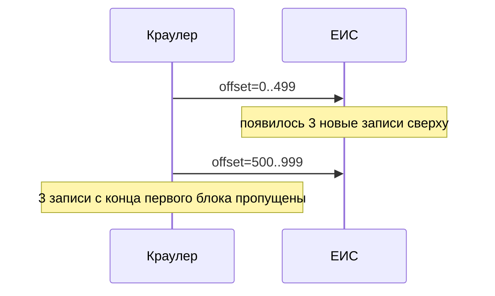

# Аудит: надёжность краулера/парсеров, безопасность, БД

Дата: 2026-10-07. База: `main` @ `6f8a80a4`. Ветка с исправлениями: `audit/fixes-1`.
Фокус: долгоживущий, отказоустойчивый сбор открытых данных ЕИС (44-ФЗ/223-ФЗ), корректность
алгоритмов, соответствие документации (`docs/dev`, `docs/workflow`) коду, безопасность.

Шкала: **P0** — блокер запуска/потеря данных; **P1** — высокий риск в долгом прогоне;
**P2** — средний; **P3** — улучшение.

## 1. Итог

| Метрика | `main` (+фикс сборки тестов) | `audit/fixes-1` |
|---|---|---|
| Pest (`--parallel`, 6 процессов) | 1739 тестов: 1729 ✓, 2 ✗, 7 error, 1 skip | 1757 тестов: 1748 ✓, 1 ✗, 7 error, 1 skip |
| PHPStan (max, larastan) | 0 ошибок | 0 ошибок |
| Pint `--test` | ✗ (2 файла в `docker/host`) | ✓ |
| `composer audit --locked` | 5 advisories (1 high) | чисто |
| `migrate` на пустой БД с pg_partman | **падает** (миграция 100093) | ✓ (83 миграции, повторный запуск — no-op) |

Оставшиеся падения зависят от окружения, а не от кода: Horizon/Redis readiness,
`pg_stat_statements` не в `shared_preload_libraries`, тесты с PostgreSQL-подпроцессами, которым нужны
S3/MinIO-креды; при `--parallel` они ещё и гоняются между собой. На `main` без первого коммита
весь набор вообще не стартовал (warning `use ZipArchive;` на этапе сборки тестов).

Секреты: gitleaks (10 находок) и trufflehog (137) по всей истории. **Реальных секретов нет**, всё
ложноположительное: 40-символьные SHA коммитов в `plans/` и lock-файлах, `MINIO_ROOT_PASSWORD=placeholder`,
публичный DKIM-ключ, примерные DSN в тестах и документации skills.

## 2. Исправлено в ветке `audit/fixes-1`

| Коммит | Sev | Суть |
|---|---|---|
| `dbabb37b` test(prepare) | P1 | `tests/Unit/Procurement/Prepare/XlsxResourceGuardTest.php`: убран `use ZipArchive;` в глобальном пространстве имён. Warning обрывал весь набор при сборке тестов. |
| `1a959852` fix(crawler) | **P0** | `app/Services/Procurement/Eis/CsvSourceMethod.php:553` `parseCsv`: раньше строки резались по `\n`, и запись с переводом строки внутри кавычек ломалась. Теперь `fgetcsv` на `php://temp` с `escape: ''` по RFC 4180. `rowsTotal` считает все записи источника, поэтому `ArchiveWindowScanner` больше не считает окно «исчерпанным» досрочно, если блок неполный из-за битых строк. Битые записи считаются в `rows_errors` (`ListingBatch::$rowsMalformed`). |
| `b912df60` fix(procurement) | P1 | `ProcurementIngestProcessor::isOlderThanHead`: снимок старше головы (повтор старого блока, догон архива) больше не откатывает карточку, а только обновляет `last_seen`. Для точности «день» сравнение идёт по календарным датам. |
| `fc9ed809` fix(documents) | P1 | `DocumentDownloader`: `Http::retry()` обходил `PlatformRequestBudget`, отчёт о прокси и журнал `prc_fetches`. Теперь каждая попытка берёт слот бюджета, сообщает результат прокси и пишется в журнал. Отброшенный ответ закрывается, чтобы не текли дескрипторы. |
| `b077c1fa` fix(scheduler) | P1 | `routes/console.php`: любая artisan-команда, включая `package:discover` в `composer install`, падала без БД. Невалидный cron молча превращался в `*/30`, что расходилось с формой в админке. Теперь недоступная БД логируется один раз, невалидный cron пропускается с `Log::error`, пустое расписание не регистрируется. |
| `bc3b50cd` fix(crawler) | **P0** | `CsvBlockIngestor`: на 403, 5xx или HTML-заглушке курсор уходил вперёд, и блок терялся навсегда. Теперь при ответе не 2xx и при непустом блоке, из которого не разобрано ни одного снимка, бросается `ListingBlockRejectedException`, но уже после записи в `prc_fetches`. |
| `22aac324` fix(db) | **P0** | Миграция `2026_09_10_100093_repair_partition_coverage` падала на чистой БД: партиции pg_partman `_pYYYYMMDD` пересекались по диапазонам. Теперь каждая партиция создаётся в SAVEPOINT, SQLSTATE 42P17 пропускается. |
| `85b27fad` fix(proxy) | P1 | `Proxy::$password` хранился открытым текстом и попадал в `toArray()`/JSON. Теперь стоит cast `encrypted` и `#[Hidden]`, `ProxyResolver` расшифровывает пароль сам. Миграция `2026_10_07_100096` шифрует существующие пароли, идемпотентна, `down` восстанавливает. |
| `b617fb4c` style(docker) | P3 | Pint для `docker/host/backup/backup-objects.php` и `docker/host/mail/smtp-smoke.php`. |
| `chore(deps)` | P1 | Патч-обновления без `--with-dependencies`: filament 5.8.4 (CVE-2026-104181, MFA без повторного ввода пароля), laravel 13.35 (CVE-2026-102279), commonmark 2.10.3 (high: квадратичный DoS в GFM-таблицах), flysystem 3.36 (CVE-2026-102601). |

Для каждого поведенческого фикса есть тест, который падал на старом коде.

## 3. Рекомендации (не менялось — нужно решение или это больше «очевидного фикса»)

### 3.1 Ретраи и backoff — P1
`CsvSourceMethod.php:440-506` (`requestWithRetries`/`waitBeforeRetry`): фиксированная задержка
`retryDelayMs` (по умолчанию 500 мс). Нет экспоненты и jitter, `Retry-After` игнорируется,
на всех попытках используется одна и та же аренда прокси. В долгом прогоне это синхронные
повторы, которые бьют в уже лежащий источник.

```php
private function backoffMs(int $attempt, ?Response $r, int $baseMs = 500, int $capMs = 30_000): int
{
    $retryAfter = $r?->header('Retry-After');
    if (is_numeric($retryAfter)) {
        return min($capMs, (int) $retryAfter * 1000);
    }
    // AWS "full jitter"
    return random_int(0, min($capMs, $baseMs * (2 ** ($attempt - 1))));
}
```
Помимо этого: на 407/429/5xx и ConnectionException через прокси брать новую аренду прокси.
Ссылки: [AWS — Exponential Backoff and Jitter](https://aws.amazon.com/blogs/architecture/exponential-backoff-and-jitter/),
[Google SRE — Handling Overload](https://sre.google/sre-book/handling-overload/),
[RFC 9110 §10.2.3 Retry-After](https://www.rfc-editor.org/rfc/rfc9110#field.retry-after).

### 3.2 Бюджет времени fresh-шага — P1
`CrawlRunJob`: checkpoint 240 с при timeout 300 с. Один блок может занять до 5 попыток × 30 с
плюс повтор на пустое тело, а у fresh-листинга нет `deadlineAt`, как у архива. В итоге
воркер убивается по timeout посреди блока. Рекомендация: передавать `deadlineAt = start + checkpoint`
во все HTTP-вызовы fresh, как это уже сделано в архиве.

### 3.3 Fencing записи в fresh-режиме — P1 (расхождение с docs)
Документация обещает, что все записи курсора и ingest идут под execution lease. В коде
`withinExecutionLease` используется только в `ArchiveWindowScanner.php:147`. `FreshRunProcessor`
пишет без fencing, и «зомби»-воркер после истечения lease может перезаписать курсор нового владельца.

```php
$this->runs->withinExecutionLease(run: $run, callback: fn () => $this->ingestor->ingest($batch, $run));
```
И условие на уровне SQL: `UPDATE prc_runs SET cursor = ? WHERE id = ? AND owner_token = ?`, проверять число затронутых строк.
См. [Kleppmann — fencing tokens](https://martin.kleppmann.com/2016/02/08/how-to-do-distributed-locking.html).

### 3.4 Ложное «source_exhausted» — P1
`FreshRunProcessor.php:124`: пустое тело 200 после одного повтора завершает прогон как исчерпанный.
У ЕИС пустое тело часто означает троттлинг или WAF. Рекомендация: считать это `transient`,
а завершать прогон только после N подряд пустых ответов и при совпадении с ожидаемым total (если он доступен).

### 3.5 Offset-пагинация по «живому» списку — P2
Новые записи сдвигают offset, и строки на стыке блоков пропускаются. Варианты: перекрытие блоков
(`offset - overlap`, дубли гасит `snapshot_hash`) или keyset по `(updated_at, reg_number)`, если источник
его позволяет.



### 3.6 Часовой пояс источника — P1 (не проверено вживую)
Даты CSV парсятся в TZ приложения (UTC), хотя ЕИС отдаёт московское или местное время.
Нужна явная `source_timezone` (`Europe/Moscow`) в конфиге источника, хранение в `timestamptz`
и разовый probe по известной закупке. Сейчас ошибки разбора дат молча пропускают строку:
нужен счётчик и лог, как сделано для malformed CSV.

### 3.7 Кодировка — P2
`CsvSourceMethod.php:139`, `GsfxReader.php:81`: Windows-1251 захардкожена. Рекомендация: проверять
`Content-Type; charset` и `mb_check_encoding($body, 'UTF-8')` до конвертации.

### 3.8 Rate limiting — P2
`PlatformRequestBudget::acquire` (`:37`) на каждом запросе читает crawler/proxy из БД и использует
фиксированное окно `RateLimiter`, что даёт двойной burst на границе окон. Рекомендация: кэшировать
настройки с TTL 30–60 с и перейти на GCRA или token bucket в Redis (Lua).

### 3.9 БД: upsert и уникальность — P1
`updateOrCreate` для `prc_financing`/`prc_items`/`prc_protocols`/`prc_awards` без уникальных индексов
(в docs это признано) при параллельных воркерах даёт дубли. До запуска можно позволить:

```sql
CREATE UNIQUE INDEX CONCURRENTLY prc_items_proc_pos_uq ON prc_items (procurement_id, position_number);
-- затем в коде:
-- Item::upsert($rows, uniqueBy: ['procurement_id','position_number'], update: [...]);
```
Аналогично `participant_ordinal`: ключ лучше строить из стабильного идентификатора участника (ИНН/КПП),
а не из порядка в источнике. Для очередей на БД используйте `FOR UPDATE SKIP LOCKED`.
[PostgreSQL INSERT … ON CONFLICT](https://www.postgresql.org/docs/17/sql-insert.html#SQL-ON-CONFLICT).

### 3.10 Воркеры и память — P2
`config/horizon.php:211-260`: `maxJobs=0`, `maxTime=0`, остаётся только `memory=128`. Для недельных
прогонов стоит включить переработку воркеров, например `maxJobs=500` и `maxTime=3600`.

### 3.11 Наблюдаемость — P2
Метрики на источник: доля 4xx/5xx, malformed, отклонённые блоки (`ListingBlockRejectedException`),
отставание курсора от «сейчас», возраст последнего успешного блока. Алерт, если по прогону нет прогресса дольше 2× checkpoint.

### 3.12 Безопасность и CI — P2/P3
- `.github/workflows/ci.yml:186`: `trivy-action` закреплён на v0.9.2, это очень старая версия. Обновить по SHA.
- `docker/php/Dockerfile:3`: `minio/mc:latest` не закреплён. Закрепить по digest.
- `docker/host/backup/backup-objects.php:14`: `allFiles()` грузит весь список объектов в память, хэши копий не сверяются. Перейти на потоковый листинг и сверку ETag/sha256.
- 7z/unar: путь записи передаётся как шаблон. Сейчас это закрыто валидацией `*?[]` и ведущего `-`; оставить тест-регресс.
- После шифрования паролей прокси ротация `APP_KEY` требует `APP_PREVIOUS_KEYS`. Зафиксировать в runbook.
- Хорошо сделано: XML с `LIBXML_NONET`, распаковка архивов с лимитами, `Process` с массивом аргументов, allowlist целей (`SourceTargetValidator`) против SSRF.

## 4. Не удалось проверить и почему

- **Статус CI на GitHub**: API Actions вернул 404/403 для используемого токена.
- **Поведение живого ЕИС** (TZ, пустые 200, лимиты): живые запросы к источнику не выполнялись.
- **Тесты с PostgreSQL-подпроцессами и Horizon readiness**: нужны MinIO/S3 и запущенный Horizon. В песочнице это отдельная инфраструктура.
- **`pnpm audit`**: corepack не смог создать кэш в песочнице.
- **`tia-baseline` в CI** использует `ENV_FILE=.env`, которого нет в чистом checkout. Похоже на ошибку, но без запуска CI не подтверждено.

## 5. Решения владельца

1. Семантика «устаревший снимок не перезаписывает голову» (по дате `source_updated_at`).
2. Пустое или невалидное расписание теперь **не запускается** (раньше было `*/30`).
3. Строгий отказ на блоках не 2xx или неразбираемых: прогоны будут падать видимо, а не терять данные.
4. Шифрование паролей прокси и процедура ротации ключа.
5. Часовой пояс источника.
6. Репозиторий вендора `axiomasoft/azguard-private` **публичный**: GitHub API отдаёт 200 без авторизации. Это намеренно?
